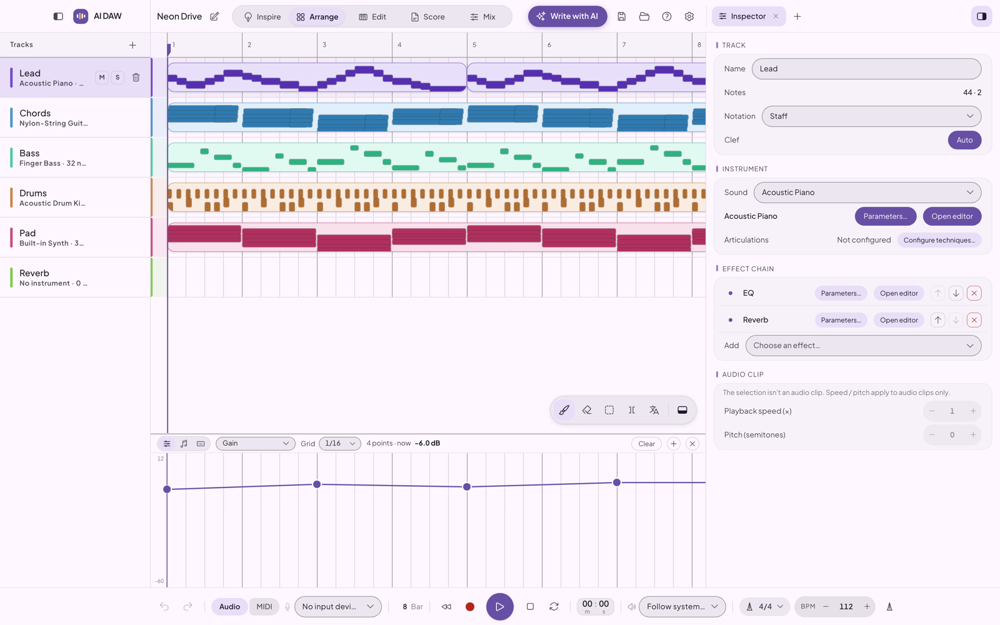
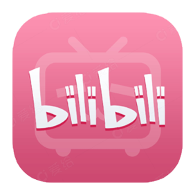

<p align="center">
  
</p>

<p align="center">
  <a href="https://github.com/heshengtao/ai-daw/releases"></a>
  <a href="LICENSE"></a>
  
  <a href="https://hub.docker.com/r/ailm32442/ai-daw"></a>
</p>

<p align="center">
  <a href="README_zh.md">简体中文</a> · <a href="README_zh-TW.md">繁體中文</a> · <a href="README.md">English</a> · <a href="README_ja.md">日本語</a> ·
  <a href="README_ko.md">한국어</a> · <a href="README_es.md">Español</a> · <a href="README_fr.md">Français</a> · <a href="README_de.md">Deutsch</a> ·
  <a href="README_ru.md">Русский</a> · <a href="README_ar.md"><b>العربية</b></a>
</p>

<p align="center">
  <a href="https://hub.docker.com/r/ailm32442/ai-daw"><b>Docker Hub</b></a> ·
  <a href="https://github.com/heshengtao/ai-daw/releases">تنزيل</a>
</p>

## ما هو AI DAW؟

**AI DAW استوديو موسيقي صغير مبني على الذكاء الاصطناعي لسطح مكتبك** — اكتب، ووزّع، وامزج، وأنجز الماستر في تطبيق خفيف واحد، ودع وكيل ذكاء اصطناعي يعمل في الجلسة إلى جانبك.

إنه DAW حقيقي: خط زمني متعدد المسارات، وبيانو رول، ومازج بإرسالات وباصات، ومسارات أتمتة، وسنث مدمج، واستضافة إضافات VST3 / CLAP / AU. وهو مصمّم أيضًا **ليشغّله نموذج** — فمهارة (Skill) مرفقة تعلّم أي إطار عمل للذكاء الاصطناعي قيادة التطبيق العامل عبر MCP، فيستطيع الوكيل إضافة مسارات، وكتابة نوتات، وموازنة مزيج، وتحليل النتيجة بينما تشاهد ذلك يحدث في الواجهة.

كل شيء يعمل على جهازك. لا حساب، ولا مفتاح API، ولا صوت يغادر حاسوبك.



## لماذا هذا مهم

أصبحت النماذج بارعة في كتابة الشيفرة لأنها تستطيع **تشغيلها** عبر إطار عمل لوكيل برمجي؛ وأصبحت بارعة في النمذجة ثلاثية الأبعاد لأنها تستطيع قيادة برمجيات نمذجة حقيقية عبر Blender MCP. في الحالتين يحصل النموذج على أداة حقيقية، ونتيجة حقيقية، وحلقة تغذية راجعة حقيقية — وهذا ما يجعل التكرار السريع ممكنًا.

والموسيقى كانت تفتقد تلك الحلقة في الغالب. يستطيع النموذج توليد الصوت، لكنه لا يستطيع *العمل على جلسة* كما يفعل الإنسان: لا توزيع ليحرّره، ولا مازج ليدير فيدراته، ولا سجل تراجع، ولا طريقة ليلاحظ أن آخر تعديلاته زادت الأمر سوءًا.

**AI DAW محاولة صغيرة ومدروسة لسد هذه الفجوة.** إنه DAW حقيقي يستطيع وكيل ذكاء اصطناعي تشغيله عبر Skill وMCP، ما يجعله مفيدًا في:

- **اختبار ما يعرفه النموذج فعليًا عن تأليف الأغاني** — لا ما إذا كان صوته يبدو معقولًا، بل ما إذا كان قادرًا على بناء توزيع، واختيار الأجزاء، وإصلاح مزيج.
- **جمع آثار حقيقية للتأليف** — كل تعديل يجريه الوكيل يستقر في مشروع عادي بسجل تراجع عادي، فتصبح الجلسة بيانات عن كيفية تفكير النموذج في الموسيقى.
- **خطوة نحو نماذج تكتب الموسيقى كما تكتب الشيفرة** — بأداة تردّ عليها.

## خفيف بالتصميم

أن يكون صغيرًا ميزة، لا تنازلًا.

- **بصمة خفيفة** — لا Electron، ولا سحابة، ولا حديقة نماذج مرفقة. تطبيق macOS حجمه نحو 38 MB — وللمقارنة، تُثبَّت برامج DAW الشائعة مثل Ableton Live وLogic Pro وFL Studio عادةً بحجم 1–3 GB، ما يجعل AI DAW **أصغر بنسبة تزيد على 95%**.
- **بدء سريع** — لا شيء ثقيل يُحمَّل عند الإقلاع؛ ونماذج الذكاء الاصطناعي لا تُستدعى إلا عند استخدامها.
- **نماذج كبيرة عند الطلب، لا في المثبّت أبدًا** — العمل الثقيل مثل توليد الموسيقى غير مدمج افتراضيًا. **الصوت الغنائي** (SoulX-Singer، 1.4 GB) و**تبديل الصوت** (SoulX-Singer-SVC، 2.4 GB) نموذجان اختياريان في المدير → النماذج: نزّلهما عندما تريد، ولن يكلّفاك مساحة قرص قبل ذلك.
- **مصمّم للتوسّع** — **إضافات التطبيق** (حِزم npm) تضيف بالفعل أدوات للوكيل ولوحات في الشريط الجانبي؛ وواجهات ربط نماذج الذكاء الاصطناعي الخارجية بسير العمل على خريطة الطريق.

## قُده من أي إطار عمل للذكاء الاصطناعي

يوفّر AI DAW **Skill** (`skills/aidaw`) يعلّم وكيل ذكاء اصطناعي كيفية تشغيل التطبيق العامل — قراءة وكتابة المشروع والمسارات والمقاطع والنوتات؛ تحليل طابع أسلوبي، والبحث في نظرية الموسيقى وأنماط الطبول، وتحويل وصفة نوع موسيقي إلى MIDI؛ المزج (الكسب، والبان، والإرسالات، والأتمتة)؛ النقل والتسجيل؛ تحليل الجهارة والطيف؛ تصدير WAV؛ فحص الإضافات. ويعمل عبر خادم **MCP** المدمج، فيستطيع تبنّيه أي إطار عمل يدعم Agent Skills.

ويشمل التطبيق أيضًا 18 آلة موسيقية قائمة على عيّنات صوتية — **بيانو أكوستيك، وقيثارة نايلون وقيثارة إلكتريك نظيفة، وباص بالأصابع، وطقم طبول أكوستيك، ومجموعة وتريات، ووتريات بطيئة، وكمان/فيولا/تشيللو/كونتراباص منفردة، ووتريات pizzicato، وترومبيت، وأبواق فرنسية، ووتريات ونحاسيات سنث 1 و2** (SF3/SF2، نحو 13.5 MB إجمالًا) — جاهزة للعزف فور التثبيت.

**الخيار 1 · التثبيت من سطر الأوامر**

```bash
npx skills add heshengtao/ai-daw
```

**الخيار 2 · اطلب من وكيلك تثبيته**

```
Install this Skill: https://github.com/heshengtao/ai-daw
```

كل تعديل يجريه الوكيل يمر عبر مسار الأوامر نفسه الذي تستخدمه الواجهة: فيستقر في سجل التراجع، ويظهر في الواجهة، ويُنسب إلى الوكيل — فتستطيع دائمًا رؤية ما فعله والتراجع عنه. تفضّل البقاء داخل التطبيق؟ **الكتابة بالذكاء الاصطناعي** تفتح الحلقة نفسها في لوحة محادثة (الإعدادات → توليد النص).

## الميزات

### Inspire — سطر واحد يدخل، وتسجيل جاهز يخرج

العرض الواقع في أقصى يسار الشريط العلوي هو **Inspire**: مكتب كامل الصفحة لـ«اكتب → ولّد → استمع». تكتب على اليسار، وتستمع على اليمين. لا إعجابات، ولا مشاركات، ولا حدود ترقية — فقط وصفك، وكلماتك، وشريط التشغيل.

- **قائمة منسدلة واحدة، ومحرّكان** — أوزان YuE2 / ACE-Step المحلية وأي خدمة سحابية مُهيّأة (Suno / Mureka / Lyria …) تتشارك قائمة واحدة؛ وإضافة مزوّد تعني تغيير موضع واحد
- **بسيط / متقدّم** — «بسيط» يكتفي بسطر وصف واحد؛ و«متقدّم» يتيح كتابة الكلمات بوسوم `[Verse]` / `[Chorus]` / `[Bridge]` / `[Outro]`، وقلب مفتاح **Instrumental**، وضبط المدة والخطوات والبذرة
- **تسجيلات بالدفعات** — اطلب حتى 8 تسجيلات بضغطة واحدة؛ تُصيَّر واحدًا بعد الآخر، كلٌّ ببذرة جديدة، وتظهر في القائمة فور انتهائها
- **متابعة تسجيل** — كل تصيير محلي يحتفظ برمز دلالي، لذا يكتب زر **متابعة** المقطع التالي انطلاقًا من موضع توقف ذلك التسجيل — فيحصل النموذج على البنية، لا على الصوت وحده
- **يجلب ما يحتاجه** — تُعالَج الأوزان الناقصة والمحرّك الغائب أو المتوقّف بالترتيب عند ضغط «توليد»
- **التسجيلات في عمود** — مجمّعة حسب اليوم؛ ويحصل كل تسجيل على **غلاف مولَّد** بألوان مسارات المشروع، وزر تشغيل ظاهر دائمًا، وشريط تشغيل خاص به: انقر للاستماع، واسحب للتنقل. والبطاقة المركّزة هي أيضًا ما يقوده مفتاح النقل في الشريط السفلي
- **يبقى ملكك** — السجل يعيش على جهازك؛ ومسحه لا يمس المشروع أبدًا، ولا يدخل التسجيل الجلسة (＋) أو يصل إلى القرص (حفظ) إلا عندما تطلب ذلك

<p align="center">
  
</p>

### التوزيع والتحرير — ألّف على خط زمني حقيقي

وزّع الأغنية كما تسمعها. اسحب المقاطع عبر المسارات، واقسمها حيث تتغير الموسيقى، ودع المسطرة والشبكة تتبعان إيقاعًا وميزانًا يمكنك تغييرهما في أي موضع من الأغنية. مقاطع MIDI ترسم نوتاتها بنفسها، ومقاطع الصوت ترسم موجتها بنفسها، فتقرأ التوزيع بلمحة.

- **توزيع متعدد المسارات** — مقاطع MIDI والصوت جنبًا إلى جنب، وسحب وإفلات بين المسارات، وتحديد بإطار
- **بيانو رول سهل القراءة** — معاينات المقاطع تُظهر النوتات؛ والمحرّر يمنحك الشدة والتكبير ولوحة مفاتيح افتراضية
- **النوتة والتاب** — مسار النوتة يرسم تدوينًا على المدرج أو تاب جيتار من النوتات نفسها، ويخرج MusicXML عند التصدير
- **إيقاع وميزان متغيّران** — غيّر الإيقاع أو الميزان في أي نقطة؛ وتتبع الشبكة ذلك
- **النقل والحلقة** — تشغيل، وإيقاف، وتنقل، وتكرار منطقة، ومترونوم
- **مسارات الأتمتة** — ارسم منحنيات لأي معامل تعرضه إضافة أو السنث المدمج
- **أدوات عند المؤشر** — شريط أدوات عائم يبدّل بين الرسم / المسح / التحديد / القسم / الكلمات، ونقرة واحدة تبدّل المسار السفلي بين الأتمتة والنوتة ولوحة المفاتيح
- **صندوق أدوات تحرير حقيقي** — قسم، ونقل، ونسخ/لصق، وتراجع/إعادة، إضافة إلى ورقة مختصرات لوحة المفاتيح

<p align="center">
  
</p>

### المزج والماستر — أنهِ الأغنية

وازن الأغنية، ثم اجعلها عالية. شرائط القنوات تمنحك الكسب، والبان، والإرسالات، والباصات، والكتم/السولو، والقياس؛ وسلسلة ماستر على باص الماستر تعالج الجهارة والقمم والعرض الاستريو، فتصيّر عملًا جاهزًا للنشر دون مغادرة التطبيق.

- **المازج** — الكسب، والبان، والإرسالات، والباصات، والكتم/السولو، وقياس المستوى
- **تأثيرات مدمجة** — الديناميكيات، وEQ، والتأثيرات الزمنية، جاهزة للإدراج على أي مسار
- **سلسلة الماستر** — تطبيع الجهارة، وتحديد القمم الحقيقية (true-peak)، والعرض الاستريو
- **سنث مدمج** — مذبذبات، ومغلفات، ومرشّح مع راسم اهتزاز حي
- **التصدير** — WAV بلا فقدان أو MP3 بترميز LAME (معدل العينات ومعدل البت حسب اختيارك)، أو ملف MIDI قياسي، أو نوتة MusicXML

<p align="center">
  
</p>

### الإضافات — أحضر آلاتك وتأثيراتك

يستضيف AI DAW إضافات **VST3** و**CLAP** في كل الأنظمة، إضافة إلى **Audio Units (AU / AUv3)** على macOS، فترافقك الأدوات التي تملكها بالفعل. ومدير الإضافات يبحث في السجل المفتوح، ويفلتر حسب النوع والتوافق مع نظام التشغيل، ويثبّت الإضافات أو يحدّثها أو يزيلها بنقرة واحدة — أو وجّهه إلى إضافة لديك بالفعل على القرص.

- **استضافة VST3 / CLAP / AU** — حمّل آلات وتأثيرات من أطراف ثالثة على أي مسار (AU وAUv3 على macOS)
- **مدير الإضافات** — ابحث في السجل، وفلتر حسب الآلة/التأثير والمنصة، وثبّت / حدّث / أزل
- **استيراد محلي** — أدخل إضافة مثبّتة لديك في مكان آخر
- **المحرّرات والمعاملات** — افتح واجهة الإضافة الخاصة بها، أو قُد معاملاتها من المفتّش ومسارات الأتمتة؛ وإضافات AU التي لا تملك عرضًا خاصًا تحصل على لوحة معاملات عامة
- **مكتبات SoundFont** — استورد ملفات `.sf2` / `.sf3` الخاصة بك (بنك واحد يتوسّع إلى عشرات الإعدادات المسبقة)، أو ثبّت بنكًا مفتوحًا مثل MuseScore General أو FluidR3 أو FreePats من فهرس SoundFont المدمج
- **مدير تنزيل واحد** — الإضافات وSoundFonts ونماذج الذكاء الاصطناعي وبيئات التشغيل تتشارك مديرًا واحدًا مع تقدّم حي، وإلغاء، وحالة تثبيت لكل عنصر

<p align="center">
  
</p>

### إضافات التطبيق — وسّع التطبيق نفسه

إضافات الصوت توسّع مجال الصوت؛ أما **إضافات التطبيق** فتوسّع التطبيق نفسه. تُوزَّع كحِزم npm وتستطيع إضافة **أدوات MCP** يمكن للوكيل استدعاؤها، و**لوحات** تُعرض في الشريط الجانبي الأيمن — فيمكن إضافة سير عمل تفتقده دون تفرّع التطبيق.

- **توزيع عبر npm** — ثبّت من فهرس (`index.json`) أو مباشرة من سجل؛ ويحدد `engines.aidaw` إصدارات التطبيق التي تدعمها الإضافة، وتغطي المرايا الشبكات غير المتصلة أو المحمية بجدار ناري
- **الاكتشاف والمثبَّت** — تعرض اللوحة كل ما تعرفه فهارسك (الإصدار، والمؤلف، وتثبيت / تحديث) إلى جانب كل ما يعمل (الحالة، والأدوات، واللوحات، وتمكين / إعادة تحميل / إزالة)
- **وجهان للإضافة** — أدوات جهة الخادم تعمل في مضيف QuickJS الخاص بالدايمون وتصل إلى الجلسة عبر الأوامر نفسها التي تستخدمها الواجهة؛ ولوحات جهة العميل وحدات ESM تُحمَّل في عرض الويب مع إعادة تحميل ساخنة
- **المجلدات المحلية أيضًا** — «استيراد مجلد» يثبّت إضافة تبنيها بنفسك؛ و`examples/extensions/hello` هو المرجع الأدنى (أداة واحدة، ولوحة واحدة)
- **ليست سلسلة الصوت** — لـ VST3 / CLAP / AU انظر **الإضافات** أعلاه؛ فهذا مجال التطبيق، لا المازج

<p align="center">
  
</p>

### الذكاء الاصطناعي المحلي — حوّل الصوت إلى مادة قابلة للعمل عليها

ميزات الذكاء الاصطناعي مصممة لجلسات حقيقية، لا للعروض التجريبية. وجّهها إلى مسار فتعيد لك شيئًا يمكنك متابعة تحريره: نوتات MIDI قابلة للنقل، وتسجيل صوتي بضجيج غرفة أقل، وستيمات يمكنك إعادة موازنتها. كل شيء يعمل على عتادك — CPU افتراضيًا، مع تسريع اختياري عبر CoreML (macOS) وDirectML (Windows). وكل مهمة تظهر في **لوحة الذكاء الاصطناعي** واحدة، مفلترة بـ **الكل / توليد / تحويل**، ويخبرك كل صف ما إذا كان نموذجه مثبّتًا بالفعل.

- **كشف الإيقاع** — Beat This! (ISMIR 2024) يستنتج BPM عامًا وميزانًا في تمريرة واحدة
- **من الصوت إلى MIDI** — Basic Pitch يحوّل أداءً مسجّلًا إلى نوتات قابلة للتحرير؛ بدّل النموذج إلى **MuScriptor** (عبر محرّك audio.cpp) للنسخ متعدد الآلات، الذي ينتج مسار MIDI واحدًا لكل آلة. 393 MB–5.1 GB، يُنزَّل عند الطلب (CC BY-NC 4.0 — غير تجاري)
- **تنظيف الصوت** — LocalVQE يقلّل الضجيج والصدى في التسجيلات الصوتية
- **فصل الستيمات** — HTDemucs v4 يقسم مسارًا إلى 4 أو 6 ستيمات، جاهزة لإعادة المزج
- **الصوت الغنائي** — لحن MIDI وكلمات وصوت مرجعي تتحول إلى تسجيل صوتي قابل للتحرير (استنساخ الجرس zero-shot عبر SoulX-Singer). ويمكن تحرير الكلمات نوتة بنوتة في بيانو رول (`-` للوصل)، والأصوات المرجعية تعيش في **مكتبة أصوات** مشتركة بين المشاريع — فتغيير الجرس ليس سوى اختيار صوت آخر
- **تبديل الصوت** — خذ صوتًا موجودًا، واحفظ لحنه وكلماته وتوقيته، واستبدل الجرس فقط بصوت مرجعي (SoulX-Singer-SVC، zero-shot). وتستقر النتيجة على مسار جديد أسفل المصدر ولا يفصلها عنك سوى تراجعة واحدة؛ وفصل الغناء عن مزيج كامل أولًا يبقي المصاحبة خارج متتبّع الطبقة (pitch tracker)
- **بلا اتصال بحكم التصميم** — لا حساب، ولا مفتاح API، ولا رفع

<p align="center">
  
</p>

### خادم MCP — دع وكيل ذكاء اصطناعي يعمل في جلستك

اقلب مفتاحًا واحدًا فيصبح مشروعك شيئًا يستطيع مساعد ذكاء اصطناعي تشغيله. خادم **MCP (Model Context Protocol)** المدمج يعرّض الجلسة عبر HTTP مرتبط بـ `127.0.0.1` — وصّل وكيلك، ووكّل إليه مهمة، وشاهده يضيف مقاطع، أو يصحح نوتات، أو يغيّر المستويات بينما تتحدّث الواجهة في الوقت الفعلي. وأداة سطر الأوامر `aidaw` عميل رفيع للخادم نفسه.

- **MCP عبر HTTP** — نقطة نهاية محصورة بالاسترجاع المحلي (loopback) يتصل بها وكيلك
- **تعديلات حية** — تظهر إجراءات الوكيل فورًا كتغييرات عادية في المشروع
- **Song Agent داخل التطبيق** — زر **الكتابة بالذكاء الاصطناعي** يفتح لوحة محادثة تؤلّف بالأدوات نفسها؛ ووجّهها إلى أي نموذج متوافق مع OpenAI في الإعدادات → توليد النص
- **`aidaw` CLI** — قابل للتثبيت على `PATH` من الإعدادات

<p align="center">
  
</p>

## التثبيت

ستُنشر ملفات ثنائية جاهزة على صفحة [GitHub Releases](https://github.com/heshengtao/ai-daw/releases). وإلى أن يحدث ذلك، ابنِ من الشيفرة المصدرية.

### المتطلبات

- Rust (stable) مع Cargo
- Node.js ≥ 18 و[pnpm](https://pnpm.io/)
- متطلبات نظام Tauri v2 — انظر <https://tauri.app/start/prerequisites/>

### البناء من المصدر

```bash
git clone https://github.com/heshengtao/ai-daw.git
cd ai-daw

pnpm install
pnpm tauri dev        # تشغيل التطبيق في وضع التطوير
pnpm tauri build      # إنتاج بناء إصدار
```

أوامر أخرى مفيدة:

```bash
pnpm build            # فحص أنواع الواجهة الأمامية وبناؤها
pnpm build:aidaw      # بناء aidaw CLI (انظر tools/build-aidaw.sh)
```

### المنصات المدعومة

| المنصة | الحالة |
| --- | --- |
| Windows (x86_64) |  مدعومة |
| macOS (Apple Silicon) |  مدعومة (انظر ملاحظة «التطبيق تالف» أدناه) |
| Linux (x86_64 / arm64) |  مدعومة |

> **هل يقول macOS إن «التطبيق تالف»؟** التطبيق موقّع توقيعًا مخصّصًا (ad-hoc) وغير موثّق (notarized)، لذا يضع macOS
> التنزيلات في الحجر الصحي. شغّل هذا الأمر في Terminal، ثم افتح التطبيق بشكل عادي:
>
> ```bash
> xattr -cr "/Applications/AI DAW.app"
> ```

> **أجهزة Mac المعتمدة على Intel غير مدعومة بعد.** لا ينشر ONNX Runtime ملفات ثنائية جاهزة لـ
> `x86_64-apple-darwin`، لذا لا يمكن ربط نماذج الذكاء الاصطناعي المحلية على macOS بإنتل.

## الوصول من المتصفح والوضع بلا واجهة

يستطيع AI DAW العمل **بلا نافذة** وتقديم الواجهة نفسها لأي متصفح على شبكتك.
وتطبيق سطح المكتب وعميل المتصفح يديران الجلسة *نفسها* — المشروع نفسه، وسجل التراجع
نفسه، ومحرّك الصوت نفسه.

### Docker (صورة جاهزة)

```bash
docker run -d --name ai-daw -p 28430:28430 -v ai-daw-data:/data ailm32442/ai-daw
```

تُنشر الصور على وسوم الإصدار `v*`، و`latest` يشير إلى أحدث إصدار؛ ولم تعد التزامات main
العادية تعيد بناء الصورة. لتجربة `Dockerfile`، شغّل سير العمل `Docker (ai-daw)` يدويًا
من Actions.

افتح <http://localhost:28430> وابدأ العمل — **بلا تسجيل دخول، وبلا رمز، وبلا فحص لملفات
تعريف الارتباط**. وبناء الوضع بلا واجهة مخصّص للآلات بلا شاشة؛ وضبط الوصول مسؤولية
عملية النشر (شبكة محلية، أو شبكة حاوية، أو وكيل عكسي أمامها).

الحاويات عادةً **بلا بطاقة صوت**. في هذه الحالة ينتقل محرّك الصوت إلى **ساعة افتراضية**: فالتصيير
يستمر في الوقت الفعلي، ورأس التشغيل / الحلقة / المقاييس تعمل بشكل طبيعي، ويخرج PCM عبر `/audio`
— **فتصبح صفحة الويب هي بطاقة الصوت**. وتشير إلى ذلك شارة «ساعة افتراضية» في شريط الحالة
(انقرها لإعادة محاولة الجهاز). ولإجبار هذا المسار على جهاز يملك صوتًا،
عيّن `AIDAW_AUDIO=virtual`.

**محرّرات الإضافات تعمل أيضًا.** لا يملك الحاوية نظام نوافذ، لكن الصورة تتضمن Xvfb:
فإضافة VST3 / CLAP ترسم محرّرها على شاشة افتراضية، ويشفّر الدايمون تلك الشاشة كتدفّق إطارات،
وتعرضها الصفحة على لوحة رسم مع إعادة توجيه الفأرة ولوحة المفاتيح. وهكذا يصبح المحرّر نافذة
داخل الصفحة — المحرّر نفسه الذي ستحصل عليه في نافذة أصلية على سطح المكتب.
(في بناء سطح المكتب، ما زال «فتح المحرّر» يفتح النافذة الأصلية الحقيقية: دقة أفضل وزمن وصول أقل.)
عيّن `AIDAW_GUI_STREAM=0` لتجاوز الشاشة الافتراضية وتوفير الذاكرة — فما زال بإمكانك تحرير المعاملات،
لكنك لن ترى المحرّر.
الصورة الآن بنحو **585 MB** (كانت ~286 MB): والزيادة سببها Xvfb مع OpenGL البرمجي من Mesa،
وهو ما تحتاجه بعض محرّرات الإضافات — وبدون `libgl1-mesa-dri` تُعرض سوداء. وإن لم تستخدم
أي من إضافاتك GL، فاحذف سطري `libgl1` / `libglx-mesa0` واستعد ~150 MB.


### Docker (البناء من المصدر)

```bash
git clone https://github.com/heshengtao/ai-daw.git
cd ai-daw
docker build -t ai-daw .
docker run -d -p 28430:28430 -v ai-daw-data:/data ai-daw
```

### الثنائي بلا واجهة

```bash
npm run build                                                # ينتج dist/
cargo run -p ai-daw-daemon --no-default-features --bin aidawd -- \
  --data-dir ~/.ai-daw --port 28430 --web-dir dist
```

### متغيرات البيئة

| المتغير | الافتراضي | الغرض |
| --- | --- | --- |
| `AIDAW_DATA_DIR` | `/data` في الصورة | الجلسات، والإعدادات المسبقة، والنماذج |
| `AIDAW_WEB_DIR` | `/web` في الصورة | الواجهة الأمامية المبنية التي تُقدَّم |
| `AIDAW_NO_AUDIO` | غير معيّن | تجاوز فتح جهاز صوت (حاويات بلا ALSA) |
| `AIDAW_AUDIO` | غير معيّن | `virtual` = لا تلمس بطاقة صوت أبدًا، واستخدم الساعة الافتراضية فقط |
| `AIDAW_MODELS_EXTRA` | `/opt/models` في الصورة | مجلدات بحث إضافية عن النماذج (مفصولة بـ `:`، وتُرتَّب بعد مجلد التنزيل) |
| `AIDAW_ORT_BUNDLED` | `/opt/ort` في الصورة | مجلد ONNX Runtime المرفق |
| `AIDAW_ARTICULATION_MAPS` | `/opt/articulation-maps` في الصورة | مكتبة خرائط الأداء (articulation) المرفقة |
| `AIDAW_MCP_URL` | يُكتشف تلقائيًا | المكان الذي تبحث فيه `aidaw` CLI عن التطبيق العامل |


> يبدأ بناء الوضع بلا واجهة أيضًا خادم MCP المدمج (الإعداد في `<data dir>/mcp.json`، ومعطّل افتراضيًا)،
> فيستطيع ذكاء اصطناعي قيادة المشروع نفسه عبر MCP داخل الحاوية.

### HTTP API

| الطريقة | المسار | الغرض |
| --- | --- | --- |
| `POST` | `/rpc/{command}` | كل الأوامر، بالأسماء والوسائط نفسها التي يستخدمها IPC في التطبيق (`GET /commands` يسرد ما يقدّمه هذا البناء) |
| `GET` | `/events` | Server-Sent Events: تعديلات المحرّك وحالة النقل |
| `GET` | `/audio` | WebSocket: PCM حي (48 kHz استريو float32، كتل ~10 ms) |
| `GET` | `/health` | الحيوية + ما إذا كان جهاز صوت متاحًا |
| `GET` | `/commands` | كل أسماء الأوامر التي يعرّضها الخادم |

## البنية

```
src-tauri/          قوقعة Tauri: النوافذ، ومحرّرات الإضافات الأصلية، والمحدّث التلقائي
crates/daemon/      الخادم الخلفي كاملًا: محرّك المشروع، ومضيف الصوت، وMCP، وHTTP
crates/engine/      DSP + الجدولة + التصيير (بلا اعتماد على Tauri)
crates/ipc/         مخطط الأوامر/الأحداث المشترك بين التطبيق وCLI وMCP
crates/extensions/  مضيف إضافات التطبيق: تثبيت npm، والبيانات الوصفية، وأدوات QuickJS، ولوحات العميل
src/                واجهة Vue 3 الأمامية — متطابقة لسطح المكتب والمتصفح
```

لا تتحدث الواجهة الأمامية إلى Rust مباشرة أبدًا: `src/api/ipc.ts` يختار وسيلة نقل (`Tauri IPC`
أو `HTTP + SSE + WebSocket`)، فتعمل كل شاشة في القوقعتين. ولهذا فإن بناء المتصفح ليس نقلًا (port) — إنه التطبيق
نفسه يتحدث إلى الخادم نفسه عبر الشبكة.

## الأسئلة الشائعة

### هل AI DAW مجاني؟

نعم. AI DAW مفتوح المصدر بموجب Apache 2.0. لا مستويات مدفوعة ولا ميزات محجوبة.

### هل يعمل دون اتصال؟

نعم. التطبيق وكل نموذج ذكاء اصطناعي يعملان محليًا. والوصول الوحيد إلى الشبكة هو تنزيل حِزم الإضافات ونماذج الذكاء الاصطناعي (وهو ما تبدأه أنت)، وجلب فهارس الإضافات وإضافات التطبيق، واستدعاء خدمة موسيقى سحابية إن هيّأت واحدة.

### هل أحتاج إلى GPU؟

لا. نماذج الذكاء الاصطناعي تعمل على CPU افتراضيًا. ويستطيع macOS استخدام CoreML وWindows استخدام DirectML عندما يدعم العتاد ذلك؛ وكلاهما اختياري.

### أي نماذج ذكاء اصطناعي تأتي مع التطبيق؟

نموذجان صغيران: **Basic Pitch** (من الصوت إلى MIDI) و**LocalVQE** (تنظيف الصوت)، فيعملان فور التثبيت. أما النماذج الأكبر — **Beat This!** (كشف الإيقاع) و**HTDemucs** (فصل الستيمات، 4 أو 6) — فتُنزَّل عند الطلب من مدير النماذج داخل التطبيق عند أول استخدام، وتُخزَّن خارج شجرة المصدر.

لا تكون أوزان أي نموذج جزءًا من المستودع أو المثبّتات أبدًا، ويحتفظ كل نموذج برخصة ناشره: انظر [MODELS.md](MODELS.md). ويشمل ذلك النماذج الاختيارية CC BY-NC 4.0 (غير التجارية) — **YuE2** لتوليد الأغاني و**SheetSage2** لنوتات الأغاني المُعاد أداؤها (cover).

### أي صيغ إضافات مدعومة؟

VST3 وCLAP على Windows وmacOS وLinux؛ وكذلك **Audio Units (AU / AUv3)** على macOS.

### ما اللغات التي تدعمها الواجهة؟

الصينية المبسّطة، والصينية التقليدية، والإنجليزية، واليابانية، والكورية، والإسبانية، والفرنسية، والألمانية، والروسية، والعربية. بدّلها في أي وقت من **الإعدادات → عام → اللغة**؛ ويُحفظ اختيارك ويتبع لغة نظامك حتى تبدّلها. والقواميس في `src/i18n/`، وأي نص تنقصه الترجمة يعود إلى الإنجليزية. والنص العربي مدعوم بالكامل وتنعكس الواجهة كلها لتناسب الكتابة من اليمين إلى اليسار؛ وتبقى الخط الزمني والنوتة الموسيقية والمازج من اليسار إلى اليمين فقط، لأن محور الزمن في DAW يُقرأ من اليسار إلى اليمين. وملف README مترجم إلى اللغات العشر نفسها.

### هل أحتاج التطبيق قيد التشغيل ليقوده وكيل؟

نعم. الـ Skill و`aidaw` CLI يتواصلان مع AI DAW عامل عبر MCP، فابدأ التطبيق أولًا (`aidaw status` سيخبرك إن كان قيد التشغيل).

## الدعم

### ضع لنا نجمة!
⭐ دعمكم هو قوّتنا الدافعة للمضي قدمًا!

### الإكراميات مرحّب بها!
<div align="center" style="display: flex; gap: 20px; justify-content: center; flex-wrap: wrap;">

[](https://ko-fi.com/agentparty)
[](https://afdian.com/a/agentparty)

</div>

### تابعنا
<div align="center">
  <a href="https://space.bilibili.com/26978344">
    
  </a>
  <a href="https://www.youtube.com/@agentParty">
    
  </a>
</div>

### انضم إلى المجتمع
إن كانت لديك أسئلة أو مشكلات في المشروع، فمرحبًا بك في مجتمعنا.

1. مجموعة QQ: `931057213` (مكتملة) / `902882342` (المجموعة 2)

2. Discord: [رابط Discord](https://discord.gg/f2dsAKKr2V)

## المساهمون

<a href="https://github.com/heshengtao/ai-daw/graphs/contributors">
  
</a>

## الرخصة

**شيفرة** التطبيق بموجب Apache-2.0 — انظر [LICENSE](LICENSE).

**أوزان** النماذج طبقة منفصلة: لا تكون جزءًا من هذا المستودع ولا من
المثبّتات أبدًا، وتحتفظ بالرخصة التي منحها إياها ناشرها، وينزّلها التطبيق
عند الطلب (ويتحقق من `sha256` لكل ملف منزّل). انظر **[MODELS.md](MODELS.md)** للجدول الكامل
للنماذج والمصادر والرخص.

بعض النماذج الاختيارية **CC BY-NC 4.0 (غير تجارية)** — YuE2 لتوليد الأغاني و
SheetSage2 لنوتات الأغاني المُعاد أداؤها (cover). وهي تنزيلات اختيارية: لا تستخدم تلك الأوزان في
عمل تجاري إلا إذا كنت تحمل رخصة تجارية من ناشريها. والصوت/MIDI المولَّد ملكك،
وفق شروط المصدر الأصلية ورهنًا بالحقوق التي تملكها
في الصوت المدخل.

## رخص الأطراف الثالثة

يستند هذا المشروع إلى برمجيات مفتوحة المصدر من أطراف ثالثة. والملفات المقتبسة من مشاريع أخرى، والاعتماديات التي ليست رخصها ضمن المجموعة المتسامحة الافتراضية، مدرجة في [NOTICE](NOTICE).
