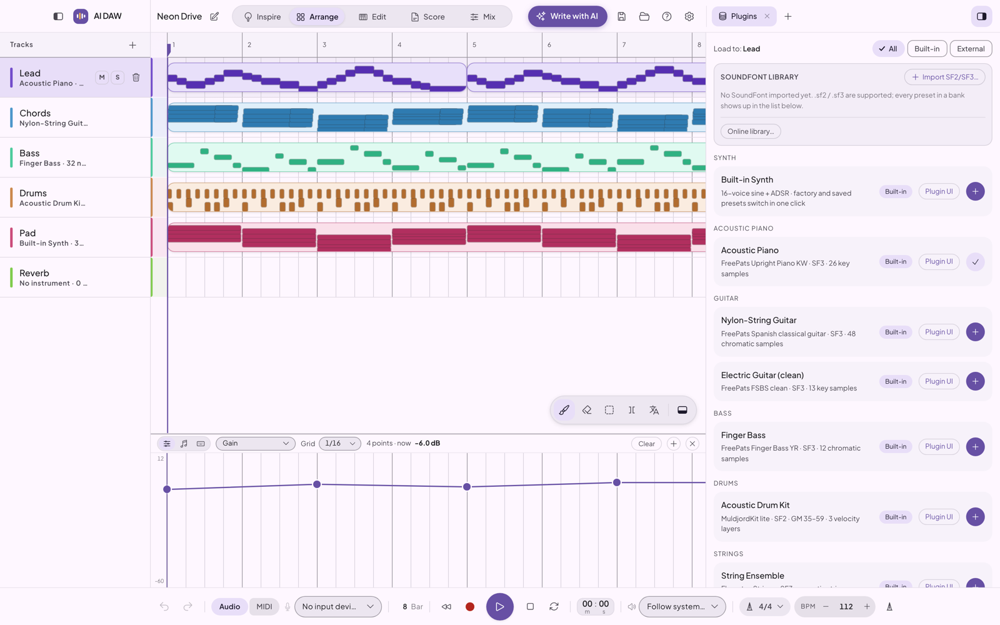

<p align="center">
  
</p>

<p align="center">
  <a href="https://github.com/heshengtao/ai-daw/releases"></a>
  <a href="LICENSE"></a>
  
  <a href="https://hub.docker.com/r/ailm32442/ai-daw"></a>
</p>

<p align="center">
  <a href="README_zh.md">简体中文</a> · <a href="README_zh-TW.md">繁體中文</a> · <a href="README.md">English</a> · <a href="README_ja.md">日本語</a> ·
  <a href="README_ko.md">한국어</a> · <a href="README_es.md"><b>Español</b></a> · <a href="README_fr.md">Français</a> · <a href="README_de.md">Deutsch</a> ·
  <a href="README_ru.md">Русский</a> · <a href="README_ar.md">العربية</a>
</p>

<p align="center">
  <a href="https://hub.docker.com/r/ailm32442/ai-daw"><b>Docker Hub</b></a> ·
  <a href="https://github.com/heshengtao/ai-daw/releases">Descargar</a>
</p>

## ¿Qué es AI DAW?

**AI DAW es un pequeño estudio de música nativo de IA para tu escritorio** — compón, arregla, mezcla y masteriza en una sola app ligera, y deja que un agente de IA trabaje en la sesión junto a ti.

Es un DAW de verdad: una línea de tiempo multipista, un piano roll, un mezclador con envíos y buses, carriles de automatización, un sintetizador integrado y alojamiento de plugins VST3 / CLAP / AU. También está hecho para **ser operado por un modelo**: un Skill incluido enseña a cualquier harness de IA a controlar la app en ejecución por MCP, de modo que un agente puede añadir pistas, escribir notas, equilibrar una mezcla y analizar el resultado mientras lo ves suceder en la interfaz.

Todo se ejecuta en tu propia máquina. Sin cuenta, sin clave de API, sin audio que salga de tu ordenador.


## Por qué esto importa

Los modelos se volvieron buenos escribiendo código porque podían **ejecutarlo** dentro de un framework de agentes de programación; se volvieron buenos en modelado 3D porque podían manejar software de modelado real a través de Blender MCP. En ambos casos el modelo obtiene una herramienta real, un resultado real y un bucle de retroalimentación real, y eso es lo que hace posible iterar rápido.

A la música le ha faltado casi siempre ese bucle. Un modelo puede generar audio, pero no puede *trabajar en una sesión* como lo haría una persona: no tiene un arreglo que editar, ni un mezclador que mover, ni historial de deshacer, ni forma de darse cuenta de que su último cambio empeoró las cosas.

**AI DAW es un intento pequeño y deliberado de cerrar esa brecha.** Es un DAW real que un agente de IA puede operar mediante un Skill y MCP, lo que lo hace útil para:

- **Probar lo que un modelo sabe realmente sobre composición** — no si su audio suena plausible, sino si puede construir un arreglo, elegir partes y arreglar una mezcla.
- **Recopilar trazas reales de composición** — cada edición del agente acaba en un proyecto normal con un historial de deshacer normal, así que una sesión se convierte en datos sobre cómo razona un modelo acerca de la música.
- **Un paso hacia modelos que escriban música como escriben código** — con una herramienta que les responde.

## Ligero por diseño

Ser pequeño es una característica, no un compromiso.

- **Huella ligera** — sin Electron, sin nube, sin zoológico de modelos incluido. La app de macOS ocupa unos 38 MB; como referencia, los DAW convencionales como Ableton Live, Logic Pro y FL Studio suelen instalarse entre 1 y 3 GB, así que AI DAW es **más de un 95 % más pequeño**.
- **Arranque rápido** — nada pesado se carga al inicio; los modelos de IA solo se incorporan cuando los usas.
- **Modelos grandes bajo demanda, nunca en el instalador** — el trabajo pesado, como la generación de música, no viene integrado por defecto. La **voz cantada** (SoulX-Singer, 1,4 GB) y el **cambio de voz** (SoulX-Singer-SVC, 2,4 GB) son modelos opcionales en Gestor → Modelos: descárgalos cuando los quieras y hasta entonces no ocupan disco.
- **Pensado para extenderse** — las **extensiones de la app** (paquetes npm) ya añaden herramientas para agentes y paneles laterales; las interfaces para conectar modelos de IA externos al flujo de trabajo están en la hoja de ruta.

## Contrólalo desde cualquier harness de IA

AI DAW incluye un **Skill** (`skills/aidaw`) que enseña a un agente de IA a operar la app en ejecución: leer y escribir el proyecto, las pistas, los clips y las notas; analizar un estilo, consultar teoría musical y patrones de batería, y convertir una receta de género en MIDI; mezclar (ganancia, panorama, envíos, automatización); transporte y grabación; análisis de sonoridad y espectro; exportación a WAV; escaneo de plugins. Funciona sobre el servidor **MCP** integrado, así que cualquier harness compatible con Agent Skills puede usarlo.

La app también incluye 18 instrumentos muestreados — **piano acústico, guitarras de nylon y eléctrica limpia, bajo de dedos, una batería acústica, un ensemble de cuerdas, cuerdas lentas, violín/viola/violonchelo/contrabajo solistas, cuerdas en pizzicato, trompeta, trompas, y cuerdas y metales de sintetizador 1 y 2** (SF3/SF2, unos 13,5 MB en total) — listos para sonar desde el primer momento.

**Opción 1 · Instalar desde la línea de comandos**

```bash
npx skills add heshengtao/ai-daw
```

**Opción 2 · Pídele a tu agente que lo instale**

```
Install this Skill: https://github.com/heshengtao/ai-daw
```

Cada edición que hace un agente pasa por la misma tubería de comandos que la interfaz: queda en el historial de deshacer, aparece en la interfaz y se atribuye al agente, así que siempre puedes ver qué hizo y deshacerlo. ¿Prefieres quedarte en la app? **Escribir con IA** abre ese mismo bucle como panel de chat (Ajustes → Generación de texto).

## Funciones

### Inspire: una línea de entrada, una toma terminada de salida

La vista más a la izquierda de la barra superior es **Inspire**: un escritorio de página completa para "escribir → generar → escuchar". Escribe a la izquierda, escucha a la derecha. Sin likes, sin compartir, sin bloqueos para subir de plan: solo tu descripción, tu letra y la barra de reproducción.

- **Un desplegable, dos motores** — los pesos locales de YuE2 / ACE-Step y cualquier servicio en la nube configurado (Suno / Mureka / Lyria…) comparten una única lista; añadir un proveedor significa cambiar un solo lugar
- **Simple / Avanzado** — Simple toma una línea de descripción; Avanzado te deja escribir letras con etiquetas `[Verse]` / `[Chorus]` / `[Bridge]` / `[Outro]`, activar el interruptor **Instrumental** y ajustar duración, pasos y semilla
- **Tomas por lotes** — pide hasta 8 tomas con una sola pulsación; se renderizan una tras otra, cada una con una semilla nueva, y aparecen en la lista a medida que terminan
- **Continuar una toma** — cada renderizado local guarda un código semántico, así que **Continuar** escribe el siguiente tramo desde donde se detuvo esa toma: el modelo recibe la estructura, no solo el audio
- **Trae lo que necesita** — los pesos que faltan, un motor ausente o un motor detenido se resuelven en orden cuando pulsas Generar
- **Tomas en una columna** — agrupadas por día; cada toma recibe una **portada generada** con los matices de las pistas del proyecto, un botón de reproducción siempre visible y su propia barra de reproducción: haz clic para escuchar, arrastra para desplazarte. La tarjeta enfocada es también la que controla la tecla de transporte de la barra inferior
- **Tuyo para quedártelo** — el historial vive en tu máquina; borrarlo nunca toca el proyecto, y una toma solo entra en la sesión (＋) o llega al disco (guardar) cuando lo pides

<p align="center">
  
</p>

### Arreglos y edición: compón sobre una línea de tiempo real

Distribuye una canción tal como la escuchas. Arrastra clips entre pistas, córtalos donde cambia la música y deja que la regla y la cuadrícula sigan un tempo y un compás que puedes cambiar en cualquier punto de la canción. Los clips MIDI dibujan sus propias notas y los clips de audio dibujan su propia forma de onda, así que puedes leer el arreglo de un vistazo.

- **Arreglo multipista** — clips MIDI y de audio uno al lado del otro, arrastrar y soltar entre pistas, selección por lazo
- **Un piano roll que se lee bien** — las vistas previas de los clips muestran las notas; el editor te da velocidad, zoom y un teclado virtual
- **Partitura y tablatura** — el carril de partitura dibuja notación en pentagrama o tablatura de guitarra a partir de las mismas notas, y MusicXML sale al exportar
- **Tempo y compás dinámicos** — cambia el tempo o el compás en cualquier punto; la cuadrícula lo sigue
- **Transporte y bucle** — reproducir, detener, saltar a un punto, repetir una región, metrónomo
- **Carriles de automatización** — dibuja curvas para todo lo que exponga un plugin o el sintetizador integrado
- **Herramientas en el puntero** — un dock flotante cambia entre dibujar / borrar / seleccionar / dividir / letra, y un clic alterna el carril inferior entre automatización, partitura y teclado
- **Un kit de edición real** — dividir, mover, copiar/pegar, deshacer/rehacer, y además una hoja de atajos de teclado

<p align="center">
  
</p>

### Mezcla y masterización: termina la pista

Equilibra la canción y luego hazla sonar fuerte. Las tiras de canal te dan ganancia, panorama, envíos, buses, silenciar/solo y medición; una cadena de masterización en el bus maestro se ocupa de la sonoridad, los picos y la amplitud estéreo, para que puedas renderizar algo listo para publicar sin salir de la app.

- **Mezclador** — ganancia, panorama, envíos, buses, silenciar/solo y medición de nivel
- **Efectos integrados** — dinámica, EQ y efectos basados en tiempo, listos para poner en cualquier pista
- **Cadena de masterización** — normalización de sonoridad, limitación de pico real y amplitud estéreo
- **Sintetizador integrado** — osciladores, envolventes y un filtro con osciloscopio en vivo
- **Exportación** — WAV sin pérdida o MP3 codificado con LAME (frecuencia de muestreo y bitrate a tu elección), un archivo MIDI estándar o una partitura MusicXML

<p align="center">
  
</p>

### Plugins: trae tus propios instrumentos y efectos

AI DAW aloja plugins **VST3** y **CLAP** en todas partes, además de **Audio Units (AU / AUv3)** en macOS, para que las herramientas que ya tienes vengan contigo. Un gestor de plugins busca en el registro abierto, filtra por tipo y compatibilidad con el sistema operativo, e instala, actualiza o elimina plugins con un clic; o bien apúntalo a algo que ya tengas en disco.

- **Alojamiento de VST3 / CLAP / AU** — carga instrumentos y efectos de terceros en cualquier pista (AU y AUv3 en macOS)
- **Gestor de plugins** — busca en el registro, filtra por instrumento/efecto y plataforma, instala / actualiza / desinstala
- **Importación local** — incorpora un plugin que tengas instalado en otra parte
- **Editores y parámetros** — abre la interfaz propia de un plugin o controla sus parámetros desde el inspector y los carriles de automatización; los plugins AU sin vista propia reciben un panel de parámetros genérico
- **Bibliotecas SoundFont** — importa tus propios `.sf2` / `.sf3` (un solo banco se despliega en decenas de preajustes), o instala un banco abierto como MuseScore General, FluidR3 o FreePats desde el índice de SoundFonts integrado
- **Un único gestor de descargas** — plugins, SoundFonts, modelos de IA y runtimes comparten un mismo gestor con progreso en vivo, cancelación y estado de instalación por elemento

<p align="center">
  
</p>

### Extensiones de la app: amplía la propia aplicación

Los plugins de audio extienden el sonido; las **extensiones de la app** extienden la aplicación. Se distribuyen como paquetes npm y pueden añadir **herramientas MCP** que un agente puede llamar, además de **paneles** que se renderizan en la barra lateral derecha, de modo que un flujo de trabajo que te falta se puede añadir sin bifurcar la app.

- **Distribución por npm** — instala desde un índice (`index.json`) o directamente desde un registro; `engines.aidaw` indica qué versiones de la app admite una extensión, y los espejos cubren redes sin conexión o con cortafuegos
- **Descubrir e instaladas** — el panel lista todo lo que conocen tus índices (versión, autor, instalar / actualizar) junto a todo lo que se ejecuta (estado, herramientas, paneles, activar / recargar / desinstalar)
- **Dos lados de una extensión** — las herramientas del lado del servidor se ejecutan en el host QuickJS del daemon y llegan a la sesión a través de los mismos comandos que la interfaz; los paneles del lado del cliente son ESM cargados en la webview con recarga en caliente
- **También carpetas locales** — Importar carpeta instala una extensión que estés creando tú; `examples/extensions/hello` es la referencia mínima (una herramienta, un panel)
- **No es la cadena de audio** — para VST3 / CLAP / AU consulta **Plugins** más arriba; esto es la app, no el mezclador

<p align="center">
  
</p>

### IA local: convierte el audio en material con el que puedas trabajar

Las funciones de IA están pensadas para sesiones reales, no para demos. Apúntalas a una pista y te devuelven algo que puedes seguir editando: notas MIDI que puedes mover, una toma vocal con menos ruido de sala, stems que puedes reequilibrar. Todo se ejecuta en tu propio hardware: CPU por defecto, con aceleración opcional por CoreML (macOS) y DirectML (Windows). Cada trabajo aparece en un único **panel de IA**, filtrado por **Todos / Generar / Convertir**, y cada fila te dice si su modelo ya está instalado.

- **Detección de tempo** — Beat This! (ISMIR 2024) infiere un BPM global y un compás en una sola pasada
- **Audio a MIDI** — Basic Pitch convierte una interpretación grabada en notas editables; cambia el modelo a **MuScriptor** (mediante el motor audio.cpp) para transcripción multiinstrumento, que genera una pista MIDI por instrumento. 393 MB–5,1 GB, descargado bajo demanda (CC BY-NC 4.0, no comercial)
- **Limpieza de voz** — LocalVQE reduce el ruido y la reverb en las tomas vocales
- **Separación de stems** — HTDemucs v4 divide una pista en 4 o 6 stems, listos para remezclar
- **Voz cantada** — una melodía MIDI, una letra y una voz de referencia se convierten en una toma vocal editable (clonación de timbre zero-shot de SoulX-Singer). La letra se puede editar nota por nota en el piano roll (ligaduras con `-`), y las voces de referencia viven en una **biblioteca de voces** compartida entre proyectos: cambiar el timbre es solo elegir otra
- **Cambio de voz** — toma una voz ya existente, conserva su melodía/letra/timing y sustituye solo el timbre por una voz de referencia (SoulX-Singer-SVC, zero-shot). El resultado cae en una pista nueva debajo de la fuente y se deshace con un solo paso; separar antes las voces de una mezcla completa evita que el acompañamiento entre en el rastreador de tono
- **Sin conexión por diseño** — sin cuenta, sin clave de API, sin subidas

<p align="center">
  
</p>

### Servidor MCP: deja que un agente de IA trabaje en tu sesión

Activa un interruptor y tu proyecto se vuelve algo que un asistente de IA puede operar. El servidor **MCP (Model Context Protocol)** integrado expone la sesión por HTTP enlazada a `127.0.0.1`: conecta tu agente, dale una tarea y míralo añadir clips, corregir notas o cambiar niveles mientras la interfaz se actualiza en tiempo real. La herramienta de línea de comandos `aidaw` es un cliente ligero del mismo servidor.

- **MCP sobre HTTP** — un endpoint solo de bucle local al que tu agente se conecta
- **Ediciones en vivo** — las acciones del agente aparecen de inmediato como cambios normales del proyecto
- **Song Agent en la app** — el botón **Escribir con IA** abre un panel de chat que compone con las mismas herramientas; apúntalo a cualquier modelo compatible con OpenAI en Ajustes → Generación de texto
- **CLI `aidaw`** — instalable en tu `PATH` desde Ajustes

<p align="center">
  
</p>

## Instalación

Los binarios precompilados se publicarán en la página de [GitHub Releases](https://github.com/heshengtao/ai-daw/releases). Hasta entonces, compila desde el código fuente.

### Requisitos

- Rust (stable) con Cargo
- Node.js ≥ 18 y [pnpm](https://pnpm.io/)
- Requisitos de sistema de Tauri v2 — consulta <https://tauri.app/start/prerequisites/>

### Compilar desde el código fuente

```bash
git clone https://github.com/heshengtao/ai-daw.git
cd ai-daw

pnpm install
pnpm tauri dev        # ejecuta la app en modo desarrollo
pnpm tauri build      # genera una compilación de release
```

Otros comandos útiles:

```bash
pnpm build            # comprueba los tipos del frontend y lo compila
pnpm build:aidaw      # compila la CLI aidaw (ver tools/build-aidaw.sh)
```

### Plataformas compatibles

| Plataforma | Estado |
| --- | --- |
| Windows (x86_64) | Compatible |
| macOS (Apple Silicon) | Compatible (ver la nota sobre la "app dañada" más abajo) |
| Linux (x86_64 / arm64) | Compatible |

> **¿macOS dice "La app está dañada"?** La app está firmada ad hoc (no notarizada), así que macOS
> pone en cuarentena las descargas. Ejecuta esto en Terminal y luego abre la app con normalidad:
>
> ```bash
> xattr -cr "/Applications/AI DAW.app"
> ```

> **Los Mac con Intel aún no son compatibles.** ONNX Runtime no publica binarios precompilados para
> `x86_64-apple-darwin`, así que los modelos de IA locales no se pueden enlazar en macOS con Intel.

## Acceso desde el navegador y modo headless

AI DAW puede ejecutarse **sin ventana** y servir la misma interfaz a cualquier navegador de tu red. La app de escritorio y el cliente del navegador manejan la *misma* sesión: el mismo proyecto, el mismo historial de deshacer, el mismo motor de audio.

### Docker (imagen precompilada)

```bash
docker run -d --name ai-daw -p 28430:28430 -v ai-daw-data:/data ailm32442/ai-daw
```

Las imágenes se publican con las etiquetas de release `v*`, y `latest` apunta al release más reciente; los commits normales de main ya no reconstruyen la imagen. Para probar el `Dockerfile`, ejecuta manualmente el flujo de trabajo `Docker (ai-daw)` desde Actions.

Abre <http://localhost:28430> y empieza a trabajar: **sin inicio de sesión, sin token, sin comprobación de cookies**. La compilación headless está pensada para máquinas sin pantalla; el control de acceso es responsabilidad de cada despliegue (LAN, red del contenedor o un proxy inverso por delante).

Los contenedores normalmente **no tienen tarjeta de sonido**. En ese caso el motor de audio cambia a un **reloj virtual**: la renderización sigue ocurriendo en tiempo real, el cabezal de reproducción / el bucle / los medidores se comportan con normalidad, y el PCM sale por `/audio` — **la página web se convierte en la tarjeta de sonido**. Un chip "Reloj virtual" en la barra de estado lo indica (haz clic en ella para reintentar el dispositivo). Para forzar esta ruta en una máquina que sí tiene audio, define `AIDAW_AUDIO=virtual`.

**Los editores de plugins también funcionan.** El contenedor no tiene sistema de ventanas, pero la imagen incluye Xvfb: un plugin VST3 / CLAP sigue dibujando su propio editor en una pantalla virtual, el daemon codifica esa pantalla como flujo de fotogramas y la página lo renderiza en un canvas mientras reenvía el ratón y el teclado. Así el editor se convierte en una ventana dentro de la página: el mismo editor que tendrías en una ventana nativa en el escritorio. (En la compilación de escritorio, "Abrir editor" sigue mostrando la ventana nativa real: mejor fidelidad y menor latencia.) Define `AIDAW_GUI_STREAM=0` para omitir la pantalla virtual y ahorrar memoria: aún puedes editar parámetros, solo que no verás el editor. La imagen ahora ocupa unos **585 MB** (antes ~286 MB): el extra es Xvfb más el OpenGL por software de Mesa, que algunos editores de plugins necesitan; sin `libgl1-mesa-dri` se renderizan en negro. Si ninguno de tus plugins usa GL, quita las líneas `libgl1` / `libglx-mesa0` y recupera ~150 MB.


### Docker (compilar desde el código fuente)

```bash
git clone https://github.com/heshengtao/ai-daw.git
cd ai-daw
docker build -t ai-daw .
docker run -d -p 28430:28430 -v ai-daw-data:/data ai-daw
```

### Binario headless

```bash
npm run build                                                # genera dist/
cargo run -p ai-daw-daemon --no-default-features --bin aidawd -- \
  --data-dir ~/.ai-daw --port 28430 --web-dir dist
```

### Variables de entorno

| Variable | Valor predeterminado | Propósito |
| --- | --- | --- |
| `AIDAW_DATA_DIR` | `/data` en la imagen | sesiones, preajustes, modelos |
| `AIDAW_WEB_DIR` | `/web` en la imagen | frontend compilado que se sirve |
| `AIDAW_NO_AUDIO` | sin definir | omite abrir un dispositivo de audio (contenedores sin ALSA) |
| `AIDAW_AUDIO` | sin definir | `virtual` = no tocar nunca la tarjeta de sonido, usar solo el reloj virtual |
| `AIDAW_MODELS_EXTRA` | `/opt/models` en la imagen | directorios extra de búsqueda de modelos (separados por `:`, ordenados después del directorio de descargas) |
| `AIDAW_ORT_BUNDLED` | `/opt/ort` en la imagen | directorio de ONNX Runtime incluido |
| `AIDAW_ARTICULATION_MAPS` | `/opt/articulation-maps` en la imagen | biblioteca de mapas de articulación incluida |
| `AIDAW_MCP_URL` | detectado automáticamente | dónde busca la CLI `aidaw` la app en ejecución |


> La compilación headless también inicia el servidor MCP integrado (configuración en `<data dir>/mcp.json`, desactivado por defecto),
> así que una IA puede manejar el mismo proyecto por MCP dentro del contenedor.

### API HTTP

| Método | Ruta | Propósito |
| --- | --- | --- |
| `POST` | `/rpc/{command}` | todos los comandos, con los mismos nombres y argumentos que el IPC de la app (`GET /commands` lista lo que sirve esta compilación) |
| `GET` | `/events` | Server-Sent Events: ediciones del motor y estado del transporte |
| `GET` | `/audio` | WebSocket: PCM en vivo (48 kHz estéreo float32, bloques de ~10 ms) |
| `GET` | `/health` | señal de vida y si hay un dispositivo de audio disponible |
| `GET` | `/commands` | todos los nombres de comando que expone el servidor |

## Arquitectura

```
src-tauri/          shell de Tauri: ventanas, editores de plugins nativos, actualizador automático
crates/daemon/      todo el backend: motor de proyecto, host de audio, MCP, HTTP
crates/engine/      DSP + planificación + renderizado (sin dependencia de Tauri)
crates/ipc/         el esquema de comandos/eventos que comparten app, CLI y MCP
crates/extensions/  host de extensiones de la app: instalación npm, manifiestos, herramientas QuickJS, paneles de cliente
src/                frontend en Vue 3 — idéntico para escritorio y navegador
```

El frontend nunca habla directamente con Rust: `src/api/ipc.ts` elige un transporte (`Tauri IPC`
o `HTTP + SSE + WebSocket`), así que cada pantalla funciona en ambas carcasas. Por eso la compilación
para navegador no es una versión portada: es la misma app hablando con el mismo backend a través de la red.

## Preguntas frecuentes

### ¿AI DAW es gratis?

Sí. AI DAW es código abierto bajo Apache 2.0. No hay planes de pago ni funciones bloqueadas.

### ¿Funciona sin conexión?

Sí. La app y todos los modelos de IA se ejecutan localmente. El único acceso a la red es la descarga de paquetes de plugins y modelos de IA (que tú inicias), la consulta de los índices de plugins y extensiones, y la llamada a un servicio de música en la nube si configuras uno.

### ¿Necesito una GPU?

No. Los modelos de IA se ejecutan en CPU por defecto. macOS puede usar CoreML y Windows puede usar DirectML cuando el hardware lo admite; ambas cosas son opcionales.

### ¿Qué modelos de IA vienen con la app?

Dos pequeños sí: **Basic Pitch** (audio a MIDI) y **LocalVQE** (limpieza de voz), así que funcionan en el momento en que instalas. Los modelos más grandes — **Beat This!** (detección de tempo) y **HTDemucs** (separación de stems, 4 o 6) — se descargan bajo demanda desde el gestor de modelos de la app la primera vez que los usas, y se guardan fuera del árbol de código.

Ningún peso de modelo forma parte del repositorio ni de los instaladores, y cada modelo conserva la licencia de su editor: consulta [MODELS.md](MODELS.md). Eso incluye los modelos opcionales CC BY-NC 4.0 (no comercial): **YuE2** para generación de canciones y **SheetSage2** para partituras de covers.

### ¿Qué formatos de plugin son compatibles?

VST3 y CLAP en Windows, macOS y Linux; además **Audio Units (AU / AUv3)** en macOS.

### ¿Qué idiomas admite la interfaz?

Chino simplificado, chino tradicional, inglés, japonés, coreano, español, francés, alemán, ruso y árabe. Cambia cuando quieras en **Ajustes → General → Idioma**; la elección se recuerda y sigue el idioma de tu sistema hasta que la cambies. Los diccionarios están en `src/i18n/`, y cualquier cadena que falte en una traducción recurre al inglés. El texto en árabe es totalmente compatible: la línea de tiempo mantiene su disposición de izquierda a derecha, porque el eje temporal de un DAW se lee de izquierda a derecha. El README está traducido a los mismos diez idiomas.

### ¿Necesito la app abierta para que un agente la controle?

Sí. El Skill y la CLI `aidaw` se comunican con un AI DAW en ejecución por MCP, así que abre primero la app (`aidaw status` te dirá si está activa).

## Apóyanos

### ¡Danos una estrella!
⭐ ¡Tu apoyo es lo que nos impulsa a seguir adelante!

### ¡Se agradecen las propinas!
<div align="center" style="display: flex; gap: 20px; justify-content: center; flex-wrap: wrap;">

[](https://ko-fi.com/agentparty)
[](https://afdian.com/a/agentparty)

</div>

### Síguenos
<div align="center">
  <a href="https://space.bilibili.com/26978344">
    
  </a>
  <a href="https://www.youtube.com/@agentParty">
    
  </a>
</div>

### Únete a la comunidad
Si tienes preguntas o problemas con el proyecto, eres bienvenido a unirte a nuestra comunidad.

1. Grupo de QQ: `931057213` (lleno) / `902882342` (Grupo 2)

2. Discord: [Enlace de Discord](https://discord.gg/f2dsAKKr2V)

## Colaboradores

<a href="https://github.com/heshengtao/ai-daw/graphs/contributors">
  
</a>

## Licencia

El **código** de la aplicación es Apache-2.0 — consulta [LICENSE](LICENSE).

Los **pesos** de los modelos son una capa aparte: nunca forman parte de este repositorio ni de los
instaladores, conservan la licencia que les dio su editor, y la app los descarga bajo demanda (y verifica
el `sha256` de cada archivo descargado). Consulta **[MODELS.md](MODELS.md)** para la tabla completa de
modelos, fuentes y licencias.

Algunos modelos opcionales son **CC BY-NC 4.0 (no comercial)**: YuE2 para generación de canciones y
SheetSage2 para partituras de covers. Son descargas opcionales: no uses esos pesos para trabajo
comercial a menos que tengas una licencia comercial de sus editores. El audio/MIDI generado es tuyo,
bajo los términos del proyecto de origen y sujeto a los derechos que tengas sobre el audio de entrada.

## Licencias de terceros

Este proyecto se apoya en software de código abierto de terceros. Los archivos adaptados de otros proyectos, y las dependencias cuyas licencias no están en el conjunto permisivo por defecto, se enumeran en [NOTICE](NOTICE).
