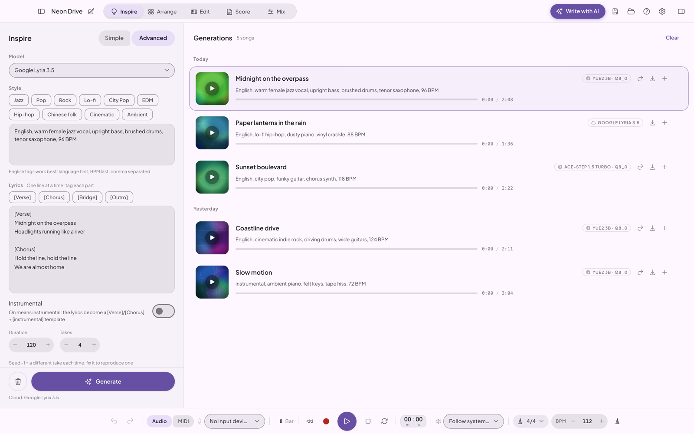
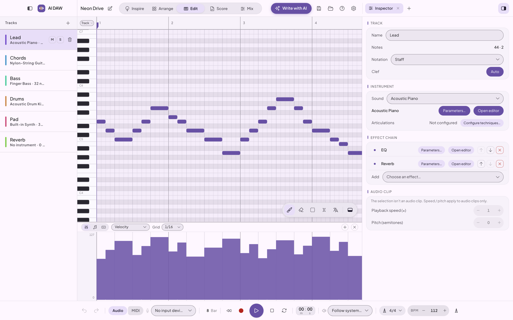
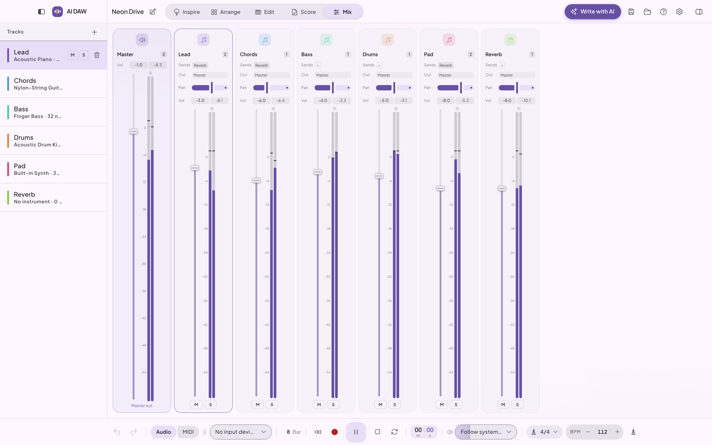
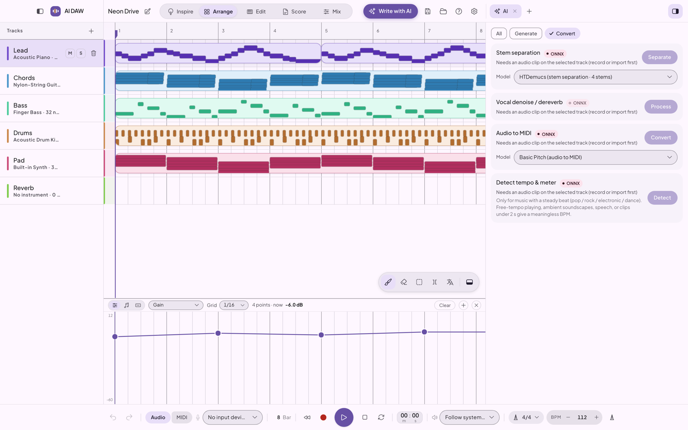

<p align="center">
  
</p>

<p align="center">
  <a href="https://github.com/heshengtao/ai-daw/releases"></a>
  <a href="LICENSE"></a>
  
  <a href="https://hub.docker.com/r/ailm32442/ai-daw"></a>
</p>

<p align="center">
  <a href="README_zh.md">简体中文</a> · <a href="README_zh-TW.md">繁體中文</a> · <a href="README.md">English</a> · <a href="README_ja.md"><b>日本語</b></a> ·
  <a href="README_ko.md">한국어</a> · <a href="README_es.md">Español</a> · <a href="README_fr.md">Français</a> · <a href="README_de.md">Deutsch</a> ·
  <a href="README_ru.md">Русский</a> · <a href="README_ar.md">العربية</a>
</p>

<p align="center">
  <a href="https://hub.docker.com/r/ailm32442/ai-daw"><b>Docker Hub</b></a> ·
  <a href="https://github.com/heshengtao/ai-daw/releases">ダウンロード</a>
</p>

## AI DAW とは？

**AI DAW は、デスクトップのための小さくて AI ネイティブな音楽スタジオ**です。作曲・アレンジ・ミックス・マスタリングを 1 つの軽量アプリで完結でき、さらに AI エージェントが同じセッションの中で一緒に作業してくれます。

これは本物の DAW です。マルチトラックのタイムライン、ピアノロール、センドとバスを備えたミキサー、自動化レーン、内蔵シンセサイザー、そして VST3 / CLAP / AU のプラグインホスティング。同時に、**モデルに操作されること**を前提に設計されています。同梱の Skill が任意の AI ハーネスに、MCP 経由で実行中のアプリを操作する方法を教えるので、エージェントはトラックを追加し、ノートを書き、ミックスを整え、その結果を分析できます。その様子は UI 上でリアルタイムに見えます。

すべてはあなたのマシン上で動作します。アカウントも API キーも不要で、音声があなたのコンピューターの外に出ることはありません。


## なぜこれが重要なのか

モデルがコードを書けるようになったのは、コーディングエージェントのフレームワークを通してコードを**実行**できたからです。3D モデリングができるようになったのは、Blender MCP を通じて実際のモデリングソフトを操作できたからです。どちらの場合も、モデルは本物のツール、本物の結果、そして本物のフィードバックループを手に入れます。高速な試行錯誤が可能になるのは、まさにそのおかげです。

音楽には、そのループがほとんど欠けていました。モデルは音声を生成できますが、人がするように*セッションで作業する*ことはできません。編集できるアレンジも、動かせるミキサーも、取り消し履歴も、直前の変更で物事が悪くなったことに気づく手段もありません。

**AI DAW は、その隙間を埋めるための、小さくて意図的な試みです。** AI エージェントが Skill と MCP を通して操作できる本物の DAW であり、次のような用途に役立ちます。

- **モデルが作曲について実際に何を知っているかを試す** — 生成した音声がそれらしく聞こえるかではなく、アレンジを組み立て、パートを選び、ミックスを修正できるかどうか。
- **実際の作曲の過程を収集する** — エージェントによる編集はすべて通常のプロジェクトに入り、通常の取り消し履歴に残るので、1 回のセッションが「モデルが音楽をどう考えるか」を示すデータになります。
- **コードを書くように音楽を書けるモデルへの一歩** — 応答を返してくれるツールとともに。

## 軽量さは設計から

小さいことは妥協ではなく、機能です。

- **軽量なフットプリント** — Electron もクラウドも、モデルの詰め合わせもありません。macOS アプリは約 38 MB です。参考までに、Ableton Live、Logic Pro、FL Studio といった主要な DAW は通常 1〜3 GB でインストールされるため、AI DAW は **95% 以上小さくなっています**。
- **起動が速い** — 起動時に重いものは何も読み込みません。AI モデルは使うときにだけ取り込まれます。
- **大きなモデルはオンデマンドで、インストーラーには決して含まれない** — 音楽生成のような重い処理はデフォルトでは統合されていません。**歌声合成**（SoulX-Singer、1.4 GB）と**ボイススワップ**（SoulX-Singer-SVC、2.4 GB）は「マネージャー → モデル」にあるオプトインのモデルです。必要になったときにダウンロードでき、それまではディスクを一切消費しません。
- **拡張できるように作られている** — **アプリ拡張**（npm パッケージ）はすでにエージェントツールとサイドバーパネルを追加できます。外部の AI モデルをワークフローに接続するためのインターフェースはロードマップ上にあります。

## 任意の AI ハーネスから操作する

AI DAW には **Skill**（`skills/aidaw`）が同梱されており、AI エージェントが実行中のアプリを操作する方法を教えます。プロジェクト、トラック、クリップ、ノートの読み書き、スタイルの分析、音楽理論とドラムパターンの検索、ジャンルレシピから MIDI への変換、ミキシング（ゲイン、パン、センド、自動化）、トランスポートと録音、ラウドネスとスペクトラムの分析、WAV 書き出し、プラグインのスキャン。内蔵の **MCP** サーバー経由で動作するので、Agent Skills をサポートするハーネスならどれでも利用できます。

アプリには 18 種類のサンプリング楽器も同梱されています — **アコースティックピアノ、ナイロン弦とクリーンなエレキギター、フィンガーベース、アコースティックドラムキット、ストリングアンサンブル、スロウストリングス、ソロのヴァイオリン/ヴィオラ/チェロ/コントラバス、ピチカートストリングス、トランペット、フレンチホルン、シンセストリングス/シンセブラス 1 & 2**（SF3/SF2、合計約 13.5 MB）— すぐに演奏できます。

**オプション 1 · コマンドラインからインストール**

```bash
npx skills add heshengtao/ai-daw
```

**オプション 2 · エージェントにインストールを頼む**

```
Install this Skill: https://github.com/heshengtao/ai-daw
```

エージェントによる編集はすべて、UI と同じコマンドパイプラインを通ります。取り消し履歴に入り、インターフェースに表示され、エージェントによる操作として記録されるので、何をしたかをいつでも確認して取り消せます。アプリ内にとどまりたい場合は、**Write with AI** が同じループをチャットパネルとして開きます（設定 → テキスト生成）。

## 機能

### Inspire — 1 行入力するだけで、完成したテイクが出てくる

トップバーの一番左にあるビューが **Inspire** です。「書く → 生成する → 聴く」のためのフルページのデスクで、左で書き、右で聴きます。いいねもシェアもアップグレード制限もなく、あるのはあなたの説明文、歌詞、再生バーだけです。

- **ドロップダウンは 1 つ、エンジンは 2 系統** — ローカルの YuE2 / ACE-Step のウェイトと、設定済みのクラウドサービス（Suno / Mureka / Lyria …）が 1 つのリストを共有します。プロバイダーの追加は 1 か所の変更で済みます
- **Simple / Advanced** — シンプルでは説明を 1 行書くだけ。アドバンスでは `[Verse]` / `[Chorus]` / `[Bridge]` / `[Outro]` タグ付きの歌詞を書き、**Instrumental** スイッチを切り替え、長さ・ステップ数・シードを調整できます
- **バッチテイク** — 1 回の操作で最大 8 テイクを要求でき、それぞれ新しいシードで順番にレンダリングされ、完成したものからリストに追加されます
- **テイクを続ける** — ローカルでレンダリングしたテイクは意味コードを保持するので、**Continue** はそのテイクが止まった位置から次の区間を書きます。モデルは音声だけでなく構造も受け取ります
- **必要なものを自分で取得** — ウェイトの欠落、エンジンの欠落、エンジンの停止は、生成を押したときに順番に処理されます
- **テイクは 1 列に** — 日付ごとにグループ化され、各テイクにはプロジェクトのトラックの色相を使った**生成カバー**、常時表示の再生ボタン、専用の再生バーが付きます。クリックで再生、ドラッグでシークできます。フォーカス中のカードは下部バーのトランスポートキーでも操作できます
- **手元に残る** — 履歴はあなたのマシン上にあり、消去してもプロジェクトには一切触れません。テイクがセッションに入る（＋）のもディスクに書き込まれるのも、あなたが指示したときだけです

<p align="center">
  
</p>

### アレンジと編集 — 本物のタイムラインで作曲する

聴こえたとおりに曲を並べられます。クリップをトラック間でドラッグし、音楽が変わるところで分割し、ルーラーとグリッドは曲中のどこでも変更できるテンポと拍子に追従します。MIDI クリップは自身のノートを、オーディオクリップは自身の波形を描くので、アレンジを一目で読めます。

- **マルチトラックのアレンジ** — MIDI とオーディオのクリップを並べて配置、トラック間のドラッグ＆ドロップ、範囲選択
- **読みやすいピアノロール** — クリップのプレビューにノートが表示され、エディターではベロシティ、ズーム、仮想キーボードを利用できます
- **楽譜とタブ** — スコアレーンは同じノートから五線譜またはギタータブを描画し、書き出し時には MusicXML が得られます
- **動的なテンポと拍子** — 曲のどの位置でもテンポや拍子を変更でき、グリッドが追従します
- **トランスポートとループ** — 再生、停止、シーク、範囲ループ、メトロノーム
- **自動化レーン** — プラグインや内蔵シンセが公開するあらゆるパラメーターにカーブを描けます
- **ポインターから使うツール** — フローティングドックで描画 / 消去 / 選択 / 分割 / 歌詞を切り替え、1 クリックで下部レーンを自動化・スコア・キーボードの間で切り替えられます
- **本格的な編集ツールキット** — 分割、移動、コピー/貼り付け、取り消し/やり直し、さらにキーボードショートカットのチートシート

<p align="center">
  
</p>

### ミックスとマスタリング — 曲を仕上げる

曲のバランスを整え、それから音を大きくします。チャンネルストリップではゲイン、パン、センド、バス、ミュート/ソロ、メータリングを扱え、マスターバスのマスタリングチェーンがラウドネス、ピーク、ステレオ幅を処理するので、アプリを離れずにリリース可能な形にレンダリングできます。

- **ミキサー** — ゲイン、パン、センド、バス、ミュート/ソロ、レベルメータリング
- **内蔵エフェクト** — ダイナミクス、EQ、時間系エフェクトを、どのトラックにもすぐ挿せます
- **マスタリングチェーン** — ラウドネスノーマライズ、トゥルーピークリミッティング、ステレオ幅
- **内蔵シンセサイザー** — オシレーター、エンベロープ、ライブオシロスコープ付きのフィルター
- **書き出し** — ロスレスの WAV または LAME エンコードの MP3（サンプルレートとビットレートは選択可）、標準 MIDI ファイル、MusicXML スコア

<p align="center">
  
</p>

### プラグイン — 手持ちの楽器とエフェクトを持ち込む

AI DAW はどこでも **VST3** と **CLAP** プラグインをホストし、macOS ではさらに **Audio Units（AU / AUv3）** もホストするので、すでに持っているツールをそのまま持ち込めます。プラグインマネージャーは公開レジストリを検索し、種類と OS の互換性で絞り込み、ワンクリックでプラグインをインストール・更新・削除できます。ディスク上にすでにあるものを指定することもできます。

- **VST3 / CLAP / AU のホスティング** — サードパーティの楽器とエフェクトをどのトラックにも読み込めます（macOS では AU と AUv3）
- **プラグインマネージャー** — レジストリを検索し、楽器/エフェクトとプラットフォームで絞り込み、インストール / 更新 / アンインストール
- **ローカルインポート** — 別の場所にインストール済みのプラグインを取り込みます
- **エディターとパラメーター** — プラグイン自身の UI を開くか、インスペクターと自動化レーンからパラメーターを操作します。独自ビューのない AU プラグインには汎用のパラメーターパネルが用意されます
- **SoundFont ライブラリ** — 自分の `.sf2` / `.sf3` をインポートするか（1 つのバンクが数十のプリセットに展開されます）、内蔵の SoundFont インデックスから MuseScore General、FluidR3、FreePats などのオープンなバンクをインストールできます
- **単一のダウンロードマネージャー** — プラグイン、SoundFont、AI モデル、ランタイムが 1 つのマネージャーを共有し、進行状況の表示、キャンセル、項目ごとのインストール状態を備えます

<p align="center">
  
</p>

### アプリ拡張 — アプリ自体を拡張する

オーディオプラグインが音を拡張するのに対し、**アプリ拡張**はアプリケーションを拡張します。npm パッケージとして配布され、エージェントが呼べる **MCP ツール**と、右側のサイドバーに描画される**パネル**を追加できます。足りないワークフローを、アプリをフォークせずに追加できるのです。

- **npm での配布** — インデックス（`index.json`）から、またはレジストリから直接インストールできます。`engines.aidaw` は拡張が対応するアプリのバージョンを示し、ミラーはオフラインやファイアウォール内のネットワークをカバーします
- **Discover とインストール済み** — パネルには、インデックスが把握しているすべて（バージョン、作者、インストール / 更新）と、実際に動作しているすべて（状態、ツール、ペイン、有効化 / 再読み込み / アンインストール）が並びます
- **拡張の 2 つの側面** — サーバー側のツールはデーモンの QuickJS ホストで動作し、UI と同じコマンドを通してセッションに到達します。クライアント側のペインは webview に読み込まれる ESM で、ホットリロードに対応します
- **ローカルフォルダーも** — 「フォルダーをインポート」で自作中の拡張をインストールできます。`examples/extensions/hello` が最小のリファレンスです（ツール 1 つ、ペイン 1 つ）
- **オーディオチェーンではない** — VST3 / CLAP / AU については上記の**プラグイン**を参照してください。これはアプリであり、ミキサーではありません

<p align="center">
  
</p>

### ローカル AI — 音声を扱える素材に変える

AI 機能はデモではなく、実際のセッションのために作られています。トラックを指定すれば、そのまま編集を続けられるものを返します。動かせる MIDI ノート、部屋のノイズが減ったボーカルテイク、バランスを取り直せるステム。すべてあなた自身のハードウェアで動作し、デフォルトは CPU、任意で CoreML（macOS）と DirectML（Windows）による高速化を利用できます。すべてのジョブは 1 つの **AI パネル**に並び、**All / Generate / Convert** で絞り込め、各行にはモデルがインストール済みかどうかが表示されます。

- **テンポ検出** — Beat This!（ISMIR 2024）が 1 パスでグローバルな BPM と拍子を推定します
- **オーディオ to MIDI** — Basic Pitch が録音した演奏を編集可能なノートに変えます。モデルを **MuScriptor**（audio.cpp エンジン経由）に切り替えるとマルチ楽器の採譜ができ、楽器ごとに 1 つの MIDI トラックが生成されます。393 MB〜5.1 GB、オンデマンドでダウンロード（CC BY-NC 4.0 — 非商用）
- **ボーカルのクリーンアップ** — LocalVQE がボーカルテイクのノイズとリバーブを軽減します
- **ステム分離** — HTDemucs v4 がトラックを 4 または 6 本のステムに分割し、リミックスできる状態にします
- **歌声合成** — MIDI のメロディ、歌詞、参照ボイスから編集可能なボーカルテイクを作ります（SoulX-Singer のゼロショット音色クローニング）。歌詞はピアノロールでノートごとに編集でき（`-` はスラー）、参照ボイスはプロジェクトをまたいで共有される**ボイスライブラリ**に保存されます。音色を変えるのは、別のものを選ぶだけです
- **ボイススワップ** — 既存のボーカルのメロディ/歌詞/タイミングを保ち、音色だけを参照ボイスに置き換えます（SoulX-Singer-SVC、ゼロショット）。結果は元のトラックの下の新しいトラックに置かれ、取り消し 1 回で戻せます。フルミックスから先にボーカルを分離しておくと、伴奏がピッチトラッカーに混入しません
- **設計からしてオフライン** — アカウントも API キーもアップロードもありません

<p align="center">
  
</p>

### MCP サーバー — AI エージェントにセッションで働いてもらう

スイッチを 1 つ入れれば、あなたのプロジェクトは AI アシスタントが操作できるものになります。内蔵の **MCP（Model Context Protocol）** サーバーは `127.0.0.1` にバインドした HTTP でセッションを公開するので、エージェントをつないでタスクを渡せば、UI がリアルタイムに更新される中で、クリップを追加し、ノートを直し、レベルを変える様子を見られます。`aidaw` コマンドラインツールは、同じサーバーに対する薄いクライアントです。

- **HTTP 上の MCP** — エージェントが接続するループバック専用のエンドポイント
- **ライブ編集** — エージェントの操作は、通常のプロジェクト変更として即座に反映されます
- **アプリ内のソングエージェント** — **Write with AI** ボタンを押すと、同じツール群に対して作曲するチャットパネルが開きます。設定 → テキスト生成 で OpenAI 互換の任意のモデルを指定できます
- **`aidaw` CLI** — 設定から `PATH` にインストールできます

<p align="center">
  
</p>

## インストール

ビルド済みのバイナリは [GitHub Releases](https://github.com/heshengtao/ai-daw/releases) ページで公開される予定です。それまではソースからビルドしてください。

### 動作要件

- Rust（stable）と Cargo
- Node.js 18 以上と [pnpm](https://pnpm.io/)
- Tauri v2 のシステム前提条件 — <https://tauri.app/start/prerequisites/> を参照

### ソースからビルド

```bash
git clone https://github.com/heshengtao/ai-daw.git
cd ai-daw

pnpm install
pnpm tauri dev        # run the app in development
pnpm tauri build      # produce a release build
```

そのほかの便利なコマンド。

```bash
pnpm build            # type-check the frontend and build it
pnpm build:aidaw      # build the aidaw CLI (see tools/build-aidaw.sh)
```

### プラットフォーム対応

| プラットフォーム | 状態 |
| --- | --- |
| Windows (x86_64) | 対応 |
| macOS (Apple Silicon) | 対応（下記の「アプリが壊れています」の注記を参照） |
| Linux (x86_64 / arm64) | 対応 |

> **macOS で「アプリが壊れています」と表示される場合** このアプリはアドホック署名（公証なし）のため、macOS
> がダウンロードを隔離します。ターミナルで以下を実行してから、通常どおりアプリを開いてください。
>
> ```bash
> xattr -cr "/Applications/AI DAW.app"
> ```

> **Intel Mac はまだサポートされていません。** ONNX Runtime は
> `x86_64-apple-darwin` 向けのビルド済みバイナリを公開していないため、Intel macOS ではローカル AI モデルをリンクできません。

## ブラウザーからのアクセスとヘッドレス

AI DAW は**ウィンドウなしで**動作し、同じインターフェースをネットワーク上の任意のブラウザーに提供できます。デスクトップアプリとブラウザークライアントは*同じ*セッションを操作します。同じプロジェクト、同じ取り消し履歴、同じオーディオエンジンです。

### Docker（ビルド済みイメージ）

```bash
docker run -d --name ai-daw -p 28430:28430 -v ai-daw-data:/data ailm32442/ai-daw
```

イメージは `v*` のリリースタグで公開され、`latest` は最新のリリースを指します。通常の main へのコミットではイメージを再ビルドしなくなりました。`Dockerfile` を試すには、Actions から `Docker (ai-daw)` ワークフローを手動で実行してください。

ブラウザーで <http://localhost:28430> を開けば、すぐに作業を始められます — **ログインもトークンも Cookie チェックもありません**。
ヘッドレスビルドはディスプレイのないマシン向けで、アクセス制御はデプロイ側の責務です（LAN、コンテナネットワーク、または手前のリバースプロキシ）。

コンテナには通常**サウンドカードがありません**。その場合、オーディオエンジンは**仮想クロック**に切り替わります。
レンダリングはリアルタイムで実行され、再生ヘッド / ループ / メーターは通常どおり動作し、PCM は `/audio` から出力されます — **Web ページがサウンドカードになります**。
ステータスバーの「仮想クロック」ピルがその状態を示します（クリックするとデバイスを再試行します）。オーディオのあるマシンでこの経路を強制するには、`AIDAW_AUDIO=virtual` を設定してください。

**プラグインのエディターも動作します。** コンテナにはウィンドウシステムがありませんが、イメージには Xvfb が同梱されています。
VST3 / CLAP プラグインは仮想ディスプレイ上で自身のエディターを描画し、デーモンがその画面をフレームストリームとしてエンコードし、ページがキャンバスにレンダリングしながらマウスとキーボードを転送します。こうしてエディターはページ内のウィンドウになります — デスクトップのネイティブウィンドウで得られるのと同じエディターです。（デスクトップ版では、「エディターを開く」は今も本物のネイティブウィンドウをポップアップします。忠実度が高く、レイテンシーも低くなります。）`AIDAW_GUI_STREAM=0` を設定すると仮想ディスプレイをスキップしてメモリを節約できます — パラメーターの編集は可能ですが、エディターは見えません。
イメージは現在約 **585 MB** です（以前は約 286 MB）。増分は Xvfb と Mesa のソフトウェア OpenGL で、一部のプラグインエディターに必要です — `libgl1-mesa-dri` がないと黒く描画されます。使用するプラグインが GL を使わないなら、`libgl1` / `libglx-mesa0` の行を削除して約 150 MB を取り戻せます。


### Docker（ソースからビルド）

```bash
git clone https://github.com/heshengtao/ai-daw.git
cd ai-daw
docker build -t ai-daw .
docker run -d -p 28430:28430 -v ai-daw-data:/data ai-daw
```

### ヘッドレスバイナリ

```bash
npm run build                                                # produces dist/
cargo run -p ai-daw-daemon --no-default-features --bin aidawd -- \
  --data-dir ~/.ai-daw --port 28430 --web-dir dist
```

### 環境変数

| 変数 | デフォルト | 用途 |
| --- | --- | --- |
| `AIDAW_DATA_DIR` | イメージ内：`/data` | セッション、プリセット、モデル |
| `AIDAW_WEB_DIR` | イメージ内：`/web` | 配信するビルド済みフロントエンド |
| `AIDAW_NO_AUDIO` | 未設定 | オーディオデバイスを開かない（ALSA のないコンテナ向け） |
| `AIDAW_AUDIO` | 未設定 | `virtual` = サウンドカードに一切触れず、仮想クロックのみを使う |
| `AIDAW_MODELS_EXTRA` | イメージ内：`/opt/models` | モデルの追加検索ディレクトリ（`:` 区切り、ダウンロードディレクトリの次に優先） |
| `AIDAW_ORT_BUNDLED` | イメージ内：`/opt/ort` | 同梱の ONNX Runtime ディレクトリ |
| `AIDAW_ARTICULATION_MAPS` | イメージ内：`/opt/articulation-maps` | 同梱のアーティキュレーションマップライブラリ |
| `AIDAW_MCP_URL` | 自動検出 | `aidaw` CLI が実行中のアプリを探す場所 |


> ヘッドレスビルドは組み込みの MCP サーバーも起動します（設定は `<data dir>/mcp.json`、デフォルトはオフ）。
> そのため、コンテナ内でも AI が MCP 経由で同じプロジェクトを操作できます。

### HTTP API

| メソッド | パス | 用途 |
| --- | --- | --- |
| `POST` | `/rpc/{command}` | すべてのコマンド。名前と引数はアプリの IPC と同じ（`GET /commands` でこのビルドが提供するものが分かります） |
| `GET` | `/events` | Server-Sent Events：エンジンの編集とトランスポートの状態 |
| `GET` | `/audio` | WebSocket：ライブ PCM（48 kHz ステレオ float32、約 10 ms ブロック） |
| `GET` | `/health` | 生存確認とオーディオデバイスの有無 |
| `GET` | `/commands` | サーバーが公開するすべてのコマンド名 |

## アーキテクチャ

```
src-tauri/          Tauri shell: windows, native plugin editors, auto-updater
crates/daemon/      the whole backend: project engine, audio host, MCP, HTTP
crates/engine/      DSP + scheduling + rendering (no Tauri dependency)
crates/ipc/         the command/event schema shared by app, CLI and MCP
crates/extensions/  app-extension host: npm install, manifests, QuickJS tools, client panes
src/                Vue 3 frontend — identical for desktop and browser
```

フロントエンドが Rust と直接やり取りすることはありません。`src/api/ipc.ts` がトランスポート（`Tauri IPC`
または `HTTP + SSE + WebSocket`）を選ぶので、どの画面も両方のシェルで動作します。ブラウザー版が移植版ではないのはそのためで、同じアプリがネットワーク越しに同じバックエンドと話しているだけです。

## FAQ

### AI DAW は無料ですか？

はい。AI DAW は Apache 2.0 のオープンソースです。有料プランも機能制限もありません。

### オフラインでも動きますか？

はい。アプリもすべての AI モデルもローカルで動作します。ネットワークアクセスは、プラグインのパッケージと AI モデルのダウンロード（あなたが開始します）、プラグインと拡張のインデックスの取得、そしてクラウド音楽サービスを設定した場合のその呼び出しだけです。

### GPU は必要ですか？

いいえ。AI モデルはデフォルトで CPU 上で動作します。macOS は CoreML、Windows は DirectML をハードウェアが対応していれば利用できますが、どちらも任意です。

### どの AI モデルがアプリに同梱されていますか？

小さな 2 つが同梱されています。 **Basic Pitch**（オーディオ to MIDI）と **LocalVQE**（ボーカルのクリーンアップ）で、インストールすればすぐに使えます。より大きなモデル — **Beat This!**（テンポ検出）と **HTDemucs**（ステム分離、4 または 6 ステム）— は、初回使用時にアプリ内のモデルマネージャーからオンデマンドでダウンロードされ、ソースツリーの外に保存されます。

モデルのウェイトがリポジトリやインストーラーに含まれることはなく、各モデルは公開元のライセンスに従います。 [MODELS.md](MODELS.md) を参照してください。任意の CC BY-NC 4.0（非商用）モデルも含まれます — 楽曲生成の **YuE2** とカバースコアの **SheetSage2** です。

### 対応しているプラグイン形式は？

Windows、macOS、Linux で VST3 と CLAP、macOS ではさらに **Audio Units（AU / AUv3）**。

### インターフェースは何言語に対応していますか？

簡体字中国語、繁体字中国語、英語、日本語、韓国語、スペイン語、フランス語、ドイツ語、ロシア語、アラビア語です。**設定 → 一般 → 言語** でいつでも切り替えられ、選択は記憶され、それまではシステム言語に従います。辞書は `src/i18n/` にあり、翻訳が欠けている文字列は英語にフォールバックします。アラビア語のテキストも完全にサポートされています — タイムラインは左から右へのレイアウトを保ちます。DAW の時間軸は左から右へ読むものだからです。README も同じ 10 言語で提供されています。

### エージェントに操作させるには、アプリを起動しておく必要がありますか？

はい。Skill と `aidaw` CLI は MCP 経由で実行中の AI DAW と通信するので、まずアプリを起動してください（`aidaw status` で起動しているか確認できます）。

## サポート

### スターをお願いします！
⭐ 皆さまのサポートが、私たちが前進する原動力です！

### 投げ銭歓迎！
<div align="center" style="display: flex; gap: 20px; justify-content: center; flex-wrap: wrap;">

[](https://ko-fi.com/agentparty)
[](https://afdian.com/a/agentparty)

</div>

### フォローする
<div align="center">
  <a href="https://space.bilibili.com/26978344">
    
  </a>
  <a href="https://www.youtube.com/@agentParty">
    
  </a>
</div>

### コミュニティに参加する
プロジェクトについて質問や問題があれば、ぜひコミュニティにご参加ください。

1. QQ グループ： `931057213`（満員） / `902882342`（グループ 2）

2. Discord: [Discord リンク](https://discord.gg/f2dsAKKr2V)

## コントリビューター

<a href="https://github.com/heshengtao/ai-daw/graphs/contributors">
  
</a>

## ライセンス

アプリケーションの**コード**は Apache-2.0 です — [LICENSE](LICENSE) を参照してください。

モデルの**ウェイト**は別のレイヤーです。このリポジトリにもインストーラーにも含まれることは決してなく、
公開元が付与したライセンスに従い、アプリが必要に応じてダウンロードします（ダウンロードした各ファイルの `sha256` を検証します）。モデル、取得元、ライセンスの一覧は **[MODELS.md](MODELS.md)** を参照してください。

一部の任意モデルは **CC BY-NC 4.0（非商用）** です — 楽曲生成の YuE2 とカバースコアの SheetSage2。これらはオプトインのダウンロードです。 公開元から商用ライセンスを取得していない限り、これらのウェイトを商用作業に使用しないでください。生成された音声/MIDI はあなたのものであり、上流の条件と、入力音声についてあなたが有する権利に従います。

## サードパーティライセンス

本プロジェクトはサードパーティのオープンソースソフトウェアの上に成り立っています。他のプロジェクトから改変して取り込んだファイルや、許容的ライセンスのデフォルトセットに含まれない依存関係は [NOTICE](NOTICE) に記載されています。
