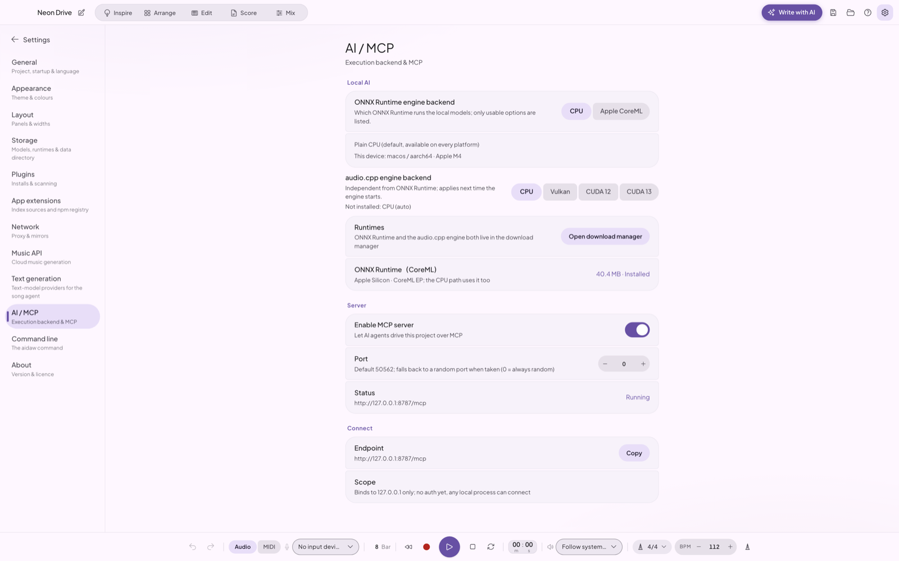

<p align="center">
  
</p>

<p align="center">
  <a href="https://github.com/heshengtao/ai-daw/releases"></a>
  <a href="LICENSE"></a>
  
  <a href="https://hub.docker.com/r/ailm32442/ai-daw"></a>
</p>

<p align="center">
  <a href="README_zh.md">简体中文</a> · <a href="README_zh-TW.md">繁體中文</a> · <a href="README.md">English</a> · <a href="README_ja.md">日本語</a> ·
  <a href="README_ko.md"><b>한국어</b></a> · <a href="README_es.md">Español</a> · <a href="README_fr.md">Français</a> · <a href="README_de.md">Deutsch</a> ·
  <a href="README_ru.md">Русский</a> · <a href="README_ar.md">العربية</a>
</p>

<p align="center">
  <a href="https://hub.docker.com/r/ailm32442/ai-daw"><b>Docker Hub</b></a> ·
  <a href="https://github.com/heshengtao/ai-daw/releases">다운로드</a>
</p>

## AI DAW란 무엇인가요?

**AI DAW는 데스크톱을 위한 작고 AI 네이티브한 음악 스튜디오입니다** — 작곡하고, 편곡하고, 믹싱하고, 마스터링하는 일을 하나의 가벼운 앱에서 끝내고, AI 에이전트가 세션 안에서 함께 작업하도록 할 수 있습니다.

이것은 진짜 DAW입니다. 멀티트랙 타임라인, 피아노 롤, 센드와 버스가 있는 믹서, 자동화 레인, 내장 신시사이저, 그리고 VST3 / CLAP / AU 플러그인 호스팅을 갖추고 있습니다. 동시에 **모델이 직접 조작하도록** 설계되었습니다 — 함께 제공되는 Skill이 어떤 AI 하네스든 MCP를 통해 실행 중인 앱을 다루도록 가르쳐 주므로, 에이전트가 트랙을 추가하고, 노트를 쓰고, 믹스 밸런스를 맞추고, 결과를 분석하는 과정을 UI에서 그대로 지켜볼 수 있습니다.

모든 것이 사용자의 컴퓨터에서 실행됩니다. 계정도, API 키도 필요 없고, 오디오가 컴퓨터 밖으로 나가지 않습니다.


## 왜 중요한가

모델이 코드를 잘 쓰게 된 것은 코딩 에이전트 프레임워크를 통해 코드를 **실행**할 수 있었기 때문이고, 3D 모델링을 잘하게 된 것은 Blender MCP를 통해 실제 모델링 소프트웨어를 조작할 수 있었기 때문입니다. 두 경우 모두 모델은 실제 도구와 실제 결과, 그리고 실제 피드백 루프를 얻었고, 바로 그것이 빠른 반복을 가능하게 합니다.

음악에는 그런 루프가 거의 없었습니다. 모델은 오디오를 생성할 수 있지만, 사람처럼 *세션을 다룰* 수는 없습니다. 편집할 어레인지먼트도, 조작할 믹서도, 되돌리기 기록도 없고, 마지막 변경이 결과를 더 나쁘게 만들었다는 사실을 알아챌 방법도 없습니다.

**AI DAW는 그 간극을 메우기 위한 작고 의도적인 시도입니다.** AI 에이전트가 Skill과 MCP를 통해 조작할 수 있는 실제 DAW이며, 따라서 다음과 같은 용도로 유용합니다.

- **모델이 작곡에 대해 실제로 무엇을 아는지 시험하기** — 오디오가 그럴듯하게 들리는지가 아니라, 어레인지먼트를 구성하고 파트를 고르고 믹스를 고칠 수 있는지를 봅니다.
- **실제 작곡 흔적 수집** — 에이전트의 모든 편집은 평범한 되돌리기 기록을 가진 평범한 프로젝트에 남으므로, 하나의 세션이 모델이 음악을 어떻게 사고하는지에 대한 데이터가 됩니다.
- **모델이 코드를 쓰듯 음악을 쓸 수 있게 되는 단계** — 응답하는 도구와 함께 말입니다.

## 설계부터 가볍게

작다는 것은 타협이 아니라 기능입니다.

- **가벼운 설치 용량** — Electron도, 클라우드도, 끼워 넣은 모델 모음도 없습니다. macOS 앱은 약 38 MB입니다. 참고로 Ableton Live, Logic Pro, FL Studio 같은 주류 DAW는 보통 1–3 GB를 차지하므로, AI DAW는 **95% 이상 더 작습니다**.
- **빠른 시작** — 부팅할 때 무거운 것이 로드되지 않으며, AI 모델은 사용할 때만 불러옵니다.
- **대형 모델은 필요할 때, 설치 파일에는 절대 포함되지 않음** — 음악 생성 같은 무거운 작업은 기본으로 통합되어 있지 않습니다. **가창 음성**(SoulX-Singer, 1.4 GB)과 **보이스 스왑**(SoulX-Singer-SVC, 2.4 GB)은 관리자 → 모델에서 선택적으로 받는 모델입니다. 필요할 때 내려받으면 되고, 그때까지는 디스크를 전혀 차지하지 않습니다.
- **확장을 전제로 설계** — **앱 확장**(npm 패키지)은 이미 에이전트 도구와 사이드바 패널을 추가합니다. 외부 AI 모델을 워크플로에 연결하는 인터페이스는 로드맵에 있습니다.

## 어떤 AI 하네스에서든 조작

AI DAW에는 AI 에이전트가 실행 중인 앱을 조작하는 방법을 가르치는 **Skill**(`skills/aidaw`)이 포함되어 있습니다 — 프로젝트, 트랙, 클립, 노트를 읽고 쓰기, 스타일 분석, 음악 이론과 드럼 패턴 조회, 장르 레시피를 MIDI로 만들기, 믹싱(게인, 패닝, 센드, 자동화), 트랜스포트와 녹음, 라우드니스와 스펙트럼 분석, WAV 내보내기, 플러그인 스캔까지 다룹니다. 내장 **MCP** 서버를 통해 동작하므로 Agent Skills를 지원하는 어떤 하네스든 바로 사용할 수 있습니다.

앱에는 18가지 샘플링 악기도 함께 들어 있습니다 — **어쿠스틱 피아노, 나일론 스트링 기타와 클린 일렉트릭 기타, 핑거 베이스, 어쿠스틱 드럼 킷, 스트링 앙상블, 슬로우 스트링, 솔로 바이올린/비올라/첼로/콘트라베이스, 피치카토 스트링, 트럼펫, 프렌치 호른, 신스 스트링/브라스 1·2** (SF3/SF2, 총 약 13.5 MB) — 설치하자마자 연주할 수 있습니다.

**방법 1 · 명령줄에서 설치**

```bash
npx skills add heshengtao/ai-daw
```

**방법 2 · 에이전트에게 설치를 부탁**

```
Install this Skill: https://github.com/heshengtao/ai-daw
```

에이전트가 만드는 모든 편집은 UI와 동일한 명령 파이프라인을 거칩니다. 되돌리기 기록에 남고, 인터페이스에 표시되며, 에이전트의 작업으로 귀속되므로 무엇을 했는지 항상 확인하고 되돌릴 수 있습니다. 앱 안에 머물고 싶다면 **Write with AI**가 같은 루프를 채팅 패널로 열어 줍니다(설정 → 텍스트 생성).

## 기능

### Inspire — 한 줄을 넣으면 완성된 테이크가 나옵니다

상단 바 맨 왼쪽의 뷰는 **Inspire**입니다. "쓰기 → 생성 → 듣기"를 위한 전체 화면 작업대입니다. 왼쪽에서 쓰고 오른쪽에서 듣습니다. 좋아요도, 공유도, 업그레이드 잠금도 없습니다 — 오직 설명과 가사, 그리고 재생 바뿐입니다.

- **드롭다운 하나, 엔진 둘** — 로컬 YuE2 / ACE-Step 가중치와 설정된 클라우드 서비스(Suno / Mureka / Lyria …)가 하나의 목록을 공유합니다. 공급자를 추가하려면 한 곳만 고치면 됩니다
- **간단 / 고급** — 간단 모드는 한 줄 설명만 받습니다. 고급 모드에서는 `[Verse]` / `[Chorus]` / `[Bridge]` / `[Outro]` 태그로 가사를 쓰고, **Instrumental** 스위치를 켜고, 길이와 스텝, 시드를 조정할 수 있습니다
- **일괄 테이크** — 한 번 누르면 최대 8개의 테이크를 요청할 수 있습니다. 각기 새로운 시드로 차례로 렌더링되고, 끝나는 대로 목록에 쌓입니다
- **테이크 이어가기** — 모든 로컬 렌더는 시맨틱 코드를 남기므로, **Continue**는 그 테이크가 멈춘 지점부터 다음 구간을 씁니다. 모델이 오디오만이 아니라 구조까지 받는 셈입니다
- **필요한 것을 알아서 가져옴** — 가중치가 없든, 엔진이 없든, 엔진이 멈춰 있든 Generate를 누르면 순서대로 처리합니다
- **한 줄로 늘어선 테이크** — 날짜별로 묶입니다. 각 테이크에는 프로젝트 트랙 색조로 만든 **생성된 커버**, 항상 보이는 재생 버튼, 자체 재생 바가 붙습니다. 클릭하면 듣고, 드래그하면 스크럽됩니다. 포커스된 카드는 하단 바의 트랜스포트 키가 제어하는 대상이기도 합니다
- **온전히 내 것** — 기록은 내 컴퓨터에 남습니다. 목록을 지워도 프로젝트는 건드려지지 않고, 테이크는 요청할 때만 세션에 들어가거나(＋) 디스크에 저장됩니다

<p align="center">
  
</p>

### 어레인지와 편집 — 실제 타임라인에서 작곡

듣는 그대로 곡을 배치하세요. 클립을 트랙 사이로 드래그하고, 음악이 바뀌는 지점에서 분할하고, 곡 어디서든 바꿀 수 있는 템포와 박자에 맞춰 눈금자와 그리드가 따라가게 하세요. MIDI 클립은 노트를, 오디오 클립은 파형을 스스로 그리므로 어레인지먼트를 한눈에 읽을 수 있습니다.

- **멀티트랙 어레인지** — MIDI와 오디오 클립을 나란히, 트랙 간 드래그 앤 드롭, 마퀴 선택
- **읽기 쉬운 피아노 롤** — 클립 미리보기에 노트가 보이고, 편집기에서 벨로시티와 줌, 가상 키보드를 제공합니다
- **악보와 타브** — 스코어 레인은 같은 노트로 오선보나 기타 타브를 그리고, 내보낼 때 MusicXML로 나옵니다
- **동적 템포와 박자** — 어느 지점에서든 템포나 박자를 바꿀 수 있고, 그리드가 따라갑니다
- **트랜스포트와 루프** — 재생, 정지, 탐색, 구간 루프, 메트로놈
- **자동화 레인** — 플러그인이나 내장 신시사이저가 노출하는 모든 파라미터에 커브를 그릴 수 있습니다
- **포인터를 따라오는 도구** — 플로팅 독에서 그리기 / 지우기 / 선택 / 분할 / 가사 도구를 전환하고, 클릭 한 번으로 하단 레인을 자동화, 스코어, 키보드 사이에서 바꿉니다
- **실전 편집 도구** — 분할, 이동, 복사/붙여넣기, 실행 취소/다시 실행, 그리고 단축키 치트 시트

<p align="center">
  
</p>

### 믹싱과 마스터링 — 트랙 완성하기

곡의 밸런스를 잡고, 그다음 크게 만드세요. 채널 스트립은 게인, 패닝, 센드, 버스, 음소거/솔로, 레벨 미터를 제공하고, 마스터 버스의 마스터링 체인이 라우드니스와 피크, 스테레오 폭을 처리하므로 앱을 떠나지 않고도 발매 가능한 결과물을 렌더링할 수 있습니다.

- **믹서** — 게인, 패닝, 센드, 버스, 음소거/솔로, 레벨 미터
- **내장 이펙트** — 다이내믹스, EQ, 시간 기반 이펙트를 어떤 트랙에든 바로 얹을 수 있습니다
- **마스터링 체인** — 라우드니스 노멀라이즈, 트루 피크 리미팅, 스테레오 폭
- **내장 신시사이저** — 오실레이터, 엔벨로프, 실시간 오실로스코프가 있는 필터
- **내보내기** — 무손실 WAV 또는 LAME 인코딩 MP3(샘플 레이트와 비트레이트 선택 가능), 표준 MIDI 파일, MusicXML 악보

<p align="center">
  
</p>

### 플러그인 — 쓰던 악기와 이펙트 그대로

AI DAW는 어디서나 **VST3**와 **CLAP** 플러그인을 호스팅하며, macOS에서는 **Audio Units(AU / AUv3)**도 지원하므로 이미 가진 도구를 그대로 가져올 수 있습니다. 플러그인 관리자는 공개 레지스트리를 검색하고, 유형과 OS 호환성으로 필터링하며, 클릭 한 번으로 설치·업데이트·제거합니다 — 이미 디스크에 있는 플러그인을 지정할 수도 있습니다.

- **VST3 / CLAP / AU 호스팅** — 어떤 트랙에도 서드파티 악기와 이펙트를 로드합니다(macOS에서는 AU, AUv3)
- **플러그인 관리자** — 레지스트리 검색, 악기/이펙트와 플랫폼별 필터, 설치 / 업데이트 / 제거
- **로컬 가져오기** — 다른 곳에 설치해 둔 플러그인 가져오기
- **에디터와 파라미터** — 플러그인 자체 UI를 열거나 인스펙터와 자동화 레인에서 파라미터를 조작합니다. 자체 뷰가 없는 AU 플러그인에는 범용 파라미터 패널이 제공됩니다
- **SoundFont 라이브러리** — 직접 가진 `.sf2` / `.sf3`를 가져오거나(뱅크 하나가 수십 개 프리셋으로 확장됩니다), 내장 SoundFont 인덱스에서 MuseScore General, FluidR3, FreePats 같은 공개 뱅크를 설치할 수 있습니다
- **하나의 다운로드 관리자** — 플러그인, SoundFont, AI 모델, 런타임이 하나의 관리자를 공유하며 실시간 진행률과 취소, 항목별 설치 상태를 제공합니다

<p align="center">
  
</p>

### 앱 확장 — 앱 자체를 확장

오디오 플러그인이 소리를 확장한다면, **앱 확장**은 애플리케이션을 확장합니다. npm 패키지로 배포되며 에이전트가 호출할 수 있는 **MCP 도구**와 오른쪽 사이드바에 렌더링되는 **패널**을 추가할 수 있으므로, 앱을 포크하지 않고도 부족한 워크플로를 더할 수 있습니다.

- **npm 배포** — 인덱스(`index.json`)나 레지스트리에서 바로 설치합니다. `engines.aidaw`가 확장이 지원하는 앱 버전을 알려 주고, 미러를 쓰면 오프라인이나 방화벽 환경도 커버됩니다
- **Discover와 설치됨** — 패널은 인덱스가 아는 모든 항목(버전, 작성자, 설치 / 업데이트)과 실제로 실행되는 항목(상태, 도구, 패널, 활성화 / 다시 로드 / 제거)을 나란히 보여 줍니다
- **확장의 양면** — 서버 측 도구는 데몬의 QuickJS 호스트에서 실행되며 UI와 같은 명령을 통해 세션에 접근합니다. 클라이언트 측 패널은 핫 리로드가 되는 ESM으로 웹뷰에 로드됩니다
- **로컬 폴더도 가능** — Import folder로 직접 개발 중인 확장을 설치합니다. `examples/extensions/hello`가 최소 참조 구현(도구 하나, 패널 하나)입니다
- **오디오 체인이 아님** — VST3 / CLAP / AU는 위의 **플러그인**을 보세요. 이것은 믹서가 아니라 앱을 확장하는 것입니다

<p align="center">
  
</p>

### 로컬 AI — 오디오를 다룰 수 있는 재료로

AI 기능은 데모가 아니라 실제 세션을 위해 만들어졌습니다. 트랙을 지정하면 계속 편집할 수 있는 결과를 돌려줍니다. 옮길 수 있는 MIDI 노트, 룸 노이즈가 줄어든 보컬 테이크, 다시 밸런스를 잡을 수 있는 스템입니다. 모든 것은 사용자의 하드웨어에서 실행됩니다 — 기본은 CPU이고, 선택적으로 CoreML(macOS)과 DirectML(Windows) 가속을 쓸 수 있습니다. 모든 작업은 하나의 **AI 패널**에 모여 있으며 **All / Generate / Convert**로 필터링되고, 각 행은 해당 모델이 이미 설치되어 있는지 알려 줍니다.

- **템포 감지** — Beat This!(ISMIR 2024)가 한 번에 전체 BPM과 박자를 추정합니다
- **오디오 → MIDI** — Basic Pitch가 녹음된 연주를 편집 가능한 노트로 바꿉니다. 모델을 **MuScriptor**(audio.cpp 엔진 경유)로 바꾸면 다중 악기 채보가 가능하며, 악기마다 MIDI 트랙 하나로 떨어집니다. 393 MB–5.1 GB, 필요할 때 다운로드(CC BY-NC 4.0 — 비상업적)
- **보컬 정리** — LocalVQE가 보컬 테이크의 노이즈와 리버브를 줄입니다
- **스템 분리** — HTDemucs v4가 트랙을 4개 또는 6개 스템으로 나누어 리믹스할 수 있게 합니다
- **가창 음성** — MIDI 멜로디와 가사, 참조 음성이 편집 가능한 보컬 테이크가 됩니다(SoulX-Singer 제로샷 음색 복제). 가사는 피아노 롤에서 노트별로 편집할 수 있고(`-` 슬러), 참조 음성은 프로젝트 간에 공유되는 **보이스 라이브러리**에 있으므로 음색을 바꾸는 일은 다른 음성을 고르는 것만큼 간단합니다
- **보이스 스왑** — 기존 보컬의 멜로디/가사/타이밍은 그대로 두고 음색만 참조 음성으로 바꿉니다(SoulX-Singer-SVC, 제로샷). 결과는 원본 아래 새 트랙에 놓이고 실행 취소 한 번이면 되돌아갑니다. 전체 믹스에서 보컬을 먼저 분리해 두면 반주가 피치 트래커에 섞이지 않습니다
- **설계부터 오프라인** — 계정도, API 키도, 업로드도 없습니다

<p align="center">
  
</p>

### MCP 서버 — AI 에이전트가 내 세션에서 작업하도록

스위치 하나만 켜면 프로젝트가 AI 어시스턴트가 조작할 수 있는 대상이 됩니다. 내장 **MCP(Model Context Protocol)** 서버는 세션을 `127.0.0.1`에 바인딩된 HTTP로 노출하므로, 에이전트를 연결해 작업을 맡기고 UI가 실시간으로 갱신되는 동안 클립 추가, 노트 수정, 레벨 변경을 지켜볼 수 있습니다. `aidaw` 명령줄 도구는 같은 서버를 위한 얇은 클라이언트입니다.

- **HTTP 기반 MCP** — 에이전트가 접속하는 루프백 전용 엔드포인트
- **실시간 편집** — 에이전트의 동작이 평범한 프로젝트 변경으로 즉시 나타납니다
- **앱 안의 Song Agent** — **Write with AI** 버튼이 같은 도구들을 상대로 작곡하는 채팅 패널을 엽니다. 설정 → 텍스트 생성에서 OpenAI 호환 모델을 지정하면 됩니다
- **`aidaw` CLI** — 설정에서 `PATH`에 설치할 수 있습니다

<p align="center">
  
</p>

## 설치

미리 빌드된 바이너리는 [GitHub Releases](https://github.com/heshengtao/ai-daw/releases) 페이지에 공개될 예정입니다. 그전까지는 소스에서 빌드하세요.

### 요구 사항

- Rust(안정판)와 Cargo
- Node.js ≥ 18과 [pnpm](https://pnpm.io/)
- Tauri v2 시스템 사전 요구 사항 — <https://tauri.app/start/prerequisites/> 참고

### 소스에서 빌드

```bash
git clone https://github.com/heshengtao/ai-daw.git
cd ai-daw

pnpm install
pnpm tauri dev        # 개발 모드로 앱 실행
pnpm tauri build      # 릴리스 빌드 생성
```

그 밖에 유용한 명령:

```bash
pnpm build            # 프런트엔드 타입 검사 후 빌드
pnpm build:aidaw      # aidaw CLI 빌드(tools/build-aidaw.sh 참고)
```

### 플랫폼 지원

| 플랫폼 | 상태 |
| --- | --- |
| Windows (x86_64) |  지원됨 |
| macOS (Apple Silicon) |  지원됨(아래 “앱이 손상되었습니다” 안내 참고) |
| Linux (x86_64 / arm64) |  지원됨 |

> **macOS에서 “앱이 손상되었습니다”가 뜨나요?** 이 앱은 애드혹 서명(공증 없음)이라 macOS가
> 다운로드 파일을 격리합니다. 터미널에서 아래를 실행한 뒤 앱을 평소처럼 여세요:
>
> ```bash
> xattr -cr "/Applications/AI DAW.app"
> ```

> **Intel Mac은 아직 지원하지 않습니다.** ONNX Runtime은 `x86_64-apple-darwin`용 사전 빌드
> 바이너리를 배포하지 않으므로, Intel macOS에서는 로컬 AI 모델을 링크할 수 없습니다.

## 브라우저 접근과 헤드리스

AI DAW는 **창 없이** 실행되어 네트워크의 어떤 브라우저에도 같은 인터페이스를 제공할 수 있습니다. 데스크톱 앱과
브라우저 클라이언트는 *동일한* 세션을 구동합니다 — 같은 프로젝트, 같은 되돌리기 기록,
같은 오디오 엔진입니다.

### Docker(사전 빌드 이미지)

```bash
docker run -d --name ai-daw -p 28430:28430 -v ai-daw-data:/data ailm32442/ai-daw
```

이미지는 `v*` 릴리스 태그에 게시되며, `latest`는 가장 최근 릴리스를 가리킵니다. 일반 main
커밋은 더 이상 이미지를 다시 빌드하지 않습니다. `Dockerfile`을 시험하려면 Actions에서
`Docker (ai-daw)` 워크플로를 수동으로 실행하세요.

<http://localhost:28430>을 열고 바로 작업을 시작하세요 — **로그인도, 토큰도, 쿠키 검사도 없습니다**.
헤드리스 빌드는 디스플레이가 없는 머신을 위한 것이며, 접근 제어는 배포 측의 몫입니다
(랜, 컨테이너 네트워크, 또는 그 앞단의 리버스 프록시).

컨테이너에는 보통 **사운드 카드가 없습니다**. 이 경우 오디오 엔진은 **가상 클록**으로
전환됩니다. 렌더링은 여전히 실시간으로 진행되고, 재생 헤드 / 루프 / 미터도 정상 동작하며,
PCM은 `/audio`로 나갑니다 — **웹 페이지가 사운드 카드가 되는 셈입니다**. 상태 바의
"Virtual clock" 알약 표시가 이를 알려 주며(클릭하면 장치를 다시 시도합니다). 오디오가 있는
머신에서도 이 경로를 강제하려면 `AIDAW_AUDIO=virtual`을 설정하세요.

**플러그인 에디터도 동작합니다.** 컨테이너에는 윈도 시스템이 없지만 이미지에 Xvfb가 들어
있어, VST3 / CLAP 플러그인이 가상 디스플레이에 자체 에디터를 그리고, 데몬이 그 화면을 프레임
스트림으로 인코딩하며, 페이지가 이를 캔버스에 렌더링하면서 마우스와 키보드를 다시 전달합니다.
즉 에디터가 페이지 안의 창이 됩니다 — 데스크톱의 네이티브 창에서 보는 것과 같은 에디터입니다.
(데스크톱 빌드에서는 "Open editor"가 여전히 실제 네이티브 창을 띄웁니다: 충실도가 더 높고
지연이 더 낮습니다.) `AIDAW_GUI_STREAM=0`으로 가상 디스플레이를 건너뛰고 메모리를 아낄 수
있습니다 — 파라미터는 계속 편집할 수 있지만 에디터는 보이지 않습니다.
이미지 크기는 이제 약 **585 MB**입니다(이전 ~286 MB). 늘어난 부분은 Xvfb와 Mesa 소프트웨어
OpenGL로, 일부 플러그인 에디터에 필요합니다 — `libgl1-mesa-dri`가 없으면 검게 렌더링됩니다.
플러그인 중 GL을 쓰는 것이 없다면 `libgl1` / `libglx-mesa0` 줄을 빼서 약 150 MB를 되찾으세요.


### Docker(소스에서 빌드)

```bash
git clone https://github.com/heshengtao/ai-daw.git
cd ai-daw
docker build -t ai-daw .
docker run -d -p 28430:28430 -v ai-daw-data:/data ai-daw
```

### 헤드리스 바이너리

```bash
npm run build                                                # dist/ 생성
cargo run -p ai-daw-daemon --no-default-features --bin aidawd -- \
  --data-dir ~/.ai-daw --port 28430 --web-dir dist
```

### 환경 변수

| 변수 | 기본값 | 용도 |
| --- | --- | --- |
| `AIDAW_DATA_DIR` | 이미지에서는 `/data` | 세션, 프리셋, 모델 |
| `AIDAW_WEB_DIR` | 이미지에서는 `/web` | 서빙할 빌드된 프런트엔드 |
| `AIDAW_NO_AUDIO` | 설정 안 함 | 오디오 장치 열기 건너뛰기(ALSA가 없는 컨테이너) |
| `AIDAW_AUDIO` | 설정 안 함 | `virtual` = 사운드 카드를 전혀 건드리지 않고 가상 클록만 사용 |
| `AIDAW_MODELS_EXTRA` | 이미지에서는 `/opt/models` | 추가 모델 검색 디렉터리(`:`로 구분, 다운로드 디렉터리 다음 순위) |
| `AIDAW_ORT_BUNDLED` | 이미지에서는 `/opt/ort` | 번들 ONNX Runtime 디렉터리 |
| `AIDAW_ARTICULATION_MAPS` | 이미지에서는 `/opt/articulation-maps` | 번들 아티큘레이션 맵 라이브러리 |
| `AIDAW_MCP_URL` | 자동 탐색 | `aidaw` CLI가 실행 중인 앱을 찾는 위치 |


> 헤드리스 빌드는 내장 MCP 서버도 시작하므로(설정 파일 `<data dir>/mcp.json`, 기본 비활성),
> 컨테이너 안에서 AI가 MCP로 같은 프로젝트를 조작할 수 있습니다.

### HTTP API

| 메서드 | 경로 | 용도 |
| --- | --- | --- |
| `POST` | `/rpc/{command}` | 모든 명령. 앱의 IPC와 같은 이름과 인수(`GET /commands`가 이 빌드가 제공하는 목록을 보여 줍니다) |
| `GET` | `/events` | Server-Sent Events: 엔진 편집과 트랜스포트 상태 |
| `GET` | `/audio` | WebSocket: 실시간 PCM(48 kHz 스테레오 float32, 약 10 ms 블록) |
| `GET` | `/health` | 생존 확인 + 오디오 장치 사용 가능 여부 |
| `GET` | `/commands` | 서버가 노출하는 모든 명령 이름 |

## 아키텍처

```
src-tauri/          Tauri 셸: 창, 플러그인 네이티브 에디터, 자동 업데이터
crates/daemon/      전체 백엔드: 프로젝트 엔진, 오디오 호스트, MCP, HTTP
crates/engine/      DSP + 스케줄링 + 렌더링(Tauri 의존성 없음)
crates/ipc/         앱, CLI, MCP가 공유하는 명령/이벤트 스키마
crates/extensions/  앱 확장 호스트: npm 설치, 매니페스트, QuickJS 도구, 클라이언트 패널
src/                Vue 3 프런트엔드 — 데스크톱과 브라우저가 동일
```

프런트엔드는 Rust와 직접 통신하지 않습니다. `src/api/ipc.ts`가 전송 계층(`Tauri IPC`
또는 `HTTP + SSE + WebSocket`)을 고르므로 모든 화면이 두 셸에서 모두 동작합니다. 브라우저
빌드가 포팅이 아니라, 같은 앱이 네트워크를 통해 같은 백엔드와 대화하는 것인 이유입니다.

## 자주 묻는 질문

### AI DAW는 무료인가요?

예. AI DAW는 Apache 2.0으로 오픈 소스입니다. 유료 등급도, 기능 잠금도 없습니다.

### 오프라인에서도 동작하나요?

예. 앱과 모든 AI 모델이 로컬에서 실행됩니다. 네트워크를 쓰는 경우는 직접 시작하는 플러그인 패키지 및 AI 모델 다운로드, 플러그인과 확장 인덱스 가져오기, 그리고 클라우드 음악 서비스를 설정한 경우의 호출뿐입니다.

### GPU가 필요한가요?

아니요. AI 모델은 기본적으로 CPU에서 실행됩니다. 하드웨어가 지원하면 macOS는 CoreML을, Windows는 DirectML을 쓸 수 있으며 둘 다 선택 사항입니다.

### 어떤 AI 모델이 앱에 포함되나요?

작은 모델 두 개가 포함됩니다. **Basic Pitch**(오디오 → MIDI)와 **LocalVQE**(보컬 정리)로, 설치하는 즉시 동작합니다. 더 큰 모델인 **Beat This!**(템포 감지)와 **HTDemucs**(스템 분리, 4 또는 6 스템)는 처음 사용할 때 앱 내 모델 관리자에서 필요에 따라 다운로드되며 소스 트리 밖에 저장됩니다.

모델 가중치는 리포지터리나 설치 파일에 절대 포함되지 않으며, 각 모델은 배포자가 부여한 라이선스를 그대로 따릅니다. [MODELS.md](MODELS.md)를 보세요. 선택 사항인 CC BY-NC 4.0(비상업적) 모델도 마찬가지입니다 — 곡 생성을 위한 **YuE2**, 커버 악보를 위한 **SheetSage2**입니다.

### 어떤 플러그인 형식을 지원하나요?

Windows, macOS, Linux에서 VST3와 CLAP을 지원하며, macOS에서는 **Audio Units(AU / AUv3)**도 지원합니다.

### 인터페이스는 어떤 언어를 지원하나요?

중국어 간체, 중국어 번체, 영어, 일본어, 한국어, 스페인어, 프랑스어, 독일어, 러시아어, 아랍어입니다. **설정 → 일반 → 언어**에서 언제든 바꿀 수 있으며, 선택은 기억되고 그전까지는 시스템 언어를 따릅니다. 사전은 `src/i18n/`에 있고, 번역이 없는 문자열은 영어로 대체됩니다. 아랍어 텍스트도 완전히 지원됩니다 — DAW의 시간 축은 왼쪽에서 오른쪽으로 읽히므로 타임라인은 왼쪽에서 오른쪽 레이아웃을 유지합니다. README도 같은 10개 언어로 번역되어 있습니다.

### 에이전트가 앱을 조작하려면 앱이 실행 중이어야 하나요?

예. Skill과 `aidaw` CLI는 실행 중인 AI DAW와 MCP로 통신하므로 앱을 먼저 시작하세요(`aidaw status`로 실행 여부를 확인할 수 있습니다).

## 지원

### 스타를 부탁드립니다!
⭐ 여러분의 응원이 저희가 나아가는 원동력입니다!

### 후원을 환영합니다!
<div align="center" style="display: flex; gap: 20px; justify-content: center; flex-wrap: wrap;">

[](https://ko-fi.com/agentparty)
[](https://afdian.com/a/agentparty)

</div>

### 팔로우하기
<div align="center">
  <a href="https://space.bilibili.com/26978344">
    
  </a>
  <a href="https://www.youtube.com/@agentParty">
    
  </a>
</div>

### 커뮤니티 참여
프로젝트에 대해 질문이나 문제가 있으면 커뮤니티에 참여해 주세요.

1. QQ 그룹: `931057213`(정원 마감) / `902882342`(그룹 2)

2. Discord: [Discord 링크](https://discord.gg/f2dsAKKr2V)

## 기여자

<a href="https://github.com/heshengtao/ai-daw/graphs/contributors">
  
</a>

## 라이선스

애플리케이션 **코드**는 Apache-2.0입니다 — [LICENSE](LICENSE)를 보세요.

모델 **가중치**는 별개의 계층입니다. 리포지터리나 설치 파일에 포함되지 않고, 배포자가 부여한
라이선스를 그대로 유지하며, 앱이 필요할 때 다운로드합니다(내려받은 각 파일의 `sha256`도
검증합니다). 모델과 출처, 라이선스의 전체 표는
**[MODELS.md](MODELS.md)**를 보세요.

일부 선택 모델은 **CC BY-NC 4.0(비상업적)**입니다 — 곡 생성을 위한 YuE2와 커버 악보를 위한
SheetSage2입니다. 선택적으로 내려받는 것이며, 배포자로부터 상업적 라이선스를 받지 않았다면
그 가중치를 상업적 작업에 사용하지 마세요. 생성된 오디오/MIDI는 상위 조건과
입력 오디오에 대해 보유한 권리에 따라
사용자에게 귀속됩니다.

## 서드파티 라이선스

이 프로젝트는 서드파티 오픈 소스 소프트웨어 위에 만들어졌습니다. 다른 프로젝트에서 각색한 파일과 허용적 기본 라이선스 집합에 속하지 않는 의존성은 [NOTICE](NOTICE)에 나열되어 있습니다.
