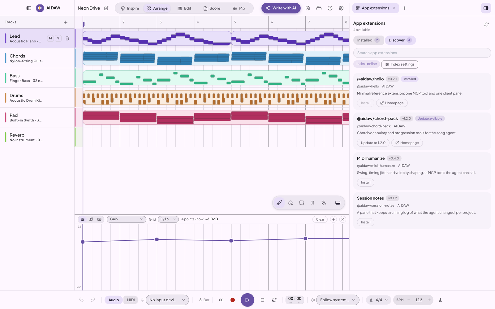

<p align="center">
  
</p>

<p align="center">
  <a href="https://github.com/heshengtao/ai-daw/releases"></a>
  <a href="LICENSE"></a>
  
  <a href="https://hub.docker.com/r/ailm32442/ai-daw"></a>
</p>

<p align="center">
  <a href="README_zh.md">简体中文</a> · <a href="README_zh-TW.md">繁體中文</a> · <a href="README.md">English</a> · <a href="README_ja.md">日本語</a> ·
  <a href="README_ko.md">한국어</a> · <a href="README_es.md">Español</a> · <a href="README_fr.md">Français</a> · <a href="README_de.md">Deutsch</a> ·
  <a href="README_ru.md"><b>Русский</b></a> · <a href="README_ar.md">العربية</a>
</p>

<p align="center">
  <a href="https://hub.docker.com/r/ailm32442/ai-daw"><b>Docker Hub</b></a> ·
  <a href="https://github.com/heshengtao/ai-daw/releases">Скачать</a>
</p>

## Что такое AI DAW?

**AI DAW — это компактная AI-нативная музыкальная студия для вашего компьютера**: пишите, аранжируйте, сводите и выполняйте мастеринг в одном лёгком приложении, а AI-агент работает в сессии рядом с вами.

Это настоящий DAW: многодорожечный таймлайн, пиано-ролл, микшер с посылами и шинами, дорожки автоматизации, встроенный синтезатор и хостинг плагинов VST3 / CLAP / AU. Кроме того, он создан так, чтобы **им управляла модель**: встроенный Skill учит любую AI-среду работать с запущенным приложением по MCP, поэтому агент может добавлять дорожки, писать ноты, балансировать микс и анализировать результат, пока вы наблюдаете за этим в интерфейсе.

Всё работает на вашей машине. Без аккаунта, без API-ключа, аудио не покидает ваш компьютер.


## Почему это важно

Модели научились хорошо писать код, потому что могли **исполнять** его через фреймворк для кодинг-агентов; модели научились хорошо работать с 3D, потому что могли управлять настоящим ПО для моделирования через Blender MCP. В обоих случаях модель получает реальный инструмент, реальный результат и реальную петлю обратной связи — именно это делает возможной быструю итерацию.

В музыке такой петли в основном не было. Модель умеет генерировать аудио, но не может *работать над сессией* так, как это делает человек: нет аранжировки, которую можно править, нет микшера, которым можно управлять, нет истории отмены и нет способа заметить, что последнее изменение сделало хуже.

**AI DAW — небольшая, осознанная попытка закрыть этот разрыв.** Это настоящий DAW, которым AI-агент может управлять через Skill и MCP, и поэтому он полезен для:

- **Проверки того, что модель действительно знает о написании песен** — не того, правдоподобно ли звучит её аудио, а того, умеет ли она выстроить аранжировку, выбрать партии и исправить микс.
- **Сбора реальных трассировок написания песен** — каждое изменение агента попадает в обычный проект с обычной историей отмены, так что сессия становится данными о том, как модель рассуждает о музыке.
- **Шага к моделям, которые смогут писать музыку так же, как пишут код** — с инструментом, который отвечает обратной связью.

## Лёгкость по замыслу

Быть компактным — это свойство, а не компромисс.

- **Небольшой след** — ни Electron, ни облака, ни набора моделей в комплекте. Приложение для macOS занимает около 38 МБ — для сравнения, популярные DAW вроде Ableton Live, Logic Pro и FL Studio обычно устанавливаются на 1–3 ГБ, то есть AI DAW **компактнее более чем на 95 %**.
- **Быстрый запуск** — при старте не загружается ничего тяжёлого; AI-модели подключаются только тогда, когда вы ими пользуетесь.
- **Большие модели по требованию, но никогда в установщике** — тяжёлая работа, например генерация музыки, по умолчанию не встроена. **Поющий голос** (SoulX-Singer, 1,4 ГБ) и **замена голоса** (SoulX-Singer-SVC, 2,4 ГБ) — опциональные модели в разделе «Менеджер → Модели»: скачайте их, когда они понадобятся, а до тех пор они не занимают места на диске.
- **Создан для расширения** — **расширения приложения** (пакеты npm) уже добавляют инструменты для агента и панели в боковой панели; интерфейсы для подключения внешних AI-моделей к рабочему процессу — в планах.

## Управляйте из любой AI-среды

AI DAW поставляется со **Skill** (`skills/aidaw`), который учит AI-агента управлять запущенным приложением: читать и записывать проект, дорожки, клипы и ноты; анализировать стиль, искать теорию музыки и барабанные паттерны и превращать жанровый рецепт в MIDI; сводить (громкость, панорама, посылы, автоматизация); управлять транспортом и записью; анализировать громкость и спектр; экспортировать WAV; сканировать плагины. Он работает через встроенный сервер **MCP**, поэтому его подхватит любая среда, поддерживающая Agent Skills.

Приложение также содержит 18 сэмплированных инструментов — **акустическое пианино, нейлоновая гитара и чистая электрогитара, finger-бас, акустическая барабанная установка, струнный ансамбль, медленные струнные, соло-скрипка/альт/виолончель/контрабас, струнные пиццикато, труба, валторны и синтезаторные струнные/духовые 1 и 2** (SF3/SF2, всего около 13,5 МБ) — готовых к игре сразу из коробки.

**Вариант 1 · Установка из командной строки**

```bash
npx skills add heshengtao/ai-daw
```

**Вариант 2 · Попросите агента установить его**

```
Install this Skill: https://github.com/heshengtao/ai-daw
```

Каждое изменение агента проходит через тот же конвейер команд, что и интерфейс: оно попадает в историю отмены, появляется в интерфейсе и атрибутируется агенту — так вы всегда видите, что он сделал, и можете это отменить. Предпочитаете оставаться в приложении? Кнопка **«Написать с AI»** открывает ту же петлю в виде панели чата (Настройки → Генерация текста).

## Возможности

### Inspire — одна строка на входе, готовый дубль на выходе

Крайний левый вид на верхней панели — **Inspire**: полноэкранное рабочее место «написать → сгенерировать → послушать». Слева пишете, справа слушаете. Ни лайков, ни репостов, ни платных ограничений — только ваше описание, ваш текст и панель воспроизведения.

- **Один список, два движка** — локальные веса YuE2 / ACE-Step и любой настроенный облачный сервис (Suno / Mureka / Lyria …) в одном списке; чтобы добавить провайдера, достаточно изменить одно место
- **Простой / Расширенный** — в простом режиме хватает одной строки описания; расширенный позволяет писать текст с тегами `[Verse]` / `[Chorus]` / `[Bridge]` / `[Outro]`, переключать **Инструментал** и настраивать длительность, шаги и seed
- **Пакетные дубли** — запрашивайте до 8 дублей одним нажатием; они рендерятся один за другим, каждый со своим seed, и попадают в список по мере готовности
- **Продолжение дубля** — каждый локальный рендер сохраняет семантический код, поэтому **«Продолжить»** пишет следующий фрагмент с того места, где дубль остановился: модель получает структуру, а не только аудио
- **Сам добывает нужное** — отсутствующие веса, отсутствующий движок или остановленный движок обрабатываются по порядку при нажатии «Сгенерировать»
- **Дубли в колонке** — сгруппированы по дням; каждый дубль получает **сгенерированную обложку** в цветах дорожек проекта, всегда видимую кнопку воспроизведения и собственную панель воспроизведения: щёлкните, чтобы послушать, потяните, чтобы перемотать. Карточка в фокусе — это ещё и то, чем управляет транспорт на нижней панели
- **Остаётся у вас** — история хранится на вашей машине; её очистка никогда не затрагивает проект, а дубль попадает в сессию (＋) или на диск (сохранение) только по вашему требованию

<p align="center">
  
</p>

### Аранжировка и редактирование — сочиняйте на настоящем таймлайне

Выстраивайте песню так, как вы её слышите. Перетаскивайте клипы между дорожками, разрезайте их там, где меняется музыка, а линейка и сетка будут следовать за темпом и размером, которые можно изменить в любом месте песни. MIDI-клипы рисуют собственные ноты, аудиоклипы — собственную волновую форму, так что аранжировка читается с одного взгляда.

- **Многодорожечная аранжировка** — MIDI- и аудиоклипы рядом, перетаскивание между дорожками, выделение рамкой
- **Пиано-ролл, который хорошо читается** — превью клипов показывают ноты; редактор даёт velocity, масштабирование и виртуальную клавиатуру
- **Ноты и табулатура** — дорожка партитуры рисует нотный стан или гитарную табулатуру из одних и тех же нот, а на экспорте получается MusicXML
- **Динамический темп и размер** — меняйте темп или размер в любой точке; сетка подстроится
- **Транспорт и луп** — воспроизведение, остановка, перемотка, зацикливание региона, метроном
- **Дорожки автоматизации** — рисуйте кривые для всего, что выводит плагин или встроенный синтезатор
- **Инструменты под курсором** — плавающий док переключает рисование / стирание / выделение / разрезание / текст, а одно нажатие меняет нижнюю дорожку между автоматизацией, партитурой и клавиатурой
- **Настоящий набор для редактирования** — разрезание, перемещение, копирование/вставка, отмена/повтор, а также шпаргалка по горячим клавишам

<p align="center">
  
</p>

### Сведение и мастеринг — доведите трек до конца

Сбалансируйте песню, а затем сделайте её громкой. Канальные полосы дают громкость, панораму, посылы, шины, выключение звука/соло и индикацию уровня; цепочка мастеринга на мастер-шине управляет громкостью, пиками и стереошириной, так что можно получить готовый к релизу результат, не покидая приложение.

- **Микшер** — громкость, панорама, посылы, шины, выключение звука/соло и индикация уровня
- **Встроенные эффекты** — динамика, EQ и эффекты на основе времени, готовые к установке на любую дорожку
- **Цепочка мастеринга** — нормализация громкости, true-peak-лимитирование и стереоширина
- **Встроенный синтезатор** — осцилляторы, огибающие и фильтр с живым осциллографом
- **Экспорт** — WAV без потерь или MP3 в кодировке LAME (частоту дискретизации и битрейт выбираете вы), стандартный MIDI-файл или партитура MusicXML

<p align="center">
  
</p>

### Плагины — свои инструменты и эффекты

AI DAW хостит плагины **VST3** и **CLAP** везде, а на macOS ещё и **Audio Units (AU / AUv3)**, так что инструменты, которые у вас уже есть, остаются с вами. Менеджер плагинов ищет в открытом реестре, фильтрует по типу и совместимости с ОС и устанавливает, обновляет или удаляет плагины одним нажатием — или укажите ему на то, что уже лежит на диске.

- **Хостинг VST3 / CLAP / AU** — загружайте сторонние инструменты и эффекты на любую дорожку (AU и AUv3 на macOS)
- **Менеджер плагинов** — поиск в реестре, фильтрация по инструменту/эффекту и платформе, установка / обновление / удаление
- **Локальный импорт** — подключите плагин, установленный в другом месте
- **Редакторы и параметры** — откройте собственный интерфейс плагина или управляйте его параметрами из инспектора и дорожек автоматизации; AU-плагины без собственного вида получают общую панель параметров
- **Библиотеки SoundFont** — импортируйте свои `.sf2` / `.sf3` (один банк разворачивается в десятки пресетов) или установите открытый банк, например MuseScore General, FluidR3 или FreePats, из встроенного индекса SoundFont
- **Один менеджер загрузок** — плагины, SoundFont, AI-модели и рантаймы используют один менеджер с прогрессом в реальном времени, отменой и состоянием установки по каждому элементу

<p align="center">
  
</p>

### Расширения приложения — расширьте само приложение

Аудиоплагины расширяют звук; **расширения приложения** расширяют само приложение. Они поставляются как пакеты npm и могут добавлять **инструменты MCP**, которые агент может вызывать, и **панели**, отрисовываемые в правой боковой панели, — поэтому недостающий вам рабочий процесс можно добавить, не форкая приложение.

- **Распространение через npm** — устанавливайте из индекса (`index.json`) или напрямую из реестра; `engines.aidaw` указывает, какие версии приложения поддерживает расширение, а зеркала покрывают офлайн- и изолированные сети
- **«Discover» и «Установленные»** — панель перечисляет всё, что известно вашим индексам (версия, автор, установка / обновление), рядом со всем, что работает (состояние, инструменты, панели, включение / перезагрузка / удаление)
- **Две стороны расширения** — серверные инструменты работают в хосте QuickJS демона и достигают сессии через те же команды, что и интерфейс; клиентские панели — это ESM, загружаемый в webview с горячей перезагрузкой
- **Локальные папки тоже** — «Импорт папки» устанавливает расширение, которое вы пишете сами; `examples/extensions/hello` — минимальный пример (один инструмент, одна панель)
- **Это не аудиоцепочка** — о VST3 / CLAP / AU см. раздел **«Плагины»** выше; здесь речь о приложении, а не о микшере

<p align="center">
  
</p>

### Локальный AI — превращайте аудио в материал, с которым можно работать

AI-функции созданы для реальных сессий, а не для демо. Направьте их на дорожку — и они вернут то, что можно продолжать редактировать: ноты MIDI, которые можно двигать, вокальный дубль с меньшим шумом помещения, стемы, которые можно перебалансировать. Всё работает на вашем оборудовании: по умолчанию CPU, с необязательным ускорением CoreML (macOS) и DirectML (Windows). Каждая задача находится в одной **панели AI** с фильтром **Все / Генерация / Конвертация**, и в каждой строке видно, установлена ли уже её модель.

- **Определение темпа** — Beat This! (ISMIR 2024) выводит глобальный BPM и размер за один проход
- **Аудио в MIDI** — Basic Pitch превращает записанное исполнение в редактируемые ноты; переключите модель на **MuScriptor** (через движок audio.cpp) для мультиинструментальной транскрипции — на каждый инструмент появляется отдельная MIDI-дорожка. 393 МБ–5,1 ГБ, скачивается по требованию (CC BY-NC 4.0 — некоммерческое использование)
- **Очистка голоса** — LocalVQE уменьшает шум и реверберацию на вокальных дублях
- **Разделение на стемы** — HTDemucs v4 разбивает дорожку на 4 или 6 стемов, готовых к ремиксу
- **Поющий голос** — мелодия MIDI, текст и референсный голос становятся редактируемым вокальным дублем (zero-shot-клонирование тембра SoulX-Singer). Текст можно править по нотам в пиано-ролле (`-` — лиги), а референсные голоса хранятся в **библиотеке голосов**, общей для всех проектов, — смена тембра сводится к выбору другого голоса
- **Замена голоса** — возьмите готовый вокал, сохраните его мелодию/текст/тайминг и замените только тембр на референсный голос (SoulX-Singer-SVC, zero-shot). Результат попадает на новую дорожку ниже исходной и отменяется одним действием; предварительное отделение вокала от полного микса не даёт аккомпанементу попасть в трекер высоты тона
- **Офлайн по замыслу** — без аккаунта, без API-ключа, без загрузок

<p align="center">
  
</p>

### MCP-сервер — пусть AI-агент работает в вашей сессии

Переключите один тумблер — и ваш проект станет тем, чем может управлять AI-ассистент. Встроенный сервер **MCP (Model Context Protocol)** открывает сессию по HTTP, привязанному к `127.0.0.1`: подключите агента, дайте ему задачу и смотрите, как он добавляет клипы, исправляет ноты или меняет уровни, пока интерфейс обновляется в реальном времени. Утилита командной строки `aidaw` — тонкий клиент к тому же серверу.

- **MCP по HTTP** — эндпоинт только для loopback, к которому подключается ваш агент
- **Живые правки** — действия агента сразу видны как обычные изменения проекта
- **Song Agent в приложении** — кнопка **«Написать с AI»** открывает панель чата, которая сочиняет теми же инструментами; укажите ей любую модель, совместимую с OpenAI, в разделе «Настройки → Генерация текста»
- **`aidaw` CLI** — устанавливается в ваш `PATH` из настроек

<p align="center">
  
</p>

## Установка

Готовые сборки будут публиковаться на странице [GitHub Releases](https://github.com/heshengtao/ai-daw/releases). До тех пор собирайте из исходников.

### Требования

- Rust (stable) с Cargo
- Node.js ≥ 18 и [pnpm](https://pnpm.io/)
- Системные зависимости Tauri v2 — см. <https://tauri.app/start/prerequisites/>

### Сборка из исходников

```bash
git clone https://github.com/heshengtao/ai-daw.git
cd ai-daw

pnpm install
pnpm tauri dev        # run the app in development
pnpm tauri build      # produce a release build
```

Другие полезные команды:

```bash
pnpm build            # type-check the frontend and build it
pnpm build:aidaw      # build the aidaw CLI (see tools/build-aidaw.sh)
```

### Поддержка платформ

| Платформа | Статус |
| --- | --- |
| Windows (x86_64) | Поддерживается |
| macOS (Apple Silicon) | Поддерживается (см. примечание про «приложение повреждено» ниже) |
| Linux (x86_64 / arm64) | Поддерживается |

> **macOS сообщает «Приложение повреждено»?** Приложение подписано ad-hoc (без нотаризации), поэтому macOS
> помещает загруженные файлы в карантин. Выполните это в Терминале, затем откройте приложение как обычно:
>
> ```bash
> xattr -cr "/Applications/AI DAW.app"
> ```

> **Intel Mac пока не поддерживается.** ONNX Runtime не публикует готовых бинарников для
> `x86_64-apple-darwin`, поэтому локальные AI-модели нельзя слинковать для Intel macOS.

## Доступ из браузера и headless

AI DAW может работать **без окна** и отдавать тот же интерфейс в любой браузер вашей сети. Настольное приложение и браузерный клиент управляют *одной и той же* сессией: тот же проект, та же история отмены, тот же аудиодвижок.

### Docker (готовый образ)

```bash
docker run -d --name ai-daw -p 28430:28430 -v ai-daw-data:/data ailm32442/ai-daw
```

Образы публикуются по релизным тегам `v*`, а `latest` указывает на самый свежий релиз; обычные коммиты в main больше не пересобирают образ. Чтобы проверить `Dockerfile`, запустите workflow `Docker (ai-daw)` вручную из Actions.

Откройте <http://localhost:28430> и начинайте работать — **без логина, без токена, без проверки cookie**. Headless-сборка предназначена для машин без дисплея; контроль доступа — задача развёртывания (LAN, сеть контейнера или обратный прокси перед ним).

В контейнерах обычно **нет звуковой карты**. В этом случае аудиодвижок переключается на **виртуальные часы**: рендеринг по-прежнему идёт в реальном времени, плейхед / луп / индикаторы ведут себя как обычно, а PCM уходит через `/audio` — **веб-страница становится звуковой картой**. Плашка «Виртуальные часы» в строке состояния сообщает об этом (нажмите её, чтобы повторить попытку с устройством). Чтобы принудительно включить этот режим на машине, где звук есть, задайте `AIDAW_AUDIO=virtual`.

**Редакторы плагинов тоже работают.** В контейнере нет оконной системы, но образ включает Xvfb: плагин VST3 / CLAP всё равно рисует свой редактор на виртуальном дисплее, демон кодирует этот экран в поток кадров, а страница отрисовывает его на canvas, передавая мышь и клавиатуру обратно. Так редактор становится окном внутри страницы — тем же редактором, который вы получили бы в нативном окне на десктопе. (В настольной сборке «Открыть редактор» по-прежнему открывает настоящее нативное окно: выше точность, ниже задержка.) Задайте `AIDAW_GUI_STREAM=0`, чтобы пропустить виртуальный дисплей и сэкономить память: параметрами всё равно можно управлять, просто редактор не будет виден. Образ теперь занимает около **585 МБ** (раньше ~286 МБ): разница — это Xvfb плюс программный OpenGL Mesa, который нужен некоторым редакторам плагинов; без `libgl1-mesa-dri` они отрисовываются чёрным. Если ни один из ваших плагинов не использует GL, уберите строки `libgl1` / `libglx-mesa0` и верните ~150 МБ.


### Docker (сборка из исходников)

```bash
git clone https://github.com/heshengtao/ai-daw.git
cd ai-daw
docker build -t ai-daw .
docker run -d -p 28430:28430 -v ai-daw-data:/data ai-daw
```

### Headless-бинарник

```bash
npm run build                                                # produces dist/
cargo run -p ai-daw-daemon --no-default-features --bin aidawd -- \
  --data-dir ~/.ai-daw --port 28430 --web-dir dist
```

### Переменные окружения

| Переменная | По умолчанию | Назначение |
| --- | --- | --- |
| `AIDAW_DATA_DIR` | `/data` в образе | сессии, пресеты, модели |
| `AIDAW_WEB_DIR` | `/web` в образе | собранный фронтенд для отдачи |
| `AIDAW_NO_AUDIO` | не задано | пропустить открытие аудиоустройства (контейнеры без ALSA) |
| `AIDAW_AUDIO` | не задано | `virtual` — никогда не трогать звуковую карту, использовать только виртуальные часы |
| `AIDAW_MODELS_EXTRA` | `/opt/models` в образе | дополнительные каталоги поиска моделей (разделитель `:`, ранжируются после каталога загрузок) |
| `AIDAW_ORT_BUNDLED` | `/opt/ort` в образе | каталог встроенного ONNX Runtime |
| `AIDAW_ARTICULATION_MAPS` | `/opt/articulation-maps` в образе | встроенная библиотека карт артикуляции |
| `AIDAW_MCP_URL` | определяется автоматически | где `aidaw` CLI ищет запущенное приложение |


> Headless-сборка также запускает встроенный MCP-сервер (конфигурация в `<data dir>/mcp.json`, по умолчанию выключен),
> поэтому AI может управлять тем же проектом по MCP внутри контейнера.

### HTTP API

| Метод | Путь | Назначение |
| --- | --- | --- |
| `POST` | `/rpc/{command}` | любая команда, те же имена и аргументы, что и в IPC приложения (`GET /commands` перечисляет, что отдаёт эта сборка) |
| `GET` | `/events` | Server-Sent Events: правки движка и состояние транспорта |
| `GET` | `/audio` | WebSocket: живой PCM (48 кГц, стерео, float32, блоки ~10 мс) |
| `GET` | `/health` | живость и доступность аудиоустройства |
| `GET` | `/commands` | все имена команд, которые предоставляет сервер |

## Архитектура

```
src-tauri/          оболочка Tauri: окна, нативные редакторы плагинов, автообновление
crates/daemon/      весь бэкенд: движок проекта, аудиохост, MCP, HTTP
crates/engine/      DSP + планирование + рендеринг (без зависимости от Tauri)
crates/ipc/         схема команд и событий, общая для приложения, CLI и MCP
crates/extensions/  хост расширений приложения: установка npm, манифесты, инструменты QuickJS, клиентские панели
src/                фронтенд на Vue 3 — одинаковый для десктопа и браузера
```

Фронтенд никогда не общается с Rust напрямую: `src/api/ipc.ts` выбирает транспорт (`Tauri IPC`
или `HTTP + SSE + WebSocket`), поэтому каждый экран работает в обеих оболочках. Именно поэтому браузерная
сборка — не порт, а то же приложение, общающееся с тем же бэкендом по сети.

## FAQ

### AI DAW бесплатен?

Да. AI DAW — открытый проект под Apache 2.0. Платных тарифов и урезанных функций нет.

### Работает ли он офлайн?

Да. Приложение и все AI-модели работают локально. Сеть нужна только для скачивания пакетов плагинов и AI-моделей (которое запускаете вы), загрузки индексов плагинов и расширений и обращения к облачному музыкальному сервису, если вы его настроите.

### Нужна ли GPU?

Нет. AI-модели по умолчанию работают на CPU. macOS может использовать CoreML, а Windows — DirectML, если оборудование это поддерживает; и то и другое необязательно.

### Какие AI-модели поставляются с приложением?

Две небольшие: **Basic Pitch** (аудио в MIDI) и **LocalVQE** (очистка голоса), поэтому они работают сразу после установки. Более крупные модели — **Beat This!** (определение темпа) и **HTDemucs** (разделение на стемы, 4 или 6) — скачиваются по требованию из менеджера моделей при первом использовании и хранятся вне дерева исходников.

Веса моделей никогда не входят в репозиторий или установщики, и каждая модель сохраняет лицензию своего издателя: см. [MODELS.md](MODELS.md). Это касается и необязательных моделей CC BY-NC 4.0 (некоммерческих) — **YuE2** для генерации песен и **SheetSage2** для партитур каверов.

### Какие форматы плагинов поддерживаются?

VST3 и CLAP на Windows, macOS и Linux; **Audio Units (AU / AUv3)** также на macOS.

### Какие языки поддерживает интерфейс?

Упрощённый китайский, традиционный китайский, английский, японский, корейский, испанский, французский, немецкий, русский и арабский. Переключайте в любой момент в разделе **Настройки → Общие → Язык**; выбор запоминается и следует за системным языком, пока вы его не измените. Словари лежат в `src/i18n/`, и любая строка, для которой нет перевода, откатывается к английскому. Арабский текст поддерживается полностью, а весь интерфейс зеркалируется для письма справа налево; только таймлайн, партитура и микшер остаются слева направо, потому что ось времени в DAW читается слева направо. README переведён на те же десять языков.

### Нужно ли запускать приложение, чтобы агент мог им управлять?

Да. Skill и `aidaw` CLI общаются с запущенным AI DAW по MCP, поэтому сначала запустите приложение (`aidaw status` сообщит, работает ли оно).

## Поддержка

### Поставьте нам звезду!
⭐ Ваша поддержка — движущая сила для нас!

### Поддержать проект
<div align="center" style="display: flex; gap: 20px; justify-content: center; flex-wrap: wrap;">

[](https://ko-fi.com/agentparty)
[](https://afdian.com/a/agentparty)

</div>

### Мы в соцсетях
<div align="center">
  <a href="https://space.bilibili.com/26978344">
    
  </a>
  <a href="https://www.youtube.com/@agentParty">
    
  </a>
</div>

### Присоединяйтесь к сообществу
Если у вас есть вопросы по проекту или проблемы с ним, присоединяйтесь к нашему сообществу.

1. QQ-группа: `931057213` (заполнена) / `902882342` (группа 2)

2. Discord: [Ссылка на Discord](https://discord.gg/f2dsAKKr2V)

## Контрибьюторы

<a href="https://github.com/heshengtao/ai-daw/graphs/contributors">
  
</a>

## Лицензия

**Код** приложения — Apache-2.0, см. [LICENSE](LICENSE).

**Веса** моделей — отдельный слой: они никогда не входят в этот репозиторий или в
установщики, сохраняют лицензию, которую дал им издатель, а приложение скачивает их
по требованию (и проверяет `sha256` каждого скачанного файла). Полная таблица моделей,
источников и лицензий — в **[MODELS.md](MODELS.md)**.

Некоторые необязательные модели — **CC BY-NC 4.0 (некоммерческие)**: YuE2 для генерации песен и
SheetSage2 для партитур каверов. Они скачиваются опционально: не используйте эти веса для
коммерческой работы, если у вас нет коммерческой лицензии от их издателей. Сгенерированное
аудио/MIDI принадлежит вам — на условиях апстрима и с учётом прав, которые вы
имеете на входное аудио.

## Лицензии третьих сторон

Этот проект основан на стороннем открытом программном обеспечении. Файлы, адаптированные из других проектов, и зависимости, чьи лицензии не входят в набор разрешительных по умолчанию, перечислены в [NOTICE](NOTICE).
