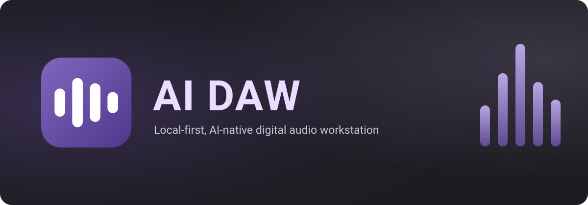

<p align="center">
  
</p>

<p align="center">
  <a href="https://github.com/heshengtao/ai-daw/releases"></a>
  <a href="LICENSE"></a>
  
  <a href="https://hub.docker.com/r/ailm32442/ai-daw"></a>
</p>

<p align="center">
  <a href="README_zh.md">简体中文</a> · <a href="README_zh-TW.md"><b>繁體中文</b></a> · <a href="README.md">English</a> · <a href="README_ja.md">日本語</a> ·
  <a href="README_ko.md">한국어</a> · <a href="README_es.md">Español</a> · <a href="README_fr.md">Français</a> · <a href="README_de.md">Deutsch</a> ·
  <a href="README_ru.md">Русский</a> · <a href="README_ar.md">العربية</a>
</p>

<p align="center">
  <a href="https://hub.docker.com/r/ailm32442/ai-daw"><b>Docker Hub</b></a> ·
  <a href="https://github.com/heshengtao/ai-daw/releases">下載</a>
</p>

## 什麼是 AI DAW？

**AI DAW 是一款輕巧、AI 原生的桌上型音樂工作室**——寫歌、編排、混音、母帶處理都在同一個輕量應用程式裡完成，同時還能讓 AI 代理和你一起在專案裡工作。

它是一款真正的 DAW：多音軌時間軸、鋼琴捲簾、帶送出與匯流排的混音台、自動化車道、內建合成器，以及 VST3 / CLAP / AU 外掛宿主。它同時也是**為了被模型操控而設計的**——隨儲存庫附帶的 Skill 能教會任何 AI Harness 透過 MCP 驅動正在執行的軟體，代理可以建立音軌、寫入音符、調整混音、進行分析，而你在介面上即時看著它發生。

一切都在你自己的電腦上執行。不要帳號、不要 API Key，音訊不出本機。


## 為什麼這件事值得做

模型之所以學會寫程式，是因為它們能透過程式設計代理框架**真的把程式跑起來**；模型之所以學會 3D 建模，是因為它們能透過 Blender MCP 操控真實的建模軟體。這兩者都讓模型拿到真實的工具、真實的結果和真實的回饋閉環——快速迭代正是從這裡來的。

音樂領域一直缺這個閉環。模型可以生成音訊，但它沒辦法像人一樣**在一個專案上工作**：沒有可編輯的編排、沒有可推的推桿、沒有復原歷史，也無從判斷自己上一步改動是不是把東西改壞了。

**AI DAW 就是為了填上這個缺口所做的一次輕巧而認真的嘗試。** 它是一款真正的 DAW，AI 代理可以透過 Skill 與 MCP 來操作它，因此它可以用來：

- **檢驗模型到底懂不懂寫歌**——不是看它生成的音訊像不像樣，而是看它能不能搭起編曲、挑出合適的聲部、把混音修好。
- **蒐集真實的寫歌軌跡**——代理的每一次修改都落在正常的專案裡、進入正常的復原歷史，於是一次工作階段就成了「模型如何思考音樂」的資料。
- **朝著「模型能像寫程式一樣寫歌」再走一步**——給它一個會回話的工具。

## 輕量化是設計目標

輕巧不是妥協，而是特性。

- **體積小**——沒有 Electron、不依賴雲端、不打包整批模型。macOS 版整包約 38 MB；作為對照，Ableton Live、Logic Pro、FL Studio 這類主流 DAW 的安裝體積通常在 1–3 GB，AI DAW 只有它們的 2%–4%，**體積縮小了 95% 以上**。
- **啟動快**——開機不載入任何笨重的東西，AI 模型只在你用到時才引入。
- **大型模型按需下載，不塞進安裝包**——大模型不做預設整合；**歌聲合成**（SoulX-Singer，1.4 GB）與**音色替換**（SoulX-Singer-SVC，2.4 GB）作為可選項放在「管理器 → 模型」裡，點一下才下載，不用就一點磁碟都不佔。
- **生來可擴充**——**應用擴充套件**（npm 套件）已經能給代理加工具、往右欄加面板；讓外部 AI 模型接進工作流程的接入介面還在路線圖上。

## 用任意 AI Harness 驅動它

AI DAW 附帶一個 **Skill**（`skills/aidaw`），它教會 AI 代理如何操作正在執行的軟體——讀寫專案、音軌、片段與音符；**分析曲風、查樂理 / 鼓譜、把曲風配方落成 MIDI**；混音（增益、聲像、送出、自動化）；走帶與錄音；響度與頻譜分析；匯出 WAV；掃描外掛。它透過內建的 **MCP** 伺服器運作，因此任何支援 Agent Skill 的 Harness 都能直接用。

App 還隨包內建了 18 件取樣樂器：**原聲鋼琴、尼龍弦木吉他、清音電吉他、指彈貝斯、原聲鼓組、弦樂群奏、慢弦樂、小提琴、中提琴、大提琴、低音提琴、弦樂撥奏、小號、法國號齊奏、合成弦樂 1/2、合成銅管 1/2**（SF3/SF2，總計約 13.5 MB），開箱即用。

**方式一 · 命令列安裝**

```bash
npx skills add heshengtao/ai-daw
```

**方式二 · 讓你的代理自己安裝**

```
Install this Skill: https://github.com/heshengtao/ai-daw
```

代理做的每一次修改都走與介面完全相同的指令管線：進入復原歷史、顯示在介面上、並署名給代理——所以你隨時能看到它做了什麼，也能隨時復原。想留在應用程式裡也一樣：頂欄的 **Write with AI** 把同一個閉環做成聊天面板（設定 → 文字生成）。

## 功能

### 靈感 —— 一句描述到一首成品

頂欄最左邊是**靈感**頁：整頁就是一個「寫 → 生成 → 試聽」的工作台，左邊寫，右邊聽。這裡沒有按讚、沒有分享，也沒有任何「升級解鎖」的門——歸你管的只有描述、歌詞和那條播放進度條。

- **一個下拉選單管兩種引擎** —— 本機 YuE2 / ACE-Step 權重與已設定的雲端服務（Suno / Mureka / Lyria …）在同一個清單裡，加一個服務不用改兩處介面
- **簡單 / 進階** —— 簡單模式給一句描述就出歌；進階模式自己寫歌詞（`[Verse]` / `[Chorus]` / `[Bridge]` / `[Outro]` 分段）、開啟**純音樂**開關，再調時長、步數、種子
- **批次出歌** —— 一次最多點 8 首，依序跑完，每首換一個新種子，出一首就在清單裡落一行
- **續寫一首** —— 每次本機生成都留一份語意碼，點「續寫」就接著這一首往下再寫一段——模型拿到的是結構，不只是音訊
- **缺什麼補什麼** —— 權重沒下、引擎沒裝、引擎沒起：點「生成」會按順序處理，不用先去別處找設定
- **成品排成一列** —— 按天分組，每首用**程式化封面**（色相跟著專案裡那條音軌走）、一個常駐播放鍵和一條播放進度條：點一下就聽、拖著就刮。選中的那張卡，就是底部走帶播放鍵控制的對象
- **紀錄留在本機** —— 生成紀錄只存在本機；清空清單不會動到專案，一首歌只有你點了「＋」才進專案、點了儲存才寫入磁碟

<p align="center">
  
</p>

### 編排與編輯 —— 在真正的時間軸上作曲

怎麼想的就怎麼擺。跨音軌拖曳片段，在音樂變化處切分，標尺與格線跟著可在曲中任意位置改變的速度與拍號走。MIDI 片段自帶音符預覽、音訊片段自帶波形，整首歌一眼就能讀出來。

- **多音軌編排** —— MIDI 與音訊片段並排，跨音軌拖放，框選
- **看得懂的鋼琴捲簾** —— 片段直接顯示音符；編輯器提供力度、縮放與虛擬鍵盤
- **五線譜與六線譜** —— 底部樂譜車道用同一批音符畫出五線譜或吉他六線譜，匯出時給出 MusicXML
- **動態速度與拍號** —— 任意位置變速 / 變拍，格線自動跟隨
- **走帶與循環** —— 播放、停止、定位、劃定循環區、節拍器
- **自動化車道** —— 為外掛或內建合成器暴露的任何參數畫曲線
- **工具跟著滑鼠走** —— 浮動工具島切換畫筆 / 擦除 / 框選 / 切分 / 填詞，底部窗格一鍵在自動化、樂譜與鍵盤之間換
- **完整的編輯工具** —— 切分、移動、複製貼上、復原 / 重做，還帶一張快速鍵速查表

<p align="center">
  
</p>

### 混音與母帶 —— 把作品做完

先做平衡，再做響度。通道條提供增益、聲像、送出、匯流排、靜音 / 獨奏與電平表；匯流排上的母帶鏈負責響度、峰值與立體聲寬度，不用離開應用程式就能匯出成品。

- **混音台** —— 增益、聲像、送出、匯流排、靜音 / 獨奏、電平表
- **內建效果器** —— 動態、均衡與時間類效果，隨手加到任意音軌
- **母帶鏈** —— 響度正規化、真峰值限幅、立體聲寬度
- **內建合成器** —— 振盪器、包絡、濾波，配即時示波器
- **匯出** —— 無損 WAV、LAME 編碼的 MP3（取樣率與位元率自己挑）、標準 MIDI 檔案，或 MusicXML 樂譜

<p align="center">
  
</p>

### 外掛 —— 帶上你自己的樂器與效果器

AI DAW 支援 **VST3** 與 **CLAP** 外掛（Windows / macOS / Linux），在 macOS 上還額外支援 **Audio Units（AU / AUv3）**，你既有的工具可以直接帶過來。外掛管理器能搜尋開放註冊表，按類型與系統相容性篩選，一鍵安裝 / 更新 / 解除安裝——也可以直接指向你本機已經裝好的外掛。

- **VST3 / CLAP / AU 宿主** —— 在任意音軌載入第三方樂器與效果器（AU 與 AUv3 限 macOS）
- **外掛管理器** —— 搜尋註冊表，按樂器 / 效果與平台篩選，安裝 / 更新 / 解除安裝
- **本機匯入** —— 把已經在別處裝好的外掛接進來
- **介面與參數** —— 開啟外掛自帶的介面，或從檢查器與自動化車道驅動它的參數；沒有自帶介面的 AU 也能拿到通用參數面板
- **取樣音色庫** —— 直接匯入自己的 `.sf2` / `.sf3`（一個庫展開成幾十上百個預設），或從內建的 SoundFont 索引一鍵裝 MuseScore General、FluidR3、FreePats 等開源庫
- **一個下載管理器** —— 外掛、音色庫、AI 模型與執行環境都在同一個管理器裡，帶即時進度、取消與單項安裝狀態

<p align="center">
  
</p>

### 應用擴充套件 —— 擴充應用程式本身

音訊外掛擴充的是聲音，**應用擴充套件**擴充的是應用程式本身。它以 npm 套件散佈，既能給代理加 **MCP 工具**，也能往右欄註冊**面板**——你缺的那套工作流程，不用 fork 整個應用程式就能補上。

- **npm 散佈** —— 從索引（`index.json`）或直接從一個 npm registry 安裝；`engines.aidaw` 宣告它支援哪些應用程式版本，鏡像位址用來應付離線 / 內部網路環境
- **探索與已安裝** —— 面板一半列你索引裡能拿到的（版本、作者、安裝 / 更新），一半列正在跑的（狀態、工具、面板、啟用 / 重新載入 / 解除安裝）
- **一個擴充套件的兩面** —— 伺服端工具跑在 daemon 的 QuickJS 宿主裡，走與介面同一套指令操作專案；用戶端面板是載入進 webview 的 ESM，支援熱重載
- **也能裝本機資料夾** —— 「匯入資料夾」裝你自己正在寫的擴充套件；`examples/extensions/hello` 是最小參考（一個工具、一個面板）
- **不是音訊外掛鏈** —— VST3 / CLAP / AU 見上面的「外掛」；這一節說的是應用程式，不是混音台

<p align="center">
  
</p>

### 本機 AI —— 把音訊變成能繼續加工的材料

這些 AI 功能是為真實的作品準備的，不是展示品。把一段素材交給它，拿回來的是能接著編輯的東西：可以挪動的 MIDI 音符、更乾淨的人聲、可以重新配比的分軌。全部跑在你自己的硬體上——預設 CPU，可選 CoreML（macOS）與 DirectML（Windows）加速。每一件事都在同一個 **AI 面板**裡，用**全部 / 生成 / 轉換**三個標籤篩選，每一列都直接告訴你模型裝了沒。

- **節拍偵測** —— Beat This!（ISMIR 2024）一次推論得出全域 BPM 與拍號
- **音訊轉 MIDI** —— Basic Pitch 把錄下的演奏變成可編輯的音符；也可以在「AI → 音訊轉 MIDI → 模型」裡換成 **MuScriptor**（走 audio.cpp 引擎）：多樂器轉錄，按樂器自動分軌。393 MB–5.1 GB 按需下載（CC BY-NC 4.0，非商用授權）
- **人聲降噪 / 去殘響** —— LocalVQE 處理人聲素材
- **音源分離** —— HTDemucs v4 拆成 4 / 6 條分軌，方便重新配比
- **歌聲合成** —— 一段 MIDI 旋律 + 歌詞 + 一條參考聲線，變出一條能繼續編輯的歌聲軌（SoulX-Singer，zero-shot 音色複製）。歌詞可以逐音寫在鋼琴捲簾裡（`-` 連音），參考聲線能存進**人聲音色庫**跨專案重複使用——換音色就是換一條參考
- **音色替換** —— 把一段**既有的人聲**換成另一條參考聲線，旋律 / 歌詞 / 節奏原樣保留（SoulX-Singer-SVC，zero-shot）。結果落在來源音軌下面，一次復原可整批退回；先做一次「音源分離 → 人聲」再替換，混音裡的伴奏就不會干擾音高判斷
- **生來離線** —— 不要帳號、不要 API Key、不上傳任何東西

<p align="center">
  
</p>

### MCP 伺服器 —— 讓 AI 代理在你的專案裡工作

打開一個開關，你的專案就變成 AI 助理可以操作的對象。內建的 **MCP（Model Context Protocol）伺服器**把工作階段透過只監聽 `127.0.0.1` 的 HTTP 端點開放出去——接上你的代理、給它一個任務，就能看它加片段、改音符、調電平，介面即時跟著變。`aidaw` 命令列就是同一個伺服器的輕量用戶端。

- **MCP over HTTP** —— 只監聽回環位址的接入點
- **即時改專案** —— 代理的操作會立刻以正常的專案改動出現
- **應用程式內的寫歌代理** —— 頂欄的 **Write with AI** 打開一個聊天面板，走的是同一套工具；在「設定 → 文字生成」裡接任意 OpenAI 相容模型即可
- **`aidaw` 命令列** —— 可在設定裡一鍵掛到 `PATH`

<p align="center">
  
</p>

## 安裝

預先編譯的安裝包將發佈在 [GitHub Releases](https://github.com/heshengtao/ai-daw/releases) 頁面；在那之前請從原始碼建置。

### 環境需求

- Rust（stable）與 Cargo
- Node.js ≥ 18 與 [pnpm](https://pnpm.io/)
- Tauri v2 所需的系統相依套件 —— 見 <https://tauri.app/start/prerequisites/>

### 從原始碼建置

```bash
git clone https://github.com/heshengtao/ai-daw.git
cd ai-daw

pnpm install
pnpm tauri dev        # 以開發模式執行
pnpm tauri build      # 打包發行版本
```

其它常用指令：

```bash
pnpm build            # 對前端做型別檢查並建置
pnpm build:aidaw      # 建置 aidaw CLI（見 tools/build-aidaw.sh）
```

### 平台支援

| 平台 | 狀態 |
| --- | --- |
| Windows (x86_64) |  支援 |
| macOS（Apple Silicon） |  支援（.dmg 首次開啟見「App 已損壞」說明） |
| Linux (x86_64 / arm64) |  支援 |

> **macOS 提示「App 已損壞，無法開啟」？** 應用程式為自簽章（未公證），從網路下載會帶上隔離屬性。在終端機執行下面這行指令後即可正常開啟：
>
> ```bash
> xattr -cr "/Applications/AI DAW.app"
> ```

> **暫不支援 Intel Mac。** ONNX Runtime 不提供 `x86_64-apple-darwin` 的預先編譯二進位檔，
> 本機 AI 模型無法為 Intel macOS 連結。

## 瀏覽器存取與無頭執行

AI DAW 可以**不開視窗**執行，把同一套介面提供給區域網路裡的任意瀏覽器。桌面端和瀏覽器端
驅動的是**同一個工作階段** —— 同一份專案、同一條復原歷史、同一個音訊引擎。

### Docker（預先建置映像檔）

```bash
docker run -d --name ai-daw -p 28430:28430 -v ai-daw-data:/data ailm32442/ai-daw
```

映像檔隨 `v*` 發版發佈，`latest` 指向最近一次發版；日常 main 提交不再重建映像檔，
需要驗證 `Dockerfile` 時在 Actions 裡手動執行一次 `Docker (ai-daw)` 即可。

瀏覽器打開 <http://localhost:28430> 就能直接用 —— **沒有登入、沒有權杖、也沒有 cookie 驗證**。
無頭版是給沒有螢幕的機器準備的，存取控制交給部署端（區域網路 / 容器網路 / 反向代理）。

容器裡通常**沒有音效卡**：這時音訊引擎會切到**虛擬時鐘**，按即時節奏照常渲染，
播放位置 / 循環 / 電平表全部正常，聲音透過 `/audio` 送到瀏覽器——**網頁就是音效卡**。
底欄會出現「虛擬時鐘」膠囊說明這件事（點它可以重試音訊裝置）。想在有音效卡的機器上
也強制走這條路，設 `AIDAW_AUDIO=virtual`。

**外掛原生介面也是可用的**：容器裡沒有視窗系統，但映像檔自帶 Xvfb——外掛照常在虛擬顯示器上
畫自己的介面，daemon 把它編碼成影格流送到頁面，滑鼠鍵盤再轉發回去。所以 VST3 / CLAP 的
編輯器在瀏覽器裡就是一塊「網頁內視窗」，和桌面上彈出來的那扇是同一個介面。
（桌面殼裡點「開啟介面」仍然直接彈原生視窗，保真度和延遲都更好。）
用 `AIDAW_GUI_STREAM=0` 可以關掉虛擬顯示器省記憶體，這時只能改參數、看不到介面。
映像檔現在約 **585 MB**（1.8.0 之前大約 286 MB）：多出來的部分是 Xvfb 與 Mesa 軟體
OpenGL——有些外掛介面要用 OpenGL 畫，沒有 `libgl1-mesa-dri` 會直接黑屏。如果你的外掛都不吃
GL，去掉 `libgl1` / `libglx-mesa0` 兩行可以省回約 150 MB。


### Docker（自己建置）

```bash
git clone https://github.com/heshengtao/ai-daw.git
cd ai-daw
docker build -t ai-daw .
docker run -d -p 28430:28430 -v ai-daw-data:/data ai-daw
```

### 無頭二進位檔

```bash
npm run build
cargo run -p ai-daw-daemon --no-default-features --bin aidawd -- --data-dir ~/.ai-daw --port 28430 --web-dir dist
```

### 環境變數

| 變數 | 預設值 | 作用 |
| --- | --- | --- |
| `AIDAW_DATA_DIR` | 映像檔內 `/data` | 工作階段、預設、模型 |
| `AIDAW_WEB_DIR` | 映像檔內 `/web` | 要託管的前端產物 |
| `AIDAW_NO_AUDIO` | 未設定 | 跳過開啟音訊裝置（沒有音效卡的容器） |
| `AIDAW_AUDIO` | 未設定 | `virtual` = 不碰音效卡，強制虛擬時鐘（聲音只走 `/audio`） |
| `AIDAW_MODELS_EXTRA` | 映像檔內 `/opt/models` | 隨包模型的額外搜尋目錄（`:` 分隔，排在下載落點之後） |
| `AIDAW_ORT_BUNDLED` | 映像檔內 `/opt/ort` | 隨包 ONNX Runtime 目錄 |
| `AIDAW_ARTICULATION_MAPS` | 映像檔內 `/opt/articulation-maps` | 隨包奏法對應庫目錄 |
| `AIDAW_MCP_URL` | 自動探索 | `aidaw` 命令列去哪裡找正在執行的應用程式 |


> 無頭模式也會啟動內嵌 MCP server（設定在 `<資料目錄>/mcp.json`，預設關閉），
> 打開後可在容器裡讓 AI 透過 MCP 直接操作同一份專案。

### HTTP 介面

| 方法 | 路徑 | 用途 |
| --- | --- | --- |
| `POST` | `/rpc/{command}` | 全部指令，名稱與參數和應用程式內 IPC 完全一致（`GET /commands` 可列出目前可用項） |
| `GET` | `/events` | SSE：編輯事件與走帶狀態 |
| `GET` | `/audio` | WebSocket：即時 PCM（48 kHz 立體聲 float32，約 10 ms 一塊） |
| `GET` | `/health` | 存活狀態 + 是否有可用的音訊裝置 |
| `GET` | `/commands` | 伺服端支援的全部指令名稱 |

## 架構

```
src-tauri/          Tauri 外殼：視窗、外掛原生介面、自動更新
crates/daemon/      整個後端：專案引擎、音訊宿主、MCP、HTTP
crates/engine/      DSP + 排程 + 渲染（不依賴 Tauri）
crates/ipc/         應用程式 / CLI / MCP 共用的指令與事件 schema
crates/extensions/  應用擴充套件宿主：npm 安裝、清單、QuickJS 工具與用戶端面板
src/                Vue 3 前端 —— 桌面與瀏覽器是同一份
```

前端從不直接和 Rust 溝通：`src/api/ipc.ts` 在 `Tauri IPC` 與 `HTTP + SSE + WebSocket`
之間切換傳輸層。所以瀏覽器版不是「移植」，而是同一個應用程式透過網路存取同一個後端。

## 常見問題

### AI DAW 是免費的嗎？

是。AI DAW 以 Apache 2.0 開源，沒有付費方案，也沒有功能閹割。

### 能離線使用嗎？

能。應用程式與所有 AI 模型都在本機執行。唯一的連網行為是下載外掛套件與 AI 模型、拉取外掛與擴充套件索引（都由你發起），以及你設定了雲端音樂服務時的呼叫。

### 需要顯示卡嗎？

不需要。AI 模型預設走 CPU；macOS 可用 CoreML、Windows 可用 DirectML（需硬體支援），兩者都是可選項。

### 哪些 AI 模型隨應用程式一起提供？

兩個小模型隨包：**Basic Pitch**（音訊轉 MIDI）與 **LocalVQE**（人聲降噪），裝好即可用。較大的模型——**Beat This!**（節拍偵測）與 **HTDemucs**（音源分離，4 / 6 分軌）——首次使用時由應用程式內的模型管理器按需下載，存放在原始碼樹之外。

模型權重從不進入儲存庫或安裝包，各自沿用發佈方的授權：見 [MODELS.md](MODELS.md)。其中包含可選的 CC BY-NC 4.0（非商用）模型——寫歌用的 **YuE2** 與錄音轉譜用的 **SheetSage2**。

### 支援哪些外掛格式？

VST3 與 CLAP（Windows / macOS / Linux），macOS 上還額外支援 **Audio Units（AU / AUv3）**。

### 介面支援哪些語言？

簡體中文、繁體中文、English、日本語、한국어、Español、Français、Deutsch、Русский、العربية 十種。在**設定 → 一般 → 語言**裡隨時切換；選擇會被記住，沒選之前跟隨系統語言。詞典都在 `src/i18n/`，某一條沒翻譯時自動回退到英文。阿拉伯語文字完整支援，介面會整體鏡像（RTL）；只有時間軸、樂譜與混音器保持由左至右，因為 DAW 的時間軸本來就該從左往右讀。README 也提供同樣十種語言。

### 需要一直開著應用程式才能讓代理驅動嗎？

需要。Skill 與 `aidaw` 命令列都透過 MCP 連線正在執行的 AI DAW，所以先把應用程式打開（`aidaw status` 會告訴你它有沒有起來）。

## 支持我們

### 請給我們點個 Star！
⭐ 你的支持是我們前進的動力！

### 歡迎打賞！
<div align="center" style="display: flex; gap: 20px; justify-content: center; flex-wrap: wrap;">

[](https://ko-fi.com/agentparty)
[](https://afdian.com/a/agentparty)

</div>

### 關注我們
<div align="center">
  <a href="https://space.bilibili.com/26978344">
    
  </a>
  <a href="https://www.youtube.com/@agentParty">
    
  </a>
</div>

### 加入社群
如果你在使用過程中遇到任何問題，歡迎加入我們的社群交流。

1. QQ 群：`931057213`（1 群已滿） `902882342`（2 群）

2. Discord: [Discord 連結](https://discord.gg/f2dsAKKr2V)

## 貢獻者

<a href="https://github.com/heshengtao/ai-daw/graphs/contributors">
  
</a>

## 授權條款

**程式碼**是 Apache-2.0，見 [LICENSE](LICENSE)。

模型**權重**是另一層：它們從不進入本儲存庫或安裝包，各自沿用發佈方的授權，由應用程式在
需要時按需下載（下載時逐個校驗 `sha256`）。完整的模型 / 來源 / 授權對照表見
**[MODELS.md](MODELS.md)**。

其中少數可選模型是 **CC BY-NC 4.0（非商用）**——寫歌用的 YuE2 與錄音轉譜用的
SheetSage2。它們都是「使用者點了才下載」的可選檔：除非你從發佈方拿到了商業授權，否則
不要把這些權重用於商業用途。生成的音訊 / MIDI 歸你所有，但受上游條款約束，且你需對
輸入音訊持有相應權利。

## 第三方授權條款

本專案建立在第三方開源軟體之上。改編自其它專案的檔案，以及授權不在寬鬆預設集合內的相依套件，都記錄在 [NOTICE](NOTICE) 中。
