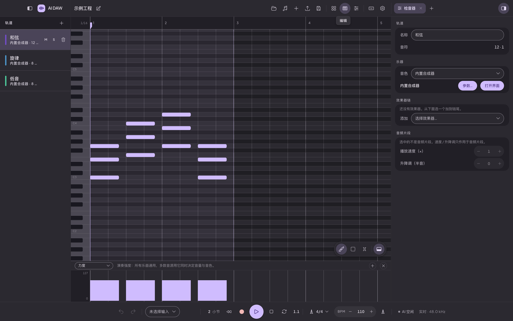
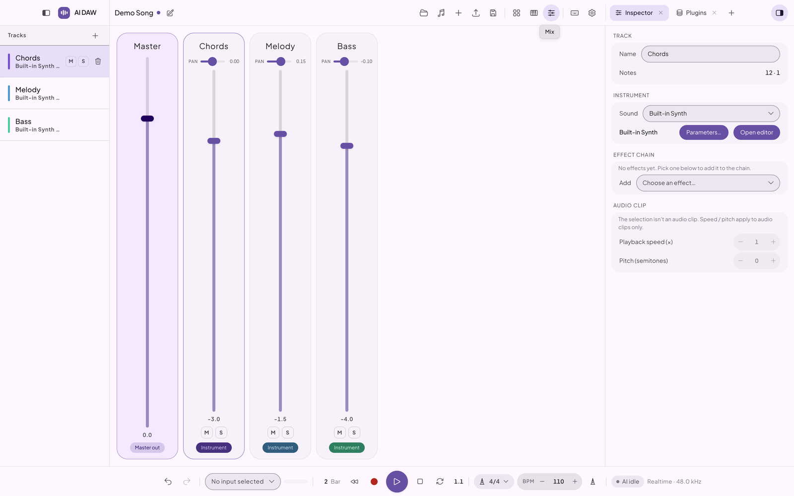
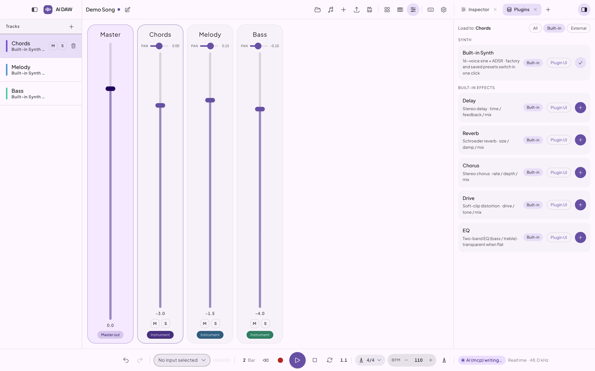
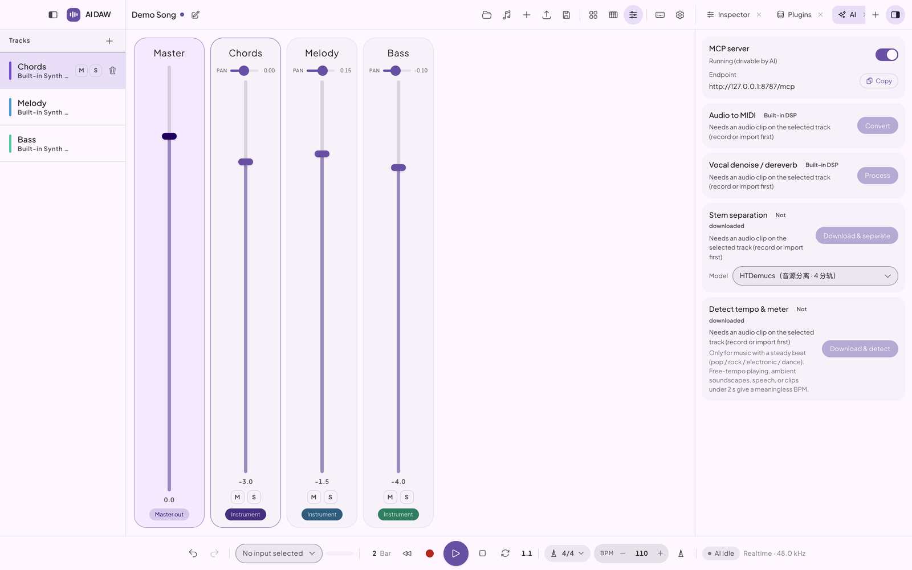
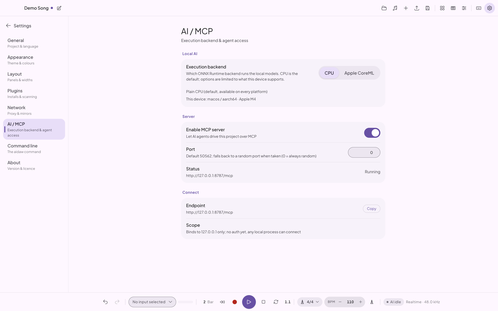

<p align="center">
  
</p>

<p align="center">
  <a href="https://github.com/heshengtao/ai-daw/releases"></a>
  <a href="LICENSE"></a>
  
  <a href="https://hub.docker.com/r/ailm32442/ai-daw"></a>
</p>

<p align="center">
  <a href="README_zh.md"><b>简体中文</b></a> ·
  <a href="README.md"><b>English</b></a>
</p>

<p align="center">
  <a href="https://hub.docker.com/r/ailm32442/ai-daw"><b>Docker Hub</b></a> ·
  <a href="https://github.com/heshengtao/ai-daw/releases">Download</a>
</p>

## 什么是 AI DAW？

**AI DAW 是一款小巧、AI 原生的桌面音乐工作室**——写作、编排、混音、母带都在一个轻量应用里完成，同时还能让 AI 代理和你一起在工程里干活。

它是一款真正的 DAW：多轨道时间线、钢琴卷帘、带发送与总线的调音台、自动化车道、内置合成器，以及 VST3 / CLAP / AU 插件宿主。它同时也是**为被模型操控而设计的**——随仓库附带的 Skill 能教会任意 AI Harness 通过 MCP 驱动正在运行的软件，代理可以建轨、写音符、调混音、做分析，而你在界面上实时看着它发生。

一切都在你自己的电脑上运行。不要账号、不要 API Key、音频不出本机。


## 为什么这件事值得做

模型之所以学会写代码，是因为它们能通过编程智能体框架**真的把代码跑起来**；模型之所以学会 3D 建模，是因为它们能通过 Blender MCP 操控真实的建模软件。这两者都让模型拿到了真实的工具、真实的结果和真实的反馈闭环——快速迭代正是从这里来的。

音乐领域一直缺这个闭环。模型可以生成音频，但它没法像人一样**在一个工程上工作**：没有可编辑的编排、没有可推的推子、没有撤销历史，也无从判断自己上一步改动是不是把东西改坏了。

**AI DAW 就是为填上这个缺口做的一次小巧而认真的尝试。** 它是一款真正的 DAW，AI 代理可以通过 Skill 与 MCP 来操作它，因此它可以用来：

- **检验模型到底懂不懂写歌**——不是看它生成的音频像不像样，而是看它能不能搭起编曲、选出合适的声部、把混音修好。
- **采集真实的写歌轨迹**——代理的每一次修改都落在正常的工程里、进入正常的撤销历史，于是一次会话就成了「模型如何思考音乐」的数据。
- **朝着「模型能像写代码一样写歌」再走一步**——给它一个会回话的工具。

## 轻量化是设计目标

小巧不是妥协，而是特性。

- **体积小**——没有 Electron、不依赖云、不打包模型全家桶。macOS 版整包约 38 MB；作为参照，Ableton Live、Logic Pro、FL Studio 这类主流 DAW 的安装体积通常在 1–3 GB，AI DAW 只有它们的 2%–4%，**体积缩小了 95% 以上**。
- **启动快**——开机不加载任何重东西，AI 模型只在你用到时才引入。
- **重模型按需下载，不塞进安装包**——大模型不做默认集成；**歌声合成**（SoulX-Singer，1.4 GB）与**音色替换**（SoulX-Singer-SVC，2.4 GB）作为可选项放在「管理器 → 模型」里，点一下才下载，不用就一点磁盘都不占。
- **生来可扩展**——让外部 AI 模型接进工作流的接入接口已在路线图上。

## 用任意 AI Harness 驱动它

AI DAW 附带一个 **Skill**（`skills/aidaw`），它教会 AI 代理如何操作正在运行的软件——读写工程、轨道、片段与音符；**分析曲风、查乐理/鼓谱、把曲风配方落成 MIDI**；混音（增益、声像、发送、自动化）；传输与录音；响度与频谱分析；导出 WAV；扫描插件。它通过内置的 **MCP** 服务器工作，因此任何支持 Agent Skill 的 Harness 都能直接用。

App 还随包内置了 18 件采样乐器：**原声钢琴、尼龙弦木吉他、清音电吉他、指弹贝斯、原声鼓组、弦乐群奏、慢弦乐、小提琴、中提琴、大提琴、低音提琴、弦乐拨奏、小号、圆号齐奏、合成弦乐 1/2、合成铜管 1/2**（SF3/SF2，总计约 13.5 MB），开箱即用。

**方式一 · 命令行安装**

```bash
npx skills add heshengtao/ai-daw
```

**方式二 · 让你的代理自己装**

```
Install this Skill: https://github.com/heshengtao/ai-daw
```

代理做的每一次修改都走与界面完全相同的命令管线：进入撤销历史、显示在界面上、并署名给代理——所以你随时能看到它做了什么，也能随时撤销。

## 功能

### 灵感 —— 一句描述到一首成品

顶栏最左边是**灵感**页：整页就是一个「写 → 生成 → 试听」的工作台，左边写，右边听。这里没有点赞、没有分享，也没有任何「升级解锁」的门——归你管的只有描述、歌词和那条播放进度条。

- **一个下拉管两种引擎** —— 本地 YuE2 / ACE-Step 权重与已配置的云端服务（Suno / Mureka / Lyria …）在同一个列表里，加一个服务不用改两处界面
- **简单 / 进阶** —— 简单模式给一句描述就出歌；进阶模式自己写歌词，用 `[Verse]` / `[Chorus]` / `[Bridge]` / `[Outro]` 分段，再调时长、步数、种子
- **缺什么补什么** —— 权重没下、引擎没装、引擎没起：点「生成」会按顺序处理，不用先去别处找设置
- **成品排成一列** —— 按天分组，每首用**波形缩略**当封面、颜色跟着工程里那条轨道走；行底就是这条音频的播放进度条，点一下就听、拖着就刮
- **记录留在本机** —— 生成记录只存在本地；清空列表不会动工程里的轨道与音频文件

### 编排与编辑 —— 在真正的时间线上作曲

怎么想的就怎么摆。跨轨道拖拽片段，在音乐变化处切分，标尺与网格跟着可在曲中任意位置改变的速度与拍号走。MIDI 片段自带音符预览、音频片段自带波形，整首歌一眼就能读出来。

- **多轨道编排** —— MIDI 与音频片段并排，跨轨道拖放，框选
- **看得懂的钢琴卷帘** —— 片段直接显示音符；编辑器提供力度、缩放与键盘
- **动态速度与拍号** —— 任意位置变速 / 变拍，网格自动跟随
- **走带与循环** —— 播放、停止、定位、划定循环区、节拍器
- **自动化车道** —— 为插件或内置合成器暴露的任何参数画曲线
- **完整的编辑工具** —— 切分、移动、复制粘贴、撤销 / 重做，还带一张快捷键速查表

<p align="center">
  
</p>

### 混音与母带 —— 把作品做完

先做平衡，再做响度。通道条提供增益、声像、发送、总线、静音 / 独奏与电平表；总线上的母带链负责响度、峰值与立体声宽度，不用离开应用就能导出成品。

- **调音台** —— 增益、声像、发送、总线、静音 / 独奏、电平表
- **内置效果器** —— 动态、均衡与时间类效果，随手加到任意轨道
- **母带链** —— 响度归一、真峰值限幅、立体声宽度
- **内置合成器** —— 振荡器、包络、滤波，配实时示波器
- **导出** —— 无损 WAV、LAME 编码的 MP3（采样率与比特率自己挑）、标准 MIDI 文件，或 MusicXML 乐谱

<p align="center">
  
</p>

### 插件 —— 带你自己的乐器与效果器

AI DAW 支持 **VST3** 与 **CLAP** 插件（Windows / macOS / Linux），在 macOS 上还额外支持 **Audio Units（AU / AUv3）**，你已有的工具可以直接带过来。插件管理器能搜索开放注册表，按类型与系统兼容性筛选，一键安装 / 更新 / 卸载——也可以直接指向你本机已经装好的插件。

- **VST3 / CLAP / AU 宿主** —— 在任意轨道加载第三方乐器与效果器（AU 与 AUv3 限 macOS）
- **插件管理器** —— 搜索注册表，按乐器 / 效果与平台筛选，安装 / 更新 / 卸载
- **本地导入** —— 把已经在别处装好的插件接进来
- **界面与参数** —— 打开插件自带的界面，或从检查器与自动化车道驱动它的参数；没有自带界面的 AU 也能拿到通用参数面板
- **采样音色库** —— 直接导入自己的 `.sf2` / `.sf3`（一个库展开成几十上百个预设），或从内置的 SoundFont 索引一键装 MuseScore General、FluidR3、FreePats 等开源库

<p align="center">
  
</p>

### 本地 AI —— 把音频变成能继续加工的材料

这些 AI 功能是为真实的作品准备的，不是演示品。把一段素材交给它，拿回来的是能接着编辑的东西：可以挪动的 MIDI 音符、更干净的人声、可以重新配比的分轨。全部跑在你自己的硬件上——默认 CPU，可选 CoreML（macOS）与 DirectML（Windows）加速。

- **节拍检测** —— Beat This!（ISMIR 2024）一次推理得出全局 BPM 与拍号
- **音频转 MIDI** —— Basic Pitch 把录下的演奏变成可编辑的音符；也可以在「AI → 音频转 MIDI → 模型」里换成 **MuScriptor**（走 audio.cpp 引擎）：多乐器转录，按乐器自动分轨。393 MB–5.1 GB 按需下载（CC BY-NC 4.0，非商用许可）
- **人声降噪 / 去混响** —— LocalVQE 处理人声素材
- **音源分离** —— HTDemucs v4 拆成 4 / 6 条分轨，方便重新配比
- **歌声合成** —— 一段 MIDI 旋律 + 歌词 + 一条参考声线，变出一条能继续编辑的歌声轨（SoulX-Singer，zero-shot 音色克隆）。歌词可以逐音写在钢琴卷帘里（`-` 连音），参考声线能存进**人声音色库**跨工程复用——换音色就是换一条参考
- **音色替换** —— 把一段**已有的人声**换成另一条参考声线，旋律 / 歌词 / 节奏原样保留（SoulX-Singer-SVC，zero-shot）。结果落在源轨下面，一次撤销可整体回退；先做一次「音源分离 → 人声」再替换，混音里的伴奏就不会干扰音高判断
- **生来离线** —— 不要账号、不要 API Key、不上传任何东西

<p align="center">
  
</p>

### MCP 服务器 —— 让 AI 代理在你的工程里干活

打开一个开关，你的工程就变成 AI 助手可以操作的对象。内置的 **MCP（Model Context Protocol）服务器**把会话通过只监听 `127.0.0.1` 的 HTTP 端点开放出去——接上你的代理、给它一个任务，就能看它加片段、改音符、调电平，界面实时跟着变。`aidaw` 命令行就是同一个服务器的薄客户端。

- **MCP over HTTP** —— 只监听回环地址的接入点
- **实时改工程** —— 代理的操作会立刻以正常的工程改动出现
- **`aidaw` 命令行** —— 可在设置里一键挂到 `PATH`

<p align="center">
  
</p>

## 安装

预编译安装包将发布在 [GitHub Releases](https://github.com/heshengtao/ai-daw/releases) 页面；在那之前请从源码构建。

### 环境要求

- Rust（stable）与 Cargo
- Node.js ≥ 18 与 [pnpm](https://pnpm.io/)
- Tauri v2 所需的系统依赖 —— 见 <https://tauri.app/start/prerequisites/>

### 从源码构建

```bash
git clone https://github.com/heshengtao/ai-daw.git
cd ai-daw

pnpm install
pnpm tauri dev        # 开发模式运行
pnpm tauri build      # 打包发布版本
```

其它常用命令：

```bash
pnpm build            # 对前端做类型检查并构建
pnpm build:aidaw      # 构建 aidaw CLI（见 tools/build-aidaw.sh）
```

### 平台支持

| 平台 | 状态 |
| --- | --- |
| Windows (x86_64) |  支持 |
| macOS（Apple Silicon） |  支持（.dmg 首次打开见「App 已损坏」说明） |
| Linux (x86_64 / arm64) |  支持 |

> **macOS 提示「App 已损坏，无法打开」？** 应用为自签名（未公证），从网络下载会带上隔离属性。在终端执行下面这行命令后即可正常打开：
>
> ```bash
> xattr -cr "/Applications/AI DAW.app"
> ```

> **暂不支持 Intel Mac。** ONNX Runtime 不提供 `x86_64-apple-darwin` 的预编译二进制，
> 本地 AI 模型无法为 Intel macOS 链接。

## 浏览器访问与无头运行

AI DAW 可以**不开窗口**运行，把同一套界面提供给局域网里的任意浏览器。桌面端和浏览器端
驱动的是**同一个会话** —— 同一份工程、同一条撤销历史、同一个音频引擎。

### Docker（预构建镜像）

```bash
docker run -d --name ai-daw -p 28430:28430 -v ai-daw-data:/data ailm32442/ai-daw
```

镜像随 `v*` 发版发布，`latest` 指向最近一次发版；日常 main 提交不再重建镜像，
需要验证 `Dockerfile` 时在 Actions 里手动跑一次 `Docker (ai-daw)` 即可。

浏览器打开 <http://localhost:28430> 就能直接用 —— **没有登录、没有令牌、也没有 cookie 校验**。
无头版是给没有显示器的机器准备的，访问控制交给部署侧（局域网 / 容器网络 / 反向代理）。

容器里通常**没有声卡**：这时音频引擎会切到**虚拟时钟**，按实时节奏照常渲染，
播放位置 / 循环 / 电平表全部正常，声音通过 `/audio` 送到浏览器——**网页就是声卡**。
底栏会出现「虚拟时钟」胶囊说明这件事（点它可以重试音频设备）。想在有声卡的机器上
也强制走这条路，设 `AIDAW_AUDIO=virtual`。

**插件原生界面也是可用的**：容器里没有窗口系统，但镜像自带 Xvfb——插件照常在虚拟显示上
画自己的界面，daemon 把它编码成帧流送到页面，鼠标键盘再转发回去。所以 VST3 / CLAP 的
编辑器在浏览器里就是一块"网页内窗口"，和桌面上弹出来的那扇是同一个界面。
（桌面壳里点「打开界面」仍然直接弹原生窗口，保真度和延迟都更好。）
用 `AIDAW_GUI_STREAM=0` 可以关掉虚拟显示省内存，这时只能改参数、看不到界面。
镜像现在约 **585 MB**（比 1.8.0 之前大约 286 MB）：多出来的部分是 Xvfb 与 Mesa 软件
OpenGL——有些插件界面要用 OpenGL 画，没有 `libgl1-mesa-dri` 会直接黑屏。如果你的插件都不吃
GL，去掉 `libgl1` / `libglx-mesa0` 两行可以省回约 150 MB。


### Docker（自己构建）

```bash
git clone https://github.com/heshengtao/ai-daw.git
cd ai-daw
docker build -t ai-daw .
docker run -d -p 28430:28430 -v ai-daw-data:/data ai-daw
```

### 无头二进制

```bash
npm run build
cargo run -p ai-daw-daemon --no-default-features --bin aidawd -- --data-dir ~/.ai-daw --port 28430 --web-dir dist
```

### 环境变量

| 变量 | 默认值 | 作用 |
| --- | --- | --- |
| `AIDAW_DATA_DIR` | 镜像内 `/data` | 会话、预设、模型 |
| `AIDAW_WEB_DIR` | 镜像内 `/web` | 要托管的前端产物 |
| `AIDAW_NO_AUDIO` | 未设置 | 跳过打开音频设备（没有声卡的容器） |
| `AIDAW_AUDIO` | 未设置 | `virtual` = 不碰声卡，强制虚拟时钟（声音只走 `/audio`） |
| `AIDAW_MODELS_EXTRA` | 镜像内 `/opt/models` | 随包模型的额外搜索目录（`:` 分隔，排在下载落点之后） |
| `AIDAW_ORT_BUNDLED` | 镜像内 `/opt/ort` | 随包 ONNX Runtime 目录 |
| `AIDAW_ARTICULATION_MAPS` | 镜像内 `/opt/articulation-maps` | 随包奏法映射库目录 |
| `AIDAW_MCP_URL` | 自动发现 | `aidaw` 命令行去哪里找正在运行的应用 |


> 无头模式也会启动内嵌 MCP server（配置在 `<数据目录>/mcp.json`，默认关闭），
> 打开后可在容器里让 AI 通过 MCP 直接操作同一份工程。

### HTTP 接口

| 方法 | 路径 | 用途 |
| --- | --- | --- |
| `POST` | `/rpc/{command}` | 全部命令，名字与参数和应用内 IPC 完全一致（`GET /commands` 可列出当前可用项） |
| `GET` | `/events` | SSE：编辑事件与传输状态 |
| `GET` | `/audio` | WebSocket：实时 PCM（48 kHz 立体声 float32，约 10 ms 一块） |
| `GET` | `/health` | 存活状态 + 是否有可用音频设备 |
| `GET` | `/commands` | 服务端支持的全部命令名 |

## 架构

```
src-tauri/          Tauri 外壳：窗口、插件原生界面、自动更新
crates/daemon/      整个后端：工程引擎、音频宿主、MCP、HTTP
crates/engine/      DSP + 调度 + 渲染（不依赖 Tauri）
crates/ipc/         应用 / CLI / MCP 共用的命令与事件 schema
src/                Vue 3 前端 —— 桌面与浏览器是同一份
```

前端从不直接和 Rust 通信：`src/api/ipc.ts` 在 `Tauri IPC` 与 `HTTP + SSE + WebSocket`
之间切换传输层。所以浏览器版不是"移植"，而是同一个应用通过网络访问同一个后端。

## 常见问题

### AI DAW 是免费的吗？

是。AI DAW 以 Apache 2.0 开源，没有付费档位，也没有功能阉割。

### 能离线使用吗？

能。应用与所有 AI 模型都在本地运行。唯一的联网行为是下载插件包与 AI 模型（由你发起），以及拉取插件注册表。

### 需要显卡吗？

不需要。AI 模型默认走 CPU；macOS 可用 CoreML、Windows 可用 DirectML（需硬件支持），两者都是可选项。

### 哪些 AI 模型随应用一起提供？

两个小模型随包：**Basic Pitch**（音频转 MIDI）与 **LocalVQE**（人声降噪），装好即可用。较大的模型——**Beat This!**（节拍检测）与 **HTDemucs**（音源分离，4 / 6 分轨）——首次使用时由应用内的模型管理器按需下载，存放在源码树之外。

模型权重从不进入仓库或安装包，各自沿用发布方的许可：见 [MODELS.md](MODELS.md)。其中包含可选的 CC BY-NC 4.0（非商用）模型——写歌用的 **YuE2** 与录音转谱用的 **SheetSage2**。

### 支持我们

### 请给我们点个 Star！
⭐ 你的支持是我们前进的动力！

### 欢迎打赏！
<div align="center" style="display: flex; gap: 20px; justify-content: center; flex-wrap: wrap;">

[](https://ko-fi.com/agentparty)
[](https://afdian.com/a/agentparty)

</div>

### 关注我们
<div align="center">
  <a href="https://space.bilibili.com/26978344">
    
  </a>
  <a href="https://www.youtube.com/@agentParty">
    
  </a>
</div>

### 加入社区
如果你在使用过程中遇到任何问题，欢迎加入我们的社区交流。

1. QQ 群：`931057213`（1群已满） `902882342`（2群）

2. Discord: [Discord 链接](https://discord.gg/f2dsAKKr2V)

## 贡献者

<a href="https://github.com/heshengtao/ai-daw/graphs/contributors">
  
</a>

## 许可

**代码**是 Apache-2.0，见 [LICENSE](LICENSE)。

模型**权重**是另一层：它们从不进入本仓库或安装包，各自沿用发布方的许可，由应用在
需要时按需下载（下载时逐个校验 `sha256`）。完整的模型 / 来源 / 许可对照表见
**[MODELS.md](MODELS.md)**。

其中少数可选模型是 **CC BY-NC 4.0（非商用）**——写歌用的 YuE2 与录音转谱用的
SheetSage2。它们都是「用户点了才下载」的可选档：除非你从发布方拿到了商业授权，否则
不要把这些权重用于商业用途。生成的音频 / MIDI 归你所有，但受上游条款约束，且你需对
输入音频持有相应权利。

## 第三方许可

本项目建立在第三方开源软件之上。改编自其它项目的文件，以及许可不在宽松默认集合内的依赖，都记录在 [NOTICE](NOTICE) 中。
