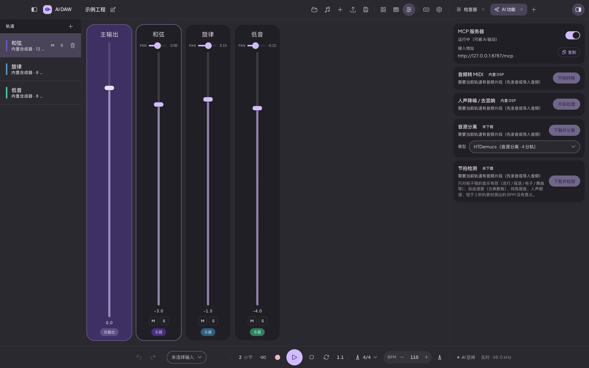
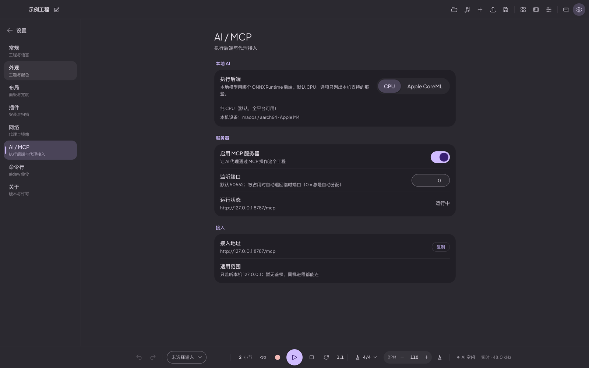

<p align="center">
  
</p>

<p align="center">
  
  <a href="LICENSE"></a>
  
</p>

<p align="center">
  <a href="README_zh.md"><b>简体中文</b></a> ·
  <a href="README.md"><b>English</b></a>
</p>

## 什么是 AI DAW？

**AI DAW 是一间完全跑在你自己电脑上的桌面音乐工作室**——写作、编排、混音、母带都在一个应用里完成，AI 是内建在流程里的，而不是外挂上去的。

DAW 该有的它都有：多轨道时间线、钢琴卷帘、带发送与总线的调音台、自动化车道、内置合成器，以及 VST3 / CLAP 插件宿主。真正的区别在于时间线之外——把一段录音丢进来让它转成 MIDI，把成品拆成分轨，测出一段演奏的速度，把一轨人声收拾干净。不用注册账号、不用填 API Key、音频不出本机：所有模型都在本地运行。

又因为整个工程通过内置的 **MCP 服务器**对外开放，AI 助手可以在你工作的时候读写这首歌——加片段、改音符、推推子——每一处改动都实时出现在界面上。

<p align="center">
  
</p>

## 功能

### 🎹 编排与编辑 —— 在真正的时间线上作曲

怎么想的就怎么摆。跨轨道拖拽片段，在音乐变化处切分，标尺与网格跟着可在曲中任意位置改变的速度与拍号走。MIDI 片段自带音符预览、音频片段自带波形，整首歌一眼就能读出来。

- **多轨道编排** —— MIDI 与音频片段并排，跨轨道拖放，框选
- **看得懂的钢琴卷帘** —— 片段直接显示音符；编辑器提供力度、缩放与键盘
- **动态速度与拍号** —— 任意位置变速 / 变拍，网格自动跟随
- **走带与循环** —— 播放、停止、定位、划定循环区、节拍器
- **自动化车道** —— 为插件或内置合成器暴露的任何参数画曲线
- **完整的编辑工具** —— 切分、移动、复制粘贴、撤销 / 重做，还带一张快捷键速查表

<p align="center">
  
</p>

### 🎚️ 混音与母带 —— 把作品做完

先做平衡，再做响度。通道条提供增益、声像、发送、总线、静音 / 独奏与电平表；总线上的母带链负责响度、峰值与立体声宽度，不用离开应用就能导出成品。

- **调音台** —— 增益、声像、发送、总线、静音 / 独奏、电平表
- **内置效果器** —— 动态、均衡与时间类效果，随手加到任意轨道
- **母带链** —— 响度归一、真峰值限幅、立体声宽度
- **内置合成器** —— 振荡器、包络、滤波，配实时示波器

<p align="center">
  
</p>

### 🧩 插件 —— 带你自己的乐器与效果器

AI DAW 支持 **VST3** 与 **CLAP** 插件，你已有的工具可以直接带过来。插件管理器能搜索开放注册表，按类型与系统兼容性筛选，一键安装 / 更新 / 卸载——也可以直接指向你本机已经装好的插件。

- **VST3 / CLAP 宿主** —— 在任意轨道加载第三方乐器与效果器
- **插件管理器** —— 搜索注册表，按乐器 / 效果与平台筛选，安装 / 更新 / 卸载
- **本地导入** —— 把已经在别处装好的插件接进来
- **界面与参数** —— 打开插件自带的界面，或从检查器与自动化车道驱动它的参数

### 🤖 本地 AI —— 把音频变成能继续加工的材料

这些 AI 功能是为真实的作品准备的，不是演示品。把一段素材交给它，拿回来的是能接着编辑的东西：可以挪动的 MIDI 音符、更干净的人声、可以重新配比的分轨。全部跑在你自己的硬件上——默认 CPU，可选 CoreML（macOS）与 DirectML（Windows）加速。

- **节拍检测** —— Beat This!（ISMIR 2024）一次推理得出全局 BPM 与拍号
- **音频转 MIDI** —— Basic Pitch 把录下的演奏变成可编辑的音符
- **人声降噪 / 去混响** —— LocalVQE 处理人声素材
- **音源分离** —— HTDemucs v4 拆成 4 / 6 条分轨，方便重新配比
- **生来离线** —— 不要账号、不要 API Key、不上传任何东西

<p align="center">
  
</p>

### 🔌 MCP 服务器 —— 让 AI 代理在你的工程里干活

打开一个开关，你的工程就变成 AI 助手可以操作的对象。内置的 **MCP（Model Context Protocol）服务器**把会话通过只监听 `127.0.0.1` 的 HTTP 端点开放出去——接上你的代理、给它一个任务，就能看它加片段、改音符、调电平，界面实时跟着变。`aidaw` 命令行就是同一个服务器的薄客户端。

- **MCP over HTTP** —— 只监听回环地址的接入点
- **实时改工程** —— 代理的操作会立刻以正常的工程改动出现
- **`aidaw` 命令行** —— 可在设置里一键挂到 `PATH`

<p align="center">
  
</p>

## 安装

预编译安装包将发布在 [GitHub Releases](https://github.com/heshengtao/ai-daw/releases) 页面；在那之前请从源码构建。

### 环境要求

- Rust（stable）与 Cargo
- Node.js ≥ 18 与 [pnpm](https://pnpm.io/)
- Tauri v2 所需的系统依赖 —— 见 <https://tauri.app/start/prerequisites/>

### 从源码构建

```bash
git clone https://github.com/heshengtao/ai-daw.git
cd ai-daw

pnpm install
pnpm tauri dev        # 开发模式运行
pnpm tauri build      # 打包发布版本
```

其它常用命令：

```bash
pnpm build            # 对前端做类型检查并构建
pnpm build:aidaw      # 构建 aidaw CLI（见 tools/build-aidaw.sh）
```

### 平台支持

| 平台 | 状态 |
| --- | --- |
| Windows (x86_64) | ✅ 支持 |
| macOS（Apple Silicon / Intel） | ✅ 支持 |
| Linux (x86_64) | ✅ 支持 |

## 常见问题

### AI DAW 是免费的吗？

是。AI DAW 以 Apache 2.0 开源，没有付费档位，也没有功能阉割。

### 能离线使用吗？

能。引擎、界面和所有 AI 模型都在本地运行。唯一的联网行为是下载插件包与 AI 模型（由你发起），以及拉取插件注册表。

### 需要显卡吗？

不需要。AI 模型默认走 CPU；macOS 可用 CoreML、Windows 可用 DirectML（需硬件支持），两者都是可选项。

### 哪些 AI 模型随应用一起提供？

两个小模型随包：**Basic Pitch**（音频转 MIDI）与 **LocalVQE**（人声降噪），装好即可用。较大的模型——**Beat This!**（节拍检测）与 **HTDemucs**（音源分离，4 / 6 分轨）——首次使用时由应用内的模型管理器按需下载，存放在源码树之外。

### 支持哪些插件格式？

VST3 与 CLAP。

### AI 代理通过 MCP 服务器能做什么？

开启服务器后，代理可以通过一个只监听回环地址的 HTTP 接入点读取工程并发起改动——加片段、改音符、调电平等等。`aidaw` 命令行就是同一个服务器的一个薄客户端。

## 许可

Apache-2.0，见 [LICENSE](LICENSE)。

## 第三方许可

本项目建立在第三方开源软件之上。改编自其它项目的文件，以及许可不在宽松默认集合内的依赖，都记录在 [NOTICE](NOTICE) 中。
